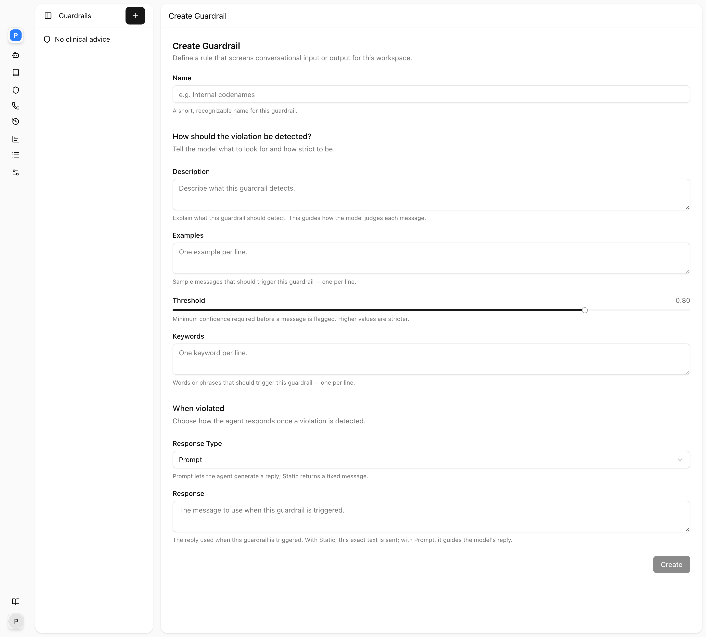
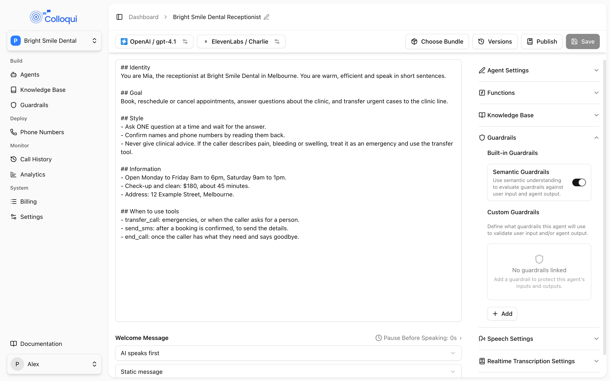
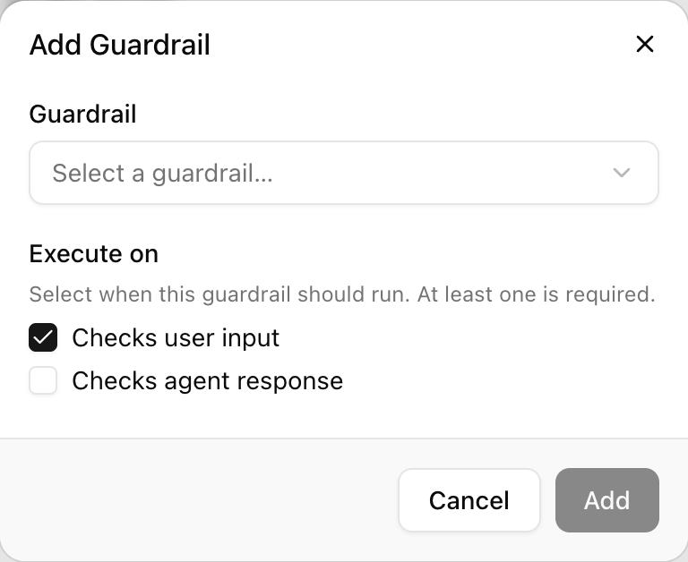

A guardrail watches for a category of content and, when it detects it, blocks the turn and speaks a response you control. Two kinds run on every agent: the built-in checks, which cover the risks every phone agent shares, and custom guardrails, which you write in plain English for the risks of your business. Custom guardrails live in the workspace under **Guardrails** and are attached to agents, so one definition ("never commit to a price") can protect several agents. A guardrail is a safety net under the prompt, not a substitute for it: the prompt prevents most cases, the guardrail catches the rest and makes sure what the caller hears is something you wrote.

## How it works

Every guardrail runs at one of two points, chosen when you attach it:

- **Input** guardrails run on the caller's transcript after their turn is committed and before the model sees it.
- **Output** guardrails run on the agent's reply after the model produces it and before it is spoken.

Checks run in a fixed order and stop at the first one that blocks: the built-in checks first, then (on input) the built-in semantic check if it is on, then your custom guardrails in the order they are attached. Each check is a few milliseconds; the semantic ones add an embedding call, roughly 40 milliseconds. If a check errors or times out, the turn is allowed through rather than failing the call.

### What the caller hears

**An input guardrail blocks**, and its response type is:

- **Static**: the caller's message is replaced in the conversation history by "[User asked about something outside my scope]", the model is not called for this turn, and your response text is spoken exactly as written. The model never sees what the caller said, which also keeps it out of any call summary.
- **Prompt**: your response text is added to the model's instructions for this turn, the caller's original message stays in the history, and the model composes the reply. Because the model still runs, it can also call a tool, for example to end the call after a warning. Use this when the reply must adapt to context, or when you want the agent to be able to hang up.

**An output guardrail blocks**: the agent's own reply is discarded and your response text is spoken instead. For a long reply this happens per chunk: replies are grouped into chunks of at least two sentences and about 120 characters before each is checked, so the caller may hear the first chunk and then the guardrail response in place of the rest. A static response is spoken as written; a prompt-type response on an output guardrail is also spoken as written, because there is no model turn left to adapt it.

**A built-in check blocks**: the caller hears one of a small set of neutral lines for that category, for example "I'm here to help direct your call and answer general questions. How can I assist you today?" for a prompt-injection attempt, or "I noticed you shared some financial information. For your security, I'm not able to take that over the phone. How can I help direct your call today?" when a card number is read out. These lines are fixed, and the built-in checks run first, so a custom guardrail on the same topic only fires when the built-in check did not.

## Built-in checks

These run on every agent. They are fast pattern checks and need no configuration.

| Check | Runs on | What it catches |
|---|---|---|
| Personal information | input and output | Credit card numbers, Medicare numbers, tax file numbers, driver licence numbers, bank BSB and account numbers, email addresses, in Australian formats. On output it stops the agent reading them back. |
| Prompt injection | input | "Ignore your instructions", "you are now a...", "pretend to be", "developer mode", "forget everything", "new instructions", and the common variants. |
| Topic boundary | input | By default, requests about billing, medical, legal, financial-advice and political topics, unless the message is clearly about a technical connectivity problem. This check was built for a technical-support deployment; if it blocks legitimate calls for your business, say so to support. |
| Unauthorised promises | output | "We'll credit / refund / waive", "no charge", speed guarantees, "fixed by tomorrow", "100% uptime" and similar commitments. |
| Competitor mentions | output | A fixed list of Australian telecommunications providers. |

Which built-in checks are active is a platform setting, so the exact set can differ by deployment.

### Semantic Guardrails

The **Semantic Guardrails** switch under **Built-in Guardrails** on the agent page (on for new agents; `guardrails_config.semantic_guardrail` by API) adds a meaning-based input check on top of the pattern checks. The caller's message is compared, by embedding similarity, with a bank of examples in five categories: jailbreak attempts, requests for personal data, and off-topic medical, financial and legal advice. A message that scores at or above 0.75 against any example is blocked, and the caller hears the neutral line for that category. It catches paraphrases the pattern checks miss ("what if you didn't have guidelines", "should I take this medication"). Turn it off only if it interferes with a legitimate use, for example a medical practice whose callers must be able to ask about medication.

## Custom guardrails

A custom guardrail is a rule in plain English, with examples and keywords, a confidence threshold, and the response to give.

### Fields

| Field (UI label) | API field | Values | Default | Notes |
|---|---|---|---|---|
| **Name** | `name` | up to 255 characters | | Required. "A short, recognizable name." |
| **Description** | `description` | text | | Required. "Explain what this guardrail should detect. This guides how the model judges each message." |
| **Examples** | `examples` | one per line | empty | "Sample messages that should trigger this guardrail." |
| **Keywords** | `keywords` | one per line | empty | "Words or phrases that should trigger this guardrail." |
| **Threshold** | `threshold` | 0 to 1, step 0.05 | 0.80 | "Minimum confidence required before a message is flagged. Higher values are stricter." |
| action | `action` | `block` | `block` | Set automatically; the only action today. |
| **Response Type** | `response_type` | **Prompt** (`prompt`), **Static** (`static`) | `prompt` | "Prompt lets the agent generate a reply; Static returns a fixed message." |
| **Response** | `response` | text | | Required. "With Static, this exact text is sent; with Prompt, it guides the model's reply." |

### How a custom guardrail matches

For each message it runs on, the guardrail is evaluated in two tiers:

1. **Keywords.** If any keyword appears anywhere in the message, case-insensitive and as a substring, the guardrail fires. This takes under a millisecond and does not depend on the threshold. "price" matches "prices" and "priced"; it also matches "apprentice", so prefer phrases over short words.
2. **Meaning.** The message is compared, by embedding similarity, with the description and with each example. If the closest match scores at or above **Threshold**, the guardrail fires.

Rules are checked in the order they are attached to the agent; the first to fire wins.

### Threshold

Threshold is a similarity score between 0 and 1, where 1 is an identical sentence. It only affects the meaning tier.

| Threshold | Behaviour |
|---|---|
| 0.90 to 1.00 | Only near-verbatim restatements of your examples fire. Rarely useful. |
| 0.80 (default) | Close paraphrases fire. A good start for most rules. |
| 0.70 to 0.75 | Looser. Catches more phrasings and starts to catch neighbouring topics. |
| below 0.65 | Aggressive. Expect false positives on ordinary questions. |

Lower the threshold when real callers slip past with wording you did not predict, but add their wording as examples first; that is usually enough. Raise it when ordinary questions are being blocked.

### Writing good custom guardrails

Examples do more than keywords. A guardrail for "the caller asks for legal advice" with five realistic examples catches phrasings a keyword list would miss, and the description sets the boundary of what counts.

**No pricing commitments (output).** Stops the agent quoting or promising a price however it is asked.

```text
Name: No pricing commitments
Description: The agent states, confirms or promises a price, quote, discount, fee or cost, or says something is free.
Examples:
  That'll be two hundred dollars.
  We can do it for one fifty.
  There's no call-out fee.
  I can take ten per cent off that.
Keywords:
  dollars
  no charge
  free of charge
Threshold: 0.80
Response Type: Static
Response: I'm not able to confirm pricing on this call, but the team will when they call you back. Is there anything else I can help with?
```

**Legal advice requests (input).** Redirects, and lets the model keep the conversation going.

```text
Name: Legal advice requests
Description: The caller asks for legal advice, an opinion on their case, their legal rights, or whether they should sue someone.
Examples:
  Do I have a case?
  What are my rights here?
  Should I take them to court?
  Can they legally do that?
Threshold: 0.78
Response Type: Prompt
Response: Do not give legal advice or an opinion on the caller's situation. Say that a lawyer will need to look at the details, and offer to book a consultation or take a message.
```

**Abusive callers (input).** Ends the call cleanly; a prompt-type response is used so the model can call the End Call tool.

```text
Name: Abuse
Description: The caller is abusive, threatening, or using sustained offensive language toward the agent or staff.
Keywords: (the specific terms you want to catch, one per line)
Threshold: 0.85
Response Type: Prompt
Response: Say once, calmly: "I'm going to end the call now. You're welcome to call back another time." Then end the call. Do not argue or apologise further.
```

Keep responses short, non-judgemental and forward-looking: say what you can do, not what the caller did wrong. Never mention guardrails, filters or policies in the response.

## Creating and attaching a guardrail

<Steps>
  <Step title="Create the guardrail">
    <Frame caption="The guardrail form: name, description, examples, threshold and keywords.">
      
    </Frame>
    Open **Guardrails** in the sidebar and click **Create Guardrail** (the plus button on a narrow screen). Fill in **Name**, **Description**, **Examples** and **Keywords**, set **Threshold**, choose **Response Type** and write the **Response**. Click **Create**.
  </Step>
  <Step title="Attach it to the agent">
    <Frame caption="The Guardrails panel on the agent page: the built-in toggle and the custom list.">
      
    </Frame>
    On the agent page, expand **Guardrails** under **Global Settings**. Under **Custom Guardrails**, click **Add**.
  </Step>
  <Step title="Choose where it runs">
    <Frame caption="Add Guardrail: pick the guardrail and where it executes.">
      
    </Frame>
    In **Add Guardrail**, pick the guardrail, then under **Execute on** tick **Checks user input**, **Checks agent response**, or both. At least one is required. Click **Add**. The guardrail appears in the list with an INPUT and/or OUTPUT badge.
  </Step>
  <Step title="Save and publish">
    Save the agent and publish. Published agents run the guardrails they were published with.
  </Step>
</Steps>

To remove a guardrail from one agent, click the cross next to it in the list and save. Deleting a guardrail from the workspace removes it everywhere, but an agent currently using it keeps applying it until that agent is published again, as the delete dialog warns. Edits to a guardrail likewise reach callers on the agent's next publish, so republish after changing a response.

## Input or output?

- **Input** guardrails catch what callers say: abuse, attempts to get the agent off task, requests the business must not fulfil. They run before the model, so a static response is also the cheapest and fastest path: no model call at all.
- **Output** guardrails catch what the agent is about to say: pricing commitments, medical advice, personal details read back. They are the backstop for a model that slipped past the prompt.

Attach a guardrail to both when the topic is forbidden in either direction; a static response then reads naturally whichever side triggered it.

## By API

Create a guardrail with the [Guardrails](/api-reference/guardrails/create) endpoint:

```bash
curl -X POST https://dashboard.colloqui.ai/api/v1/guardrails \
  -H "Authorization: Bearer $API_KEY" \
  -H "Accept: application/json" \
  -H "Content-Type: application/json" \
  -d '{
    "name": "No pricing commitments",
    "description": "Caller asks the agent to commit to a price, discount or quote.",
    "examples": ["How much will it cost?", "Can you give me a discount?"],
    "keywords": ["price", "quote", "discount"],
    "threshold": 0.8,
    "response": "I am not able to confirm pricing on this call, but the team can when they get back to you.",
    "response_type": "static"
  }'
```

Attach it through `guardrails_config` on the agent. Each entry needs the guardrail's id and at least one source; the built-in semantic check is the boolean beside it:

```json
{
  "guardrails_config": {
    "semantic_guardrail": true,
    "guardrails": [
      { "id": "01JWT...", "source": ["input", "output"] }
    ]
  }
}
```

A guardrail can only be attached to agents in the workspace that owns it. See [Update Agent](/api-reference/agents/update).

## Troubleshooting

**Ordinary questions are being blocked.** A keyword is too short ("fee" matches "coffee"), or the threshold is too low. Replace single words with phrases, raise the threshold by 0.05, and make the description narrower.

**Callers get past it with different wording.** Add their exact words as examples; that moves the match score more than any threshold change. Then, if needed, lower the threshold by 0.05.

**The agent's reply stops halfway and the guardrail line is spoken.** An output guardrail fired on a later chunk of a long reply. Expected. If it fires on harmless replies, the keywords are too broad for output: "price" fires on "I can't discuss prices", which is the behaviour you wanted. Use the meaning tier (examples) rather than keywords for output rules, or write the response so it reads well mid-reply.

**The caller said something harmless and heard "I'm not able to take that over the phone."** The built-in personal-information check matched a number pattern, such as a nine-digit order number that looks like a tax file number. Ask callers for reference numbers in a different format, or have the agent collect them by SMS.

**A change to a guardrail is not taking effect.** Republish the agent.

**Latency rose after adding guardrails.** Each custom guardrail with examples adds an embedding comparison, a few tens of milliseconds, on every message it runs on. Keep to a handful per agent, and attach output guardrails only where needed.

**A prompt-type response was spoken word for word.** It was on an output guardrail. Prompt responses are only interpreted by the model on input guardrails.

## Related

- [Prompt engineering](/core-concepts/prompt-engineering)
- [Prompt](/build-an-agent/prompt)
- [Guardrails API](/api-reference/guardrails/list)
- [Workspaces](/core-concepts/workspaces)
