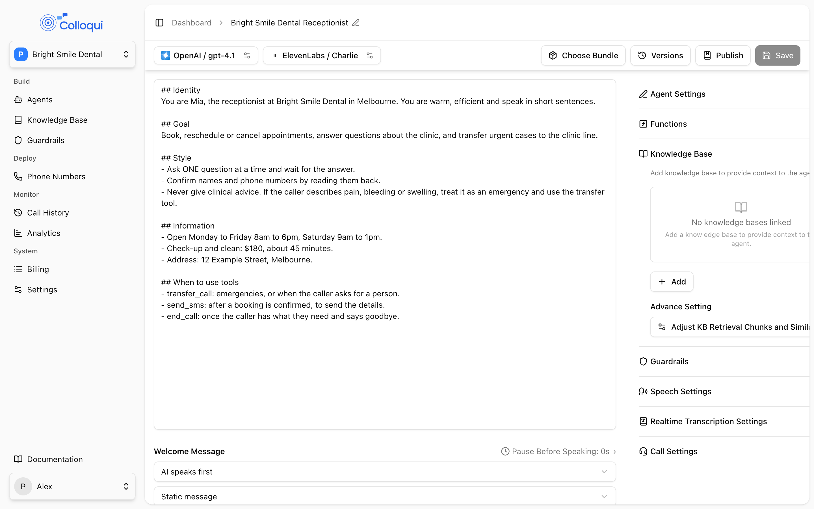

Two settings on the agent decide how retrieval behaves across every knowledge base linked to it: how many passages are pulled in for a question, and how closely a passage must match before it is used. Both sit behind **Adjust KB Retrieval Chunks and Similarity** under **Knowledge Base** on the agent page. Get them wrong in one direction and the agent confidently answers from a loosely related paragraph; get them wrong in the other and it says it does not know things that are plainly in the content. This page explains what retrieval does on every turn, so the two numbers make sense.

## How retrieval runs on each turn

<Frame caption="Chunks to Retrieve and Similarity Threshold live under Advance Setting in the Knowledge Base panel.">
  
</Frame>

Retrieval happens after the caller's turn is committed and before the model is called, on every turn where at least one knowledge base is linked to the agent (or, in a flow, to the current node).

1. **Decide whether to search at all.** The caller's message is classified:
   - *Skip*: very short messages (under three characters), greetings ("hi", "good morning"), confirmations ("yes", "okay", "that's right"), and closings ("thanks", "bye", "that's all"). No search, no context.
   - *Reuse*: follow-up phrasing such as "tell me more", "what else", "say that again" reuses the passages from the last search, as long as that search was within the last three turns.
   - *Expand*: a message that refers back without naming the subject ("how much does it cost", "is that available on weekends") runs a fresh search on the previous query combined with the new message, so the pronoun resolves.
   - *Search*: anything with a question mark, a question word ("what", "how", "can you", "is there"), an information-request phrase ("I need", "looking for", "tell me"), or five or more words.
   Short statements that match none of these reuse the buffer if one is still valid, otherwise they search.
2. **Search every linked knowledge base in parallel**, asking each for up to **Chunks to Retrieve** passages scoring at least **Similarity Threshold**. A knowledge base that fails or times out is skipped for that turn rather than failing the turn; the search has about a second to return.
3. **Merge and cut.** Results from all knowledge bases are sorted by score and only the top **Chunks to Retrieve** are kept, so three linked bases do not triple the context.
4. **Format.** Passages are joined, each with its source name, up to a platform limit of about 1,500 characters. The first passage is always included (truncated if it alone is too long); later ones are dropped once the limit is reached. So with ten chunks requested you may still only get four or five into the prompt.
5. **Insert.** The block is added as a system message immediately before the caller's latest message, with an instruction to use the material in the agent's own words rather than read it out, to state only facts that appear in it, to say it does not have the details for anything not covered, and, in a flow, to still take a transition if one matches. Placing it before the caller's message keeps the model focused on what the caller just asked.
6. **Remember.** The passages are buffered for up to three turns for reuse and expansion.

If nothing scores above the threshold, nothing is inserted and the model answers from the prompt alone. Your prompt decides what happens then.

In a conversation flow, when the call enters a node that has its own knowledge bases, a fresh search runs against them for the caller's most recent message, and the previous node's buffer is never reused. A node with no knowledge bases of its own uses the agent's.

## Settings

| Setting (UI label) | API field | Values | Default | Notes |
|---|---|---|---|---|
| **Chunks to Retrieve** | `knowledge_base_config.chunks_to_retrieve` | 1 to 10 | 3 in the dashboard | Per search, after merging across knowledge bases. |
| **Similarity Threshold** | `knowledge_base_config.similarity_threshold` | 0.30 to 0.95, step 0.05 | 0.60 in the dashboard | Higher is stricter. |

Until you save the dialog once, the agent has no stored tuning and the platform defaults apply, which retrieve more chunks at a lower threshold. Open the dialog and click **Okay** to pin the values.

These two settings are agent-wide. A node can have its own knowledge bases, but not its own chunk count or threshold.

## Chunks to Retrieve

How many passages are pulled into the model's context for each search, from 1 to 10. More chunks give the model more to work with on broad questions, at the cost of latency, attention and the 1,500-character cap described above.

Start at 3. Raise it to 5 or 6 if the agent misses answers that are in the knowledge base and the content is split across short sections. Lower it to 2 if answers wander, mix topics, or the agent gets slow. Above 6 rarely helps, because the character cap drops the extra passages anyway.

## Similarity Threshold

How closely a passage must match the question to be included, from 0.30 to 0.95. At a low threshold the agent retrieves something for almost any question, including things the knowledge base does not cover, and then answers confidently from a loosely related passage. At a high threshold it retrieves nothing unless the match is close.

| Range | Behaviour |
|---|---|
| 0.30 to 0.45 | Almost everything matches. Useful only for a tiny, tightly focused knowledge base. |
| 0.50 to 0.65 | Balanced. Start at 0.60. |
| 0.70 to 0.80 | Strict. Good for a large or scraped knowledge base with a lot of boilerplate. |
| 0.85 to 0.95 | Only near-verbatim matches. The agent will say "I don't know" often. |

If callers get answers that are plausible but wrong, raise the threshold a step and re-test the same questions. If the agent says it does not know things that are plainly in the content, lower it a step, then look at the content: a page with the answer buried under an unrelated heading scores low however you tune.

## Tell the agent what to do with nothing

The inserted block already tells the model to say it does not have the details when the material does not cover the question. Back that up in the prompt, because on turns with no retrieval there is no block at all:

```text
Your ONLY source of facts about the business is the knowledge-base text in this conversation. If there is none on the topic, you do NOT know it. Say "I don't have that detail here, but I can take a message for the team," and offer to do so.
```

Without a line like this, an agent with no knowledge base linked, or a question that scored under the threshold, answers from the model's general knowledge: on real calls that has produced invented timetables and opening hours.

## Attach where it is needed

In a conversation flow, attach the knowledge base to the node that answers questions rather than to the whole agent. A knowledge base attached to the agent runs a search on every turn of every node, slows the detail-collecting steps, and gives them something to wander off into. Under **Node Settings**, the **Knowledge Base** section reads "With none linked, this node uses the agent's knowledge bases." Link one there and that node searches only it. See [Knowledge bases](/core-concepts/knowledge-bases).

A knowledge base must be fully ingested before it can be linked. Linking one that is still processing fails with a message that the knowledge base "is not ready"; once an agent is linked, adding a new source to that knowledge base does not break saves while the source ingests.

## Setting it up

<Steps>
  <Step title="Link a knowledge base">
    On the agent page, expand **Knowledge Base** and click **Add**. Pick a knowledge base, or **Add New Knowledge Base** to create one.
  </Step>
  <Step title="Open the tuning dialog">
    Under **Advance Setting**, click **Adjust KB Retrieval Chunks and Similarity**.
  </Step>
  <Step title="Set the values">
    Drag **Chunks to Retrieve**. Use the minus and plus buttons to step **Similarity Threshold** by 0.05. Click **Okay**.
  </Step>
  <Step title="Add the fallback line to the prompt">
    Tell the agent what to say when it has no matching material.
  </Step>
  <Step title="Save and test with real questions">
    Ask five questions that are in the content and three that are not. Adjust one setting at a time.
  </Step>
</Steps>

## By API

```bash
curl -X PUT https://dashboard.colloqui.ai/api/v1/agents/{agent_id} \
  -H "Authorization: Bearer $API_KEY" \
  -H "Accept: application/json" \
  -H "Content-Type: application/json" \
  -d '{
    "llm_config": {
      "knowledge_base_ids": ["01JWT..."]
    },
    "knowledge_base_config": {
      "chunks_to_retrieve": 3,
      "similarity_threshold": 0.6
    }
  }'
```

`chunks_to_retrieve` is an integer from 1 to 10; `similarity_threshold` is a number from 0.30 to 0.95. For a node, put the ids in the node's `llm_config.knowledge_base_ids`. See [Update Agent](/api-reference/agents/update).

## Troubleshooting

**The agent ignores the knowledge base and answers from general knowledge.** Check, in order: the knowledge base is linked to the agent, or to the node the call is on; the question is phrased as a question (a bare "opening hours" with no question word and under five words may be classed as a non-question and skip the search); the threshold is not too high; the prompt has the "only source of facts" line.

**The agent answers confidently and wrongly.** The threshold is too low for this content, or the content is thin. Raise the threshold a step. If the knowledge base came from a website crawl, look at the pages: navigation menus, headings with no body and other businesses' promotional text all retrieve at scores around 0.4 to 0.6 and produce confident, empty answers. Replace a thin crawl with a pasted fact sheet.

**The agent repeats the knowledge base word for word.** It is told not to. Lower the chunk count so there is less to read, and add a style rule to the prompt ("answer in one or two sentences").

**Follow-up questions get the wrong answer.** "What about Saturdays?" reused or expanded the previous search. If the previous subject was unrelated, the agent is answering about the wrong thing. Have the prompt confirm the subject when a follow-up is ambiguous.

**Answers are slow.** Each search adds its own time plus the extra text the model reads. Lower the chunk count, attach the knowledge base only to the answering node, and check the knowledge base is not linked at both agent and node level.

**Linking fails with "is not ready".** The knowledge base is still ingesting. Wait for every source to show ingested, then link.

## Related

- [Knowledge bases](/core-concepts/knowledge-bases)
- [Prompt](/build-an-agent/prompt)
- [Nodes](/conversation-flows/nodes)
- [Knowledge base API](/api-reference/knowledge-bases/list)
