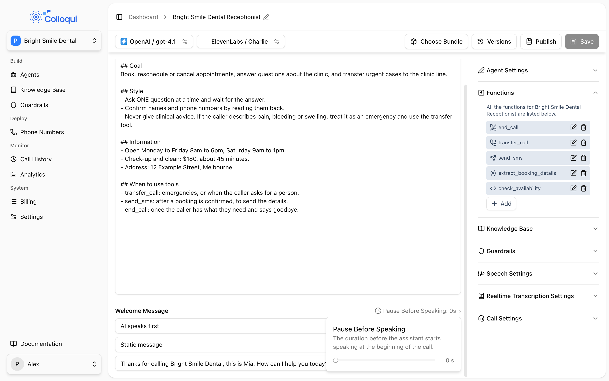

The prompt holds the instructions that apply to the whole call. For a single-prompt agent it is the agent: it is the main editor pane on the agent page. For a conversation flow it is the layer every node sits under, found as **Global Prompt** under **Agent Settings** in **Global Settings**. Below the prompt sit the settings that decide who speaks first and what the agent says when it does.

## What the model actually receives

<Frame caption="The prompt editor with the Welcome Message controls beneath it.">
  
</Frame>

Your prompt is not sent to the model on its own. At the start of each call the agent builds a system prompt in this order:

1. **A built-in voice-output policy.** A short section that tells the model it is on a live phone call: reply in plain conversational sentences, never produce markdown, lists, tables, headings, JSON or code, do not read tool results back verbatim, and say numbers the way a person would. This sits in front of your prompt so your prompt and any node instruction remain the more specific layer.
2. **Your prompt**, with `{{variables}}` replaced by their values. Variables that are set later in the call (extracted values, custom-function responses) are re-substituted into the system prompt on every caller turn.
3. **A Time Awareness section**, only when the agent has a timezone. It names the timezone and tells the model to call the `get_current_time` tool before answering anything that depends on the date or time. See below.
4. **Single-prompt agents only: a tools section** listing the tools you configured, generated from each tool's name, description and, for a transfer tool, the destination names in its directory.
5. **Conversation flows only: `## Current Step Instructions`** followed by the current node's instruction text. Each node builds its own copy of this prompt when the call enters it.

Then, per turn:

- Retrieved knowledge-base passages are inserted as a system message immediately before the caller's latest message, with an instruction to use them in the agent's own words and to say it does not have the details when they are not covered. See [Knowledge base tuning](/build-an-agent/knowledge-base-tuning).
- In a flow, the node's routing step sees the stored variables as a "Current variables" message.
- A blocked guardrail with a prompt-type response adds that response as an instruction for the turn. See [Guardrails](/build-an-agent/guardrails).

The practical consequence: the rules you put at the top of your prompt are not quite at the top. They are still early, and the built-in policy is short, so the primacy advice below holds.

## Writing the global prompt

Write the global prompt as the agent's standing orders: who it is, who it works for, what it must never do, and how it should speak. Anything true for the entire call belongs here. Anything true for one step of the call belongs in a node instruction instead, if you are building a flow.

A good voice prompt is shorter than you expect and firmer than you expect. The method is on [Prompt engineering](/core-concepts/prompt-engineering) and complete prompts are on [Prompt examples](/core-concepts/prompt-examples). Three things specific to voice:

- **Rules at the top win.** The model pays most attention to the start of the prompt. Put the rules that must never be broken first, under a heading that says so, in capitals if they are non-negotiable.
- **Name the wrong behaviour.** "Ask one question at a time" works better as "Ask ONE question per turn. NEVER combine two questions in one turn." Forbidding the specific habit is what holds.
- **Show, don't describe.** One short sample exchange per scenario does more than a paragraph of rules. The model copies what it sees.
- **The global prompt outranks node instructions.** In a flow, if a node says one thing and the global prompt says another, the global prompt usually wins. When a node instruction is being ignored, look for a rule on the same topic in the global prompt before rewriting the node.

### Worked examples

A receptionist for a trades business, trimmed to the parts that matter:

```text
CRITICAL RULES
- Ask ONE question per turn. NEVER ask two things in one sentence.
- NEVER quote a price. If asked, say the office will confirm pricing on the call back.
- NEVER ask for the caller's phone number. Confirm the number they are calling from.

ROLE
You're Sam, the receptionist at Harbour Plumbing. You take messages and book call backs.

STYLE
Short sentences. Contractions. Warm but brisk. No lists, no bullet points.

FLOW
1. Greet, then ask what the call is about.
2. Get the caller's name. Confirm the spelling only if it's unusual.
3. Ask: "Is the number you're calling from the best one to reach you on?"
4. Read back name and reason once. Then say the team will call back today and end the call.

EXAMPLE
Agent: Harbour Plumbing, this is Sam. What can I help you with?
Caller: My hot water's gone.
Agent: Sorry to hear that. Can I grab your name?
Caller: Jane Harris.
Agent: Thanks Jane. Is the number you're calling from the best one to reach you on?
Caller: Yes.
Agent: Great. So that's Jane Harris, hot water not working. Someone will call you back today. Bye for now.
```

An after-hours line that must not pretend to be open:

```text
CRITICAL RULES
- The office is CLOSED. NEVER offer to transfer or put the caller through.
- If the caller says it's an emergency, give the emergency number 1 3 0 0 0 0 0 0 0 0 once and end the call.

You're the after-hours assistant for Northside Dental. Take the caller's name, the reason, and whether the number they're calling from is the best one. Read it back once, say the practice will call in the morning, and end the call.
```

A node instruction in a flow, which should be a fraction of this size because the global prompt already covers role and style:

```text
Ask: "What suburb are you in?" Wait for the answer. If the caller gives a suburb, move on. If the reply doesn't give a suburb, ask once more in different words. Do NOT ask a third time: say "No problem" and move on.
```

## Who speaks first and the welcome message

These sit under **Welcome Message** below the prompt (for a flow, under **Agent Settings**).

| Setting (UI label) | API field | Values | Default | Notes |
|---|---|---|---|---|
| **Welcome Message** speaker | `prompt_config.first_speaker` | **AI speaks first** (`ai`), **User speaks first** (`user`) | `ai` | |
| **Pause Before Speaking** | `prompt_config.ai_speak_wait_time` | 0 to 5 s, step 0.2 | 0 | Shown when the AI speaks first. |
| **AI starts speaking after silence** | `prompt_config.ai_speak_after_silence` | on/off | off | Shown when the user speaks first. |
| **AI Entry Timeout** (shown as **Silence Time**) | `prompt_config.ai_speak_wait_time` | 0.2 to 20 s, step 0.2 | 10 | Shown when the user speaks first and the switch above is on. |
| Message type | `prompt_config.welcome_message_type` | **Static message** (`static`), **Dynamic message based on prompt** (`dynamic`) | `dynamic` | |
| Message text | `prompt_config.welcome_message` | text | "Hello, how may I help you today?" | Required when the type is static. Variables allowed. |

What happens at the start of the call:

- **AI speaks first.** The agent waits **Pause Before Speaking**, then greets. With **Static message** it says your text word for word, with variables substituted. With **Dynamic message based on prompt** the model composes the opening from your prompt; it cannot call tools on this first turn, so it will not transfer or hang up before the caller has said anything.
- **User speaks first.** The agent stays silent. If **AI starts speaking after silence** is on and the caller has not spoken by the end of **AI Entry Timeout**, the agent greets with the configured message. If the caller speaks first, the timer is cancelled and the agent replies to what they said.

Inbound calls almost always want the agent to speak first. User-first with a timeout is for outbound calls, where the person answering says "hello" first, or for lines where callers are mid-sentence from an IVR.

Switching the speaker to **AI speaks first** in the dashboard also sets the message type to static; pick dynamic again if that is what you want.

<Note>
In a conversation flow the welcome message type and text are not used, and the dashboard hides them. The start node speaks first, using its own instruction (static or prompt-based), so put the greeting there. The first-speaker, pause and silence settings still apply.
</Note>

For a business line, a static greeting that names the business is usually better than a dynamic one: it is identical on every call, it is instant because it skips the model, and compliance wording stays exact.

## Variables in prompts

Refer to a value the agent knows by wrapping its name in double curly braces. These are available on every call:

| Variable | Value |
|---|---|
| `{{user_number}}` | The caller's number |
| `{{agent_number}}` | The number the caller dialled |
| `{{call_id}}` | The call's id, matching Call History |
| `{{direction}}` | `inbound` or `outbound` |
| `{{agent_timezone}}` | The agent's timezone name, when set |
| `{{current_node}}`, `{{previous_node}}` | In a flow, the names of the current and previous nodes |

Variables extracted during the call and fields saved from a custom function are available by the names you gave them. See [Variables](/conversation-flows/variables).

## Timezone and time variables

Set the agent's timezone under **Agent Settings** with **Select a timezone** (any IANA name, such as `Australia/Sydney`). Clear it if the agent should not be aware of time. By API it is the top-level `timezone` field.

With a timezone set:

- The Time Awareness section is appended to the system prompt and the agent gets a `get_current_time` tool. The tool returns the date, time, weekday and the exact date of each weekday of next week, so "next Thursday" resolves to the right date rather than the nearest one. Calling it costs the model a round trip, so an agent answering "are you open tonight?" pays a little latency for a correct answer.
- Steps in a flow that compose without speaking (extracting variables, building a custom-function request, composing an SMS) are given a "Current date and time" message with a calendar for this week and next, so a relative date spoken a moment ago resolves correctly even though those steps cannot call the tool.
- Three time placeholders are substituted wherever variables are, including static text, custom-function URLs and SMS content:

| Placeholder | Example value |
|---|---|
| `{{current_time}}` | Thursday, March 28, 2024 at 11:46 PM AEDT |
| `{{current_hour}}` | `23.77` (hour of the day as a decimal, so `3:30` is `3.5`) |
| `{{current_calendar}}` | One dated line per day from today to Sunday, with today marked |

Add an IANA suffix to use a different zone for one placeholder: `{{current_hour_Australia/Perth}}`. Without a timezone on the agent, suffix-less placeholders resolve in UTC, and a placeholder naming an unknown zone is left unresolved so the mistake is visible.

`{{current_hour}}` is what to compare against in an opening-hours check: it is numeric. For a flow, the reliable way to gate on hours is a branch on a numeric variable rather than a sentence in the prompt. See [Patterns](/conversation-flows/patterns).

<Warning>
When creating an agent by API, set `timezone` in a separate update after creation and read the agent back to confirm it was stored.
</Warning>

## By API

```bash
curl -X PUT https://dashboard.colloqui.ai/api/v1/agents/{agent_id} \
  -H "Authorization: Bearer $API_KEY" \
  -H "Accept: application/json" \
  -H "Content-Type: application/json" \
  -d '{
    "timezone": "Australia/Sydney",
    "prompt_config": {
      "prompt": "CRITICAL RULES\n- Ask ONE question per turn.\n...",
      "first_speaker": "ai",
      "ai_speak_wait_time": 0.4,
      "welcome_message_type": "static",
      "welcome_message": "Harbour Plumbing, this is Sam. What can I help you with?"
    }
  }'
```

`prompt` and `first_speaker` are required on create. `ai_speak_wait_time` must be 0 to 5 when the AI speaks first and 0.2 to 20 when the user speaks first, and is required when `ai_speak_after_silence` is true. `welcome_message` is required when the type is `static`, except on a conversation flow, where both welcome fields are optional. See [Update Agent](/api-reference/agents/update).

## Troubleshooting

**The agent ignores a rule.** Move it to the top, put it in capitals, state the forbidden behaviour explicitly, and add a sample exchange that shows the right behaviour. Change one thing, test three times. Do not add paragraphs.

**The dynamic greeting is different every call, or too long.** Switch to a static message, or lower the temperature. See [Language model](/build-an-agent/llm).

**The agent read out a `{{placeholder}}`.** The variable was never set on that path. Make sure every path into the step sets it, or branch on `exists` first. See [Variables](/conversation-flows/variables).

**The agent gets dates wrong.** Set a timezone. With no timezone there is no time section, no tool, and the model guesses.

**A flow's greeting is not the welcome message.** Correct: flows greet from the start node. Edit the start node's instruction.

**The caller spoke first and the agent said nothing.** The speaker is set to user-first with **AI starts speaking after silence** off, and the caller's opening was swallowed as noise. Switch to **AI speaks first** for an inbound line.

## Related

- [Prompt engineering](/core-concepts/prompt-engineering)
- [Prompt examples](/core-concepts/prompt-examples)
- [Variables](/conversation-flows/variables)
- [Nodes](/conversation-flows/nodes)
