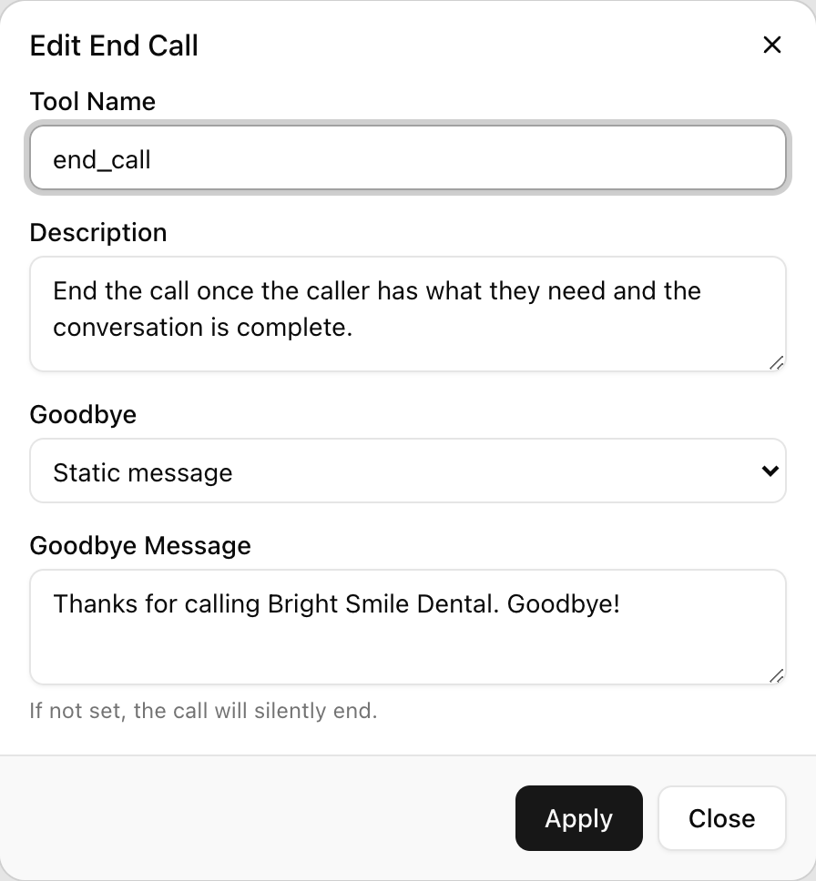

End Call hangs up the call, optionally after a goodbye line. It is the one tool every agent needs: without it, the agent has no way to finish a call and keeps trading pleasantries until the caller hangs up or the silence timer ends the call. A typical use is a receptionist agent that, once the caller says "no, that's everything", says "Thanks for calling, goodbye" and disconnects.

## How it works

When the model decides the call is over (single-prompt agent or Sub Agent node), or when a flow reaches an End Call node, the runtime does the following in order:

1. **Resolves the goodbye.** With **Static message**, the text is used as written. With **Prompt-based**, a separate model call writes the line from your instructions and a transcript of the last twenty turns of the call, with each turn capped at 500 characters. The call is told to produce one or two sentences, to be warm and professional, and not to ask a question or raise a new topic. If that call fails or returns nothing, a configured static message is used instead; with no static message the call ends silently.
2. **Speaks the goodbye.** The line is spoken with interruptions disabled, so a caller talking over it does not cut it short or cancel the hang-up.
3. **Disconnects the caller.** The caller's leg is removed from the call. The tool reports `call_ended` back to the model, which has nothing left to do.

If neither a message nor a prompt is set, step 2 is skipped and the call simply ends.

In a conversation flow, the End Call node forces the action the moment the flow enters it. It has no outgoing transitions. The node's instruction is the goodbye: **Static Sentence** is spoken word for word, **Prompt** is rendered by the model as described above.

## Settings

| Setting | API field | Values | Default | Notes |
|---|---|---|---|---|
| **Tool Name** | `name` | Letters, digits, `_`, `-`; max 255 | `end_call` on a new single-prompt agent | Must be unique among the agent's tools |
| **Description** | `description` | Up to 1,024 characters | See below | When the model should end the call |
| **Goodbye** | `goodbye_type` | `static`, `prompt` | `static` | Picks which of the next two fields is used |
| **Goodbye Message** | `goodbye_message` | Up to 1,000 characters | "Thank you for calling. Goodbye!" on a new single-prompt agent | Spoken exactly; also the fallback if a prompt-based goodbye fails |
| **Goodbye Prompt** | `goodbye_prompt` | Free text | none | Instructions for the model to write the line |

A new single-prompt agent comes with an End Call tool named `end_call`, described as "End the call once the conversation is complete or the caller asks to hang up.", with the static goodbye above. A new conversation flow has no End Call tool; it uses an End Call node instead, so you add one to the canvas.

The End Call node on a flow has no name or description of its own beyond the node name; its only setting is the instruction (Prompt or Static Sentence) carrying the goodbye.

## Setting up the tool

<Steps>
  <Step title="Open Functions">
    <Frame caption="The Edit End Call dialog.">
      
    </Frame>
    On a single-prompt agent, expand **Functions** and click **Add**, then **End Call**. On a Sub Agent node, use **Node Functions**. To edit the default tool, click its edit icon in the list.
  </Step>
  <Step title="Name and describe it">
    Keep **Tool Name** as `end_call` unless you have a reason to change it. In **Description**, write the condition for hanging up, including what does not count (see the example below).
  </Step>
  <Step title="Choose the goodbye">
    Under **Goodbye**, pick **Static message** and type the **Goodbye Message**, or pick **Prompt-based** and describe the line in **Goodbye Prompt**. Leave the field empty to end silently; the dialog reminds you: "If not set, the call will silently end."
  </Step>
  <Step title="Save">
    Click **Add Tool** (or **Apply** when editing), then save the agent.
  </Step>
</Steps>

In a flow, drag an **End Call** node onto the canvas, choose **Static Sentence** or **Prompt** on the node, type the goodbye, and connect every node a caller could finish on to it.

## Telling the agent when to end

The description decides when the agent hangs up, and the most common mistake is ending too early. A caller saying "thanks" or "ok" after an answer is usually acknowledging, not leaving. Write the condition to require an explicit signal:

```text
End the call only when the caller clearly says they are done: "no, that's
all", "nothing else", "that's everything", "goodbye" or similar. A bare
"thanks", "ok", "right" or "great" is NOT the end of the call. After you have
asked "Is there anything else I can help with?", a first bare acknowledgement
means ask once more in different words; a second one counts as no.
```

The last sentence matters. Without it, a caller who only ever says "ok" is never released.

A description for an outbound reminder agent looks different, because the call has a natural end:

```text
End the call once the appointment has been confirmed, rescheduled or
declined and you have said what happens next. Also end the call if the
caller asks you to stop calling or says they are busy.
```

## Who says goodbye

Let the End Call tool say the farewell and nothing else. If the prompt also tells the agent to say goodbye before ending, callers hear it twice: once from the model's turn and once from the tool. One line in the prompt fixes this for the whole agent:

```text
ONLY THE END CALL STEP SAYS GOODBYE. Never say goodbye, "thanks for calling"
or "have a great day" yourself. When the caller is finished, end the call.
```

In a flow the same rule applies to every node: the End Call node's static sentence is the goodbye, and no conversation node should say one.

## Static or prompt-based goodbye

Use a **Static message** when the line is the same on every call. It is spoken in well under a second and never pads.

Use **Prompt-based** when the goodbye should reflect the call, for example to repeat what was agreed. Keep the instruction tight, because the model is writing the last thing the caller hears:

```text
Thank the caller by name if they gave one, repeat in one short sentence what
will happen next (for example that someone will call back today), and say
goodbye. Two sentences maximum. Do not ask anything.
```

A prompt-based goodbye adds a model round-trip before the line is spoken, so expect a short pause between the caller's last words and the farewell. If that pause matters more than personalisation, use a static message.

## Other ways a call ends

End Call is the only way the agent ends a call deliberately, but it is not the only way a call ends:

- The caller hangs up.
- The call reaches the agent's **Max Call Duration** (3,600,000 ms by default; see [Voice behavior](/build-an-agent/voice-behavior)).
- The caller goes silent. By default the runtime prompts a silent caller twice ("Hello, still with me?" and an offer to wait), then says it is ending the call and hangs up, roughly half a minute after the caller last spoke. These steps are platform defaults rather than per-agent settings.

## By API

```json
{
  "type": "end_call",
  "name": "end_call",
  "description": "End the call only when the caller clearly says they are done. A bare thanks or ok is not the end of the call.",
  "goodbye_type": "prompt",
  "goodbye_prompt": "Thank the caller by name and say goodbye in one sentence.",
  "goodbye_message": "Thanks for calling. Goodbye!"
}
```

`goodbye_message` is kept alongside a prompt-based goodbye so there is a fallback if generation fails. In a flow, the End Call node is `"type": "end_call"` with `"instruction": {"type": "static", "text": "Thanks for calling. Goodbye!"}` and `"edges": []`. See [Update Agent](/api-reference/agents/update).

## FAQ

<AccordionGroup>
  <Accordion title="The agent hangs up too early">
    Almost always the description treats an acknowledgement as a goodbye. Rewrite it as in the example above: require an explicit no or goodbye, state that "thanks", "ok" and "great" do not count, and give the ask-once-more rule. In a flow, the same wording goes on the edge that leads to the End Call node; see [Edges](/conversation-flows/edges). Check also that no other tool or node says goodbye, which teaches the model the call is over.
  </Accordion>
  <Accordion title="The agent never hangs up">
    Check, in order: the agent has an End Call tool at all (a conversation flow needs an End Call node, not the tool); the description is not so narrow that the model never matches it; in a flow, every node a caller can finish on has a transition to the End Call node. If the model answers "no, that's all" with another question, add a rule to the prompt that the caller's explicit no means ending the call, not confirming again.
  </Accordion>
  <Accordion title="Callers hear two goodbyes">
    The prompt or a node is saying goodbye before the tool does. Add the "only the End Call step says goodbye" rule to the global prompt and remove farewells from node instructions.
  </Accordion>
  <Accordion title="The call ended with no goodbye">
    Either the goodbye fields are empty (the dialog warns that the call will silently end), or a prompt-based goodbye failed to generate and there was no static message to fall back on. Set a **Goodbye Message** even when using **Prompt-based**.
  </Accordion>
  <Accordion title="The caller talked over the goodbye and it stopped">
    It does not. The goodbye is spoken with interruptions disabled, so it plays to the end and the call then disconnects. If the caller was mid-sentence, the problem is an early end, not the goodbye; see the first question.
  </Accordion>
</AccordionGroup>

## Related

- [Tools overview](/build-an-agent/tools/overview)
- [Edges](/conversation-flows/edges) for writing "done" conditions
- [Voice behavior](/build-an-agent/voice-behavior) for call duration limits
