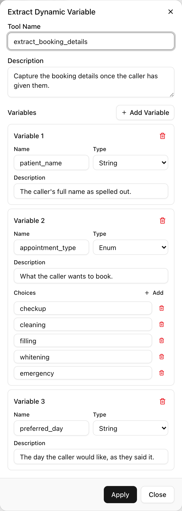
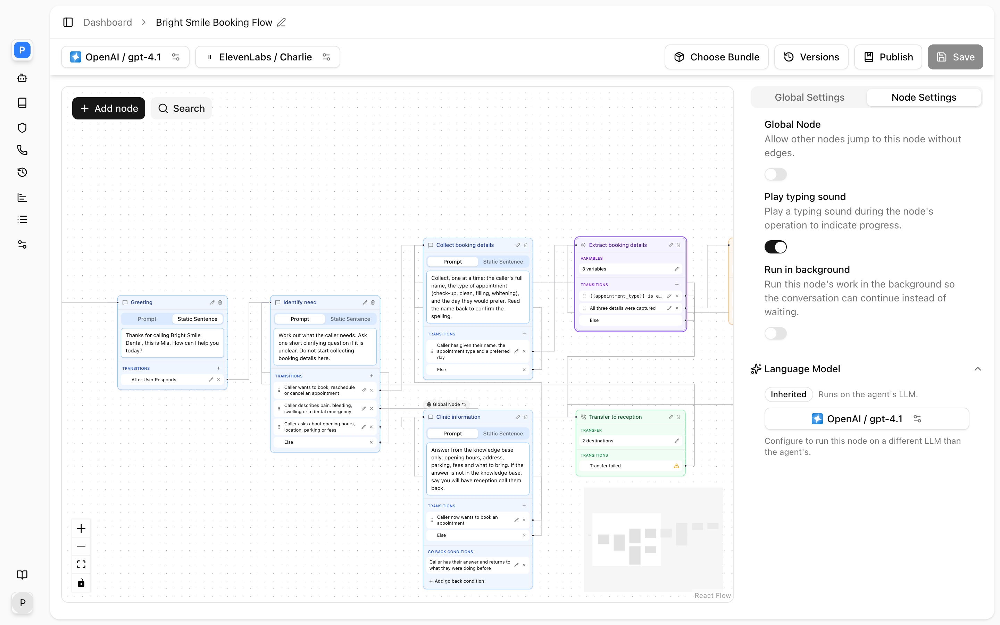

Extract Dynamic Variable reads the conversation and saves specific values, such as a name, a phone number or a yes-or-no answer, into named variables. Once saved, a variable can be spoken back, sent in an SMS, posted to your API, or used to decide where a flow goes next. A typical use is a message-taking agent that extracts `caller_name`, `callback_number` and `message` before sending them to your CRM.

## How it works

Each variable you define becomes a parameter the model must fill. In a single-prompt agent or Sub Agent node the model calls the tool when your description says to. In a flow, an Extract Variable node runs on entry, silently, in a separate model call that cannot speak. Either way the runtime then:

1. **Reads what the model returned**, one value per variable. Enum choices are given to the model as the only allowed values.
2. **Coerces each value to its type.** Numbers become numeric, integers whole numbers, booleans true or false, strings text. A value that cannot be converted is logged and stored as it came. An enum value is matched to your choices ignoring case and surrounding spaces, and stored with your exact spelling; a value that matches no choice is dropped and the variable is left unset, so routing never sees an invented category.
3. **Stores the values** for the rest of the call. Storing a variable that already exists overwrites it: a later extraction wins. The stored values are also attached to the call's data.
4. **Reports** `variables_extracted` with the values, which the model (single-prompt) or the next node (flow) can use.

### What the extractor can see

In a flow node, the extraction call is given your node instruction, the most recent conversation messages (around the last dozen to twenty turns), the current values of this node's own variables so it can reuse them unless the caller changed something, and the current date and time. It is not given the whole call. A detail spoken early in a long call can be out of reach by the time a late extraction runs. Extract soon after the detail is spoken, or have the agent restate the value once so it is back in view.

In a single-prompt agent, the model is calling the tool from within its normal turn, so it sees whatever its conversation context holds.

## Settings

| Setting | API field | Values | Notes |
|---|---|---|---|
| **Tool Name** | `name` | Letters, digits, `_`, `-`; max 255 | Hidden on an Extract Variable node |
| **Description** | `description` | Up to 1,024 characters | What this tool extracts and when; may reference `{{variables}}` |
| **Variables** | `variables[]` | At least one | Names must be unique within the tool |

Each variable has:

| Field | API field | Values | Notes |
|---|---|---|---|
| **Name** | `name` | Letters, digits, `_`, `-`; starts with a letter, `_` or `-` | How you reference it later: `{{name}}` |
| **Type** | `type` | **String**, **Number**, **Integer**, **Boolean**, **Enum** | Decides coercion and how comparisons behave |
| **Description** | `description` | Required | The extraction prompt for this value; may reference `{{variables}}` |
| **Choices** | `choices[]` | Required for Enum, at least one | The only values the variable can hold |

The dialog reminds you under an empty enum: "Add at least one choice for enum type."

## Setting up the tool

<Steps>
  <Step title="Add it">
    <Frame caption="The Extract Dynamic Variable dialog.">
      
    </Frame>
    Single-prompt agent: expand **Functions**, click **Add**, then **Extract Dynamic Variable**. Flow: drag an **Extract Variable** node onto the canvas, or use **Node Functions** on a Sub Agent node.
  </Step>
  <Step title="Describe the tool">
    In **Description**, say what it extracts and when, for example "Save the caller's contact details once they have given their name and number."
  </Step>
  <Step title="Add variables">
    Under **Variables**, add one per value with a **Name**, a **Type** and a **Description**. For **Enum**, add the **Choices**.
  </Step>
  <Step title="Write precise descriptions">
    Treat each variable description as a prompt (see below). Say what to do when the value was not given.
  </Step>
  <Step title="Save">
    Click **Add Tool** or **Apply**, then save the agent.
  </Step>
</Steps>

## The description is the instruction

The description on each variable is a prompt to the extractor, and it is where extraction problems get fixed. A bare "the caller's email" produces guesses; a precise description produces exact values.

```text
The caller's email address, lower case, no spaces. It MUST match exactly
the letters you spelled back to the caller and they confirmed, letter for
letter. Do NOT drop, add or re-spell any character. If not given, use an
empty string.
```

For numbers that will be read back or sent on:

```text
The callback number as spaced digits exactly as the caller said them, for
example "0 4 1 2 3 4 5 6 7 8". Do NOT reformat, group, round or infer any
digit. If the caller did not give one, use an empty string.
```

For an enum the flow will branch on:

```text
Why the caller rang. "booking" if they want to make or change an
appointment, "billing" for anything about invoices or payment, "other" for
everything else. Use "other" when unsure.
```

Two rules that hold in production:

- **Always name the fallback.** Every variable is required when the model fills the tool, so "leave blank" is not an option it can take. Say "use an empty string" (or a specific literal) when the value was not given; otherwise the model invents one.
- **Say which turn to read.** "From the caller's latest reply only" stops a corrected value being overwritten by the original.

## Using the values

Reference a variable anywhere by its name in double curly braces:

| Where | Example |
|---|---|
| A prompt or static sentence | "Thanks `{{caller_name}}`, and what suburb are you in?" |
| An SMS | "Your reference is `{{booking_ref}}`." |
| A Custom Function URL, header, query parameter or fixed value | `https://api.example.com/customers/{{customer_id}}` |
| An equation condition | `{{enquiry_type}}` equals `booking` |
| A later variable description | "The suburb for `{{caller_name}}`" |

The type you chose matters when comparing. A **Number** or **Integer** compares numerically; a **String** compares as text, so "9" sorts after "10". An **Enum** is always one of its choices, which makes it the right type for anything a Logic Split branches on. A variable that was never set stays as its literal placeholder wherever it is used, so either make sure every path sets it or branch on `exists` first. See [Variables](/conversation-flows/variables) and [Edges](/conversation-flows/edges).

## In a conversation flow

<Frame caption="An Extract Variable node in a flow.">
  
</Frame>

Extract Variable is a node. It speaks nothing, extracts on entry, and routes: equation conditions on its edges are evaluated first, then an optional prompt-conditioned edge is taken only if it clearly matches the result, and the else edge is the default. Most extract nodes need only the else edge; adding a prompt edge that leads to the same place costs a routing call that decides nothing. With **Run in background** on, the node routes by its else edge alone.

Place an Extract Variable node immediately after the node that collects the detail, and follow it with a Logic Split when the next step depends on the value. Several extract nodes in one flow write into the same store, so a later node can overwrite an earlier value by design, which is how a "what would you like to change?" step works. See [Nodes](/conversation-flows/nodes).

## By API

```json
{
  "type": "extract_dynamic_variable",
  "name": "extract_contact",
  "description": "Save the caller's contact details once they have given their name and number.",
  "variables": [
    {"name": "caller_name", "type": "string", "description": "The caller's full name as given. If not given, use an empty string."},
    {"name": "callback_number", "type": "string", "description": "Spaced digits exactly as said. If not given, use an empty string."},
    {"name": "enquiry_type", "type": "enum", "choices": ["booking", "billing", "other"], "description": "Why the caller rang. Use other when unsure."}
  ]
}
```

On a flow node the same fields sit under `config` with `"type": "extract_dynamic_variable"`. See [Update Agent](/api-reference/agents/update).

## FAQ

<AccordionGroup>
  <Accordion title="The variable has the wrong value">
    Tighten the description: say exactly which turn to read, forbid reformatting, and name the fallback. For an enum, check that the choices cover every case, since a value outside the list is dropped rather than stored.
  </Accordion>
  <Accordion title="The variable is empty although the caller gave the value">
    Either the value was said too long ago for the extractor to see, or an enum value did not match any choice. Move the extraction closer to where the value is spoken, or have the agent restate it. For enums, add the missing choice or tell the model which choice to use when unsure.
  </Accordion>
  <Accordion title="A corrected value was overwritten by the old one">
    The extractor saw both and chose the first. Add "from the caller's latest reply only" to the description, and in a flow route corrections through a dedicated extract node whose instruction says to update the changed field.
  </Accordion>
  <Accordion title="The spoken number sounds wrong when read back">
    A number stored as `0412345678` is read as one long number. Have the description produce spaced digits, as in the example above, so it is read digit by digit.
  </Accordion>
  <Accordion title="Can one tool extract many variables at once?">
    Yes, and it is cheaper than several tools: one call fills every variable. Group variables that are known at the same point in the conversation.
  </Accordion>
</AccordionGroup>

## Related

- [Tools overview](/build-an-agent/tools/overview)
- [Variables](/conversation-flows/variables)
- [Custom function](/build-an-agent/tools/custom-function) for sending extracted values to your API
- [Patterns](/conversation-flows/patterns) for collect, confirm and correct flows
