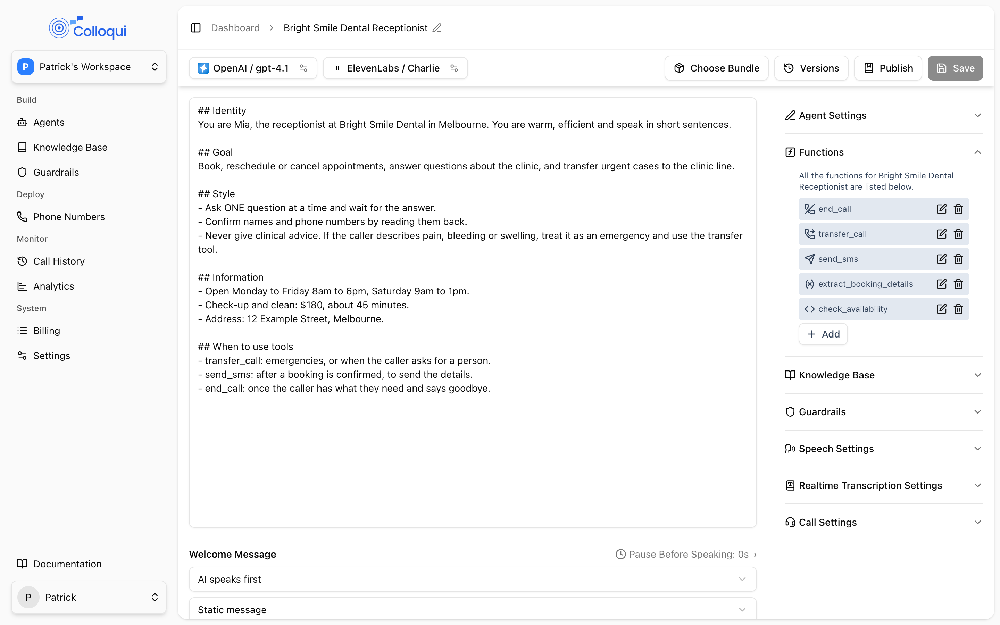

Tools let the agent act: hang up, transfer, press keypad digits, send a text, save what the caller said as variables, and call your own API. A tool is a named action with a description that tells the model when to use it, plus settings specific to its type. This page covers what every tool has in common: where tools live, how the model learns about them, what happens when they fail, and how the six types compare. Each tool has its own page with settings, examples and troubleshooting.

## The six tools

| Tool | What it does | Page |
|---|---|---|
| End Call | Says a goodbye and hangs up | [End call](/build-an-agent/tools/end-call) |
| Transfer Call | Connects the caller to a directory destination, warm or cold | [Transfer call](/build-an-agent/tools/transfer-call) |
| Press IVR | Presses keypad digits into a phone menu | [Press IVR](/build-an-agent/tools/press-ivr) |
| Send SMS | Texts the caller or a fixed number | [Send SMS](/build-an-agent/tools/send-sms) |
| Extract Dynamic Variable | Saves values from the conversation as variables | [Extract variable](/build-an-agent/tools/extract-dynamic-variable) |
| Custom Function | Makes an HTTP request to your API and uses the response | [Custom function](/build-an-agent/tools/custom-function) |

## Where tools live

<Frame caption="The Functions panel lists every tool on a single-prompt agent.">
  
</Frame>

**Single-prompt agent.** Open the agent and expand **Functions** in the settings panel. **Add** offers **Send SMS**, **End Call**, **Transfer Call**, **Extract Dynamic Variable** and **Custom Function**. Each opens a dialog with a **Tool Name**, a **Description** and the tool's own fields. The model sees every tool on every turn and decides when to call one. Press IVR has no dialog; add it by API (see [Press IVR](/build-an-agent/tools/press-ivr)). A new single-prompt agent starts with an End Call tool already attached.

**Conversation flow, dedicated nodes.** Transfer Call, Send SMS, Extract Variable, Custom Function and End Call each exist as a node type. A node runs its action as soon as the flow reaches it; the model does not decide whether to run it. The node's settings are the same dialog as the tool, minus the tool name and description, because the node carries its own name.

**Conversation flow, Sub Agent node.** A Sub Agent node is a conversation node that also carries tools. Open **Node Functions** on the node to add any of the five dialog tools. Inside that node the model decides when to call them, exactly as in a single-prompt agent. Plain Conversation nodes cannot carry tools; if a step needs to extract or send something mid-conversation, use a Sub Agent node or route to a dedicated node. See [Nodes](/conversation-flows/nodes).

## Naming rules

| Rule | Detail |
|---|---|
| Characters | Letters, digits, `_` and `-`; must start with a letter, `_` or `-` |
| Length | Up to 255 characters |
| Uniqueness | Names must be distinct within one tool list |
| Description | Up to 1,024 characters |

The name is what the model calls, so make it a verb phrase the model will recognise: `send_address_sms`, `book_appointment`, `transfer_to_staff`. If two tools do similar things, the names and descriptions together must make the difference obvious.

## How the model learns about tools

Every tool is handed to the model as a function definition: its name, its description, and the parameters the model must fill. For most tools the parameters are fixed by the type. A Transfer Call tool asks for the destination and a one-line summary; Press IVR asks for the digits; a prompt-based Send SMS asks for the message text; an Extract Dynamic Variable tool asks for one value per variable; a Custom Function asks for whatever parameters you marked as model-filled.

A single-prompt agent also gets a generated section appended to its prompt, so the model has a plain-language summary as well as the function definitions:

- Custom functions appear under a heading of tool usage instructions as a numbered list, each with your description and the parameters the model must gather. The section tells the model it must use these tools rather than answer from memory, to call dependent tools in order, and that if a tool fails it may retry at most once with corrected information before telling the caller the action could not be completed and offering an alternative.
- The other tools appear under a heading of available actions. End Call is described as ending the call when the conversation is complete. Transfer Call shows your description followed by the names of the directory destinations. Send SMS shows your content prompt and a note that the recipient is already known, so the model must not ask for or invent a phone number. Extract Dynamic Variable lists each variable with its type and description.

This is why the description on a single-prompt tool matters so much: it is the main thing the model reads when deciding whether to act.

<Tip>
If the agent has a timezone set, it also receives a built-in action that returns the current local date and time. You do not configure it. The model calls it for questions involving today, tomorrow, business hours or relative dates. See [Variables](/conversation-flows/variables).
</Tip>

## Writing the description

Write the description as the trigger condition, and say when not to act:

```text
Send the caller our street address by SMS when they ask for directions or
the address. Do not send it unless they ask, and send it only once per call.
```

Vague descriptions produce tools that fire too often or never. If a tool is used at the wrong moment, the fix is nearly always a more specific description rather than a rule elsewhere in the prompt. Three habits that hold up in production:

- Name the signal, not the topic: "when the caller says they are finished" beats "at the end".
- List the exceptions: a bare "thanks" is not a request to hang up.
- For tools with choices (a directory, an enum), list the valid choices in the description so the model picks from them rather than inventing one.

## What happens in a flow node

Dedicated nodes run without a speaking turn. In order:

1. The node runs its action. Where the model is needed to fill something in, such as the parameters of a Custom Function, the text of a prompt-based SMS, or the values of an Extract Variable, it is asked in a silent, separate call that cannot produce speech.
2. The result is used to pick the next node. Equation conditions on the node's edges are evaluated first, in code, with no model involved. If none match, a silent routing call picks among the prompt-conditioned edges using the result. If nothing matches, the else edge is taken.
3. The result is forwarded into the next node's context so the node that speaks next can tell the caller what happened. A failure is forwarded with explicit wording that nothing was created, sent or booked, so the next node does not claim success.

Transfer Call and End Call nodes are different: both force the call immediately. End Call has no edges. Transfer Call's else edge is labelled **Transfer failed** on the canvas and is where the flow goes when the transfer does not go through. See [Edges](/conversation-flows/edges).

## Speaking during and after a tool

Some tools can say something while they work. Each such line is either a **Static message**, spoken word for word, or **Prompt-based**, where you describe what to say and the model phrases it in a separate call with no access to the rest of the conversation beyond what the tool gives it.

| Tool | Speech it can produce |
|---|---|
| End Call | Goodbye: static message or prompt-based |
| Transfer Call | Transfer announcement and transfer declined line, each static or prompt-based; warm transfers also speak to the person answering |
| Custom Function | **Speak during execution** before the request and **Speak after execution** after a successful one, both static |
| Send SMS, Extract Dynamic Variable, Press IVR | Nothing; the model speaks after the result comes back |

Prefer static for anything that must be exact and for short lines, because a prompt-based line invites padding. A prompt-based line is useful where the words depend on the call, such as a warm-transfer announcement that summarises the caller's request.

## When a tool fails

Every tool returns a result to the model as JSON. A success carries the data the model needs; a failure carries an error and, for most tools, an instruction about what to tell the caller. In a single-prompt agent or Sub Agent node the model reads the result and speaks next. Two safeguards are built in:

- A Custom Function that gets an HTTP error is reported back as a terminal error telling the model not to retry with the same inputs. A second consecutive HTTP error in the same call makes the agent say a fixed apology ("Sorry, I wasn't able to complete that just now. Let me help another way.") and suppresses any further model reply on that turn, so a flaky API cannot loop.
- A failed result forwarded into a flow node is framed as a failed tool call, stating that nothing was created, changed, sent or booked.

Still, say what to do next. In a single-prompt agent, put a line in the prompt such as "If a tool reports an error, tell the caller it could not be done and offer to take a message. Never say an action succeeded unless the tool result says so." In a flow, give every Custom Function, Send SMS and Transfer Call node an else edge to a node that does not claim success.

## Variables in tool settings

Tool settings can reference a variable by wrapping its name in double curly braces, for example `{{user_number}}`. The value is substituted when the tool runs. This works in SMS content and the **Send To Number**, in a Custom Function's **API Endpoint**, **Headers**, **Query Parameters** and fixed parameter values, and in tool and variable descriptions. A variable that has not been set is left as its literal placeholder text, so make sure every path that reaches the tool sets the variables it uses. See [Variables](/conversation-flows/variables).

## Testing a custom function

The Custom Function dialog has a **Test** button that sends a request to your endpoint from the dashboard with the method, URL, headers and query parameters as entered, plus a request body you type, and shows the HTTP status and response. Variables are not substituted in the test, so type real values. See [Custom function](/build-an-agent/tools/custom-function).

## Comparing the six tools

| | End Call | Transfer Call | Press IVR | Send SMS | Extract Variable | Custom Function |
|---|---|---|---|---|---|---|
| Single-prompt | Yes | Yes | API only | Yes | Yes | Yes |
| Sub Agent node | Yes | Yes | API only | Yes | Yes | Yes |
| Dedicated node | Yes | Yes | No | Yes | Yes | Yes |
| Who decides | Model, or flow | Model, or flow | Model | Model, or flow | Model, or flow | Model, or flow |
| Model fills | Nothing | Destination, summary | Digits | Message (prompt mode) | One value per variable | Model-filled parameters |
| Can speak | Goodbye | Announcement, declined line | No | No | No | During and after |
| On failure | Hangs up anyway | Declined line, failure path | Error to model | Error to model or failure path | Nothing stored | Error to model or failure path |

## By API

Tools are the `llm_config.tools` array on the agent. Every entry has `name`, `type` and an optional `description`, then the fields for its type. A Sub Agent node carries the same array under its own `llm_config.tools`; other node types must not. See [Update Agent](/api-reference/agents/update).

```json
{
  "llm_config": {
    "tools": [
      {
        "type": "end_call",
        "name": "end_call",
        "description": "End the call once the conversation is complete or the caller asks to hang up.",
        "goodbye_type": "static",
        "goodbye_message": "Thank you for calling. Goodbye!"
      }
    ]
  }
}
```

## Related

- [Tools](/core-concepts/tools) for the concept at a glance
- [Nodes](/conversation-flows/nodes) and [Edges](/conversation-flows/edges) for tool nodes and failure paths
- [Variables](/conversation-flows/variables) for what tools can read and write
- [Prompt](/build-an-agent/prompt) for where tool rules belong in a single-prompt agent
