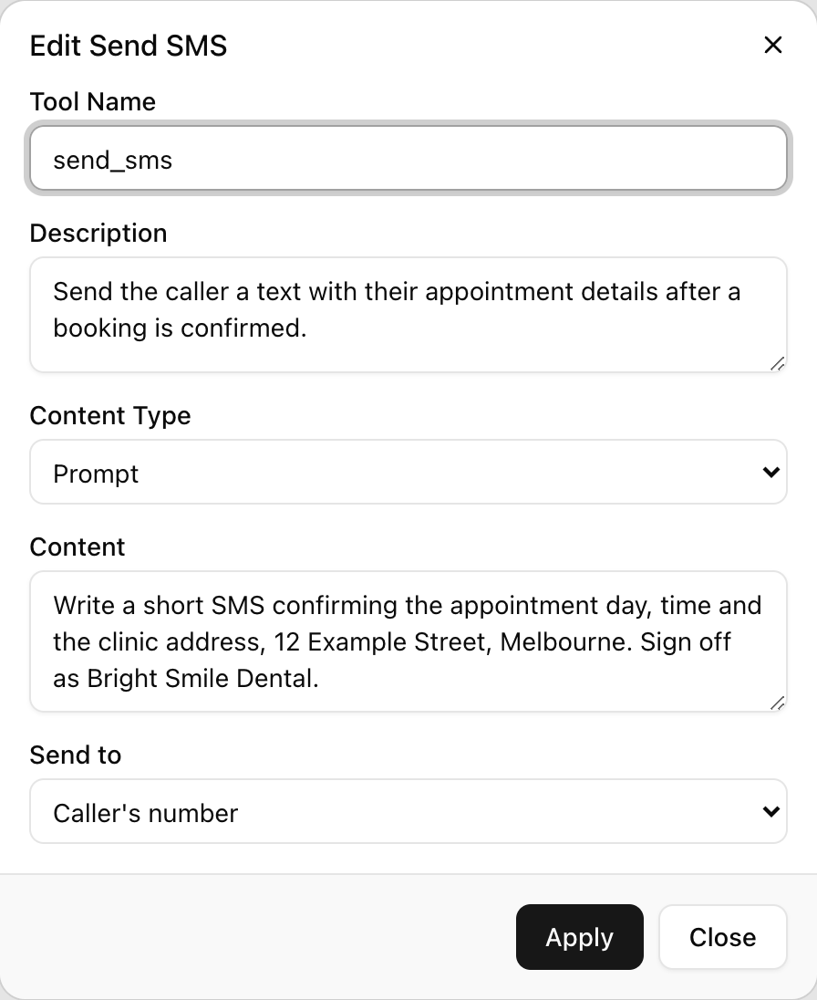
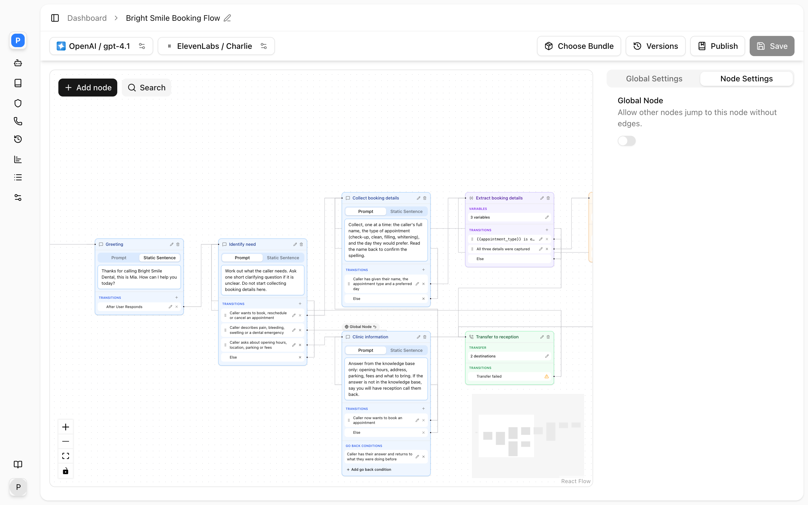

Send SMS sends a text message mid-call. Typical uses are texting the caller an address, a booking reference or a link, and notifying a staff member about a message a caller left. The recipient is fixed in the tool, never chosen by the model, so the agent cannot text a number it misheard. It can be the caller, a fixed number, or contacts and departments picked from the agent's linked [Contacts Directories](/core-concepts/contacts).

## How it works

In a single-prompt agent or Sub Agent node the model calls the tool when your description says to. In a flow, a Send SMS node sends as soon as the flow reaches it. Either way the runtime:

1. **Composes the message.** With **Content Type** set to **Static**, the **Content** text is used as written. With **Prompt**, the model writes the message from your **Content** instructions. In a flow node the composing happens in a silent, separate model call, so nothing is spoken.
2. **Substitutes variables.** Any `{{variable}}` in the message is replaced with its current value. A variable that was never set stays as its placeholder text and the message is still sent.
3. **Resolves the recipient.** **Caller's number** uses the number the caller is calling from. **Different number** uses the **Send To Number**, which may itself contain variables; if one of those is unset, the send fails rather than going to a malformed number. **Contacts / Departments** resolves the picked contacts, and every member of each picked department, to their mobile numbers; see [below](#sending-to-contacts-and-departments).
4. **Checks the number can receive SMS.** Landlines and invalid numbers are rejected before anything is sent. Numbers that could be either (some countries do not distinguish) are allowed. With several recipients, a landline drops only that recipient.
5. **Sends** and reports `sms_sent` or an error back to the model, with an instruction about what to tell the caller when it failed. The model then continues the conversation; the tool says nothing itself.

A send waits at most 15 seconds for the SMS provider before reporting an error.

## Settings

Fields in the order the **Send SMS** dialog shows them.

| Setting | API field | Values | Default | Notes |
|---|---|---|---|---|
| **Tool Name** | `name` | Letters, digits, `_`, `-`; max 255 | none | Hidden on a Send SMS node |
| **Description** | `description` | Up to 1,024 characters | none | When to send |
| **Content Type** | `content_type` | **Static**, **Prompt** | `static` | How the message is produced |
| **Content** | `content` | Required | none | The message, or the instructions for writing it |
| **Send to** | `send_to` | **Caller's number**, **Different number**, **Contacts / Departments** | `caller_number` | `caller_number`, `different_number`, `contacts_departments` |
| **Send To Number** | `send_to_number` | Mobile number in E.164 | none | Required for **Different number**; landlines are rejected on save |
| **Recipients** | `send_to_contact_ids[]`, `send_to_department_ids[]` | Ids of contacts and departments in the workspace's directories | none | Only with **Contacts / Departments**; at least one id across the two lists |

The helper text under **Send To Number** reads: "Must be a mobile number in E.164 format, e.g. +61400000000."

## Setting up the tool

<Steps>
  <Step title="Add it">
    <Frame caption="The Edit Send SMS dialog.">
      
    </Frame>
    Single-prompt agent: expand **Functions**, click **Add**, then **Send SMS**. Flow: drag a **Send SMS** node onto the canvas, or use **Node Functions** on a Sub Agent node.
  </Step>
  <Step title="Describe when to send">
    In **Description**, give the trigger and the limit, for example "when the caller asks for the address, once per call". The model also sees a note that the recipient is already known, so it will not ask for a number.
  </Step>
  <Step title="Write the content">
    Choose **Static** and type the exact message, with variables where needed, or choose **Prompt** and describe what the message must contain.
  </Step>
  <Step title="Choose the recipient">
    Leave **Send to** on **Caller's number** to text the caller. For a staff notification choose **Different number** and enter the mobile in **Send To Number**, or choose **Contacts / Departments** and click **Pick recipients** to choose people and teams from the agent's directories.
  </Step>
  <Step title="Save">
    Click **Add Tool** or **Apply**, then save the agent.
  </Step>
</Steps>

## Composing messages

**Static** content is the safe default. It can carry variables, so a confirmation is personalised without the model writing it:

```text
Hi, your appointment with Harbour Dental is confirmed for {{appointment_time}}.
Reply to this message if you need to change it.
```

**Prompt** content suits messages that summarise the call, such as a note to staff. The model is told to write the body; tell it what to include and how long it may be:

```text
Write a message for the on-call plumber. Include the caller's name, the
suburb, the problem in one sentence and the number to call back on, which
is {{user_number}}. Plain text, under 300 characters, no greeting.
```

Variables are substituted in prompt-written messages too, so you can mix the two: let the model write the summary while a fixed value like `{{user_number}}` is filled in exactly.

## Confirm before you send

When the message goes to the caller, there is nothing to confirm. When its content depends on something the caller said, such as an email address or a time, have the agent confirm that detail first and only then send. Put the order in the description:

```text
Send the booking confirmation by SMS after the caller has confirmed the
appointment time. Do not send before they confirm.
```

## Sending to contacts and departments

With **Send to** set to **Contacts / Departments**, a **Recipients** section appears ("No recipients picked yet." until you choose). **Pick recipients** opens a dialog of the same name that lists the agent's linked directories (a **Contacts Directory** selector when there is more than one) with **Contacts** and **Departments** tabs, each with a search box ("Search contacts...", "Search departments..."; "No contacts match.", "No departments match."). Each contact row shows its mobile, or **No mobile**; each department row shows its member count, or **No members**. Rows toggle, **Done** closes the picker, and the chosen names appear under **Recipients** with a remove button each. The dialog needs at least one directory linked under the agent's **Contacts** settings; otherwise it says so. Saving with nothing picked fails with "Pick at least one contact or department to send the SMS to."

At send time the recipients are the picked contacts, in order, followed by every member of each picked department, in each department's member order. Three rules keep it to one message per person:

- A contact reachable two ways, picked directly and as a member, or as a member of two picked departments, is resolved once.
- Two contacts who share a mobile number get one message between them.
- A contact with no mobile number is skipped; the phone number is never texted. If nobody has a mobile the send fails with "None of the configured contacts has a mobile number to text."

Department members are not filtered by their availability window: SMS is asynchronous, so someone off shift still gets the text. All recipients go out in one request, and the content, with its variables, is the same for everyone. Which contacts and departments exist is read from the directory snapshot taken when the call started, so a person added mid-call is texted from the next call on. See [Contacts Directory](/core-concepts/contacts).

## Billing

Each message sent is metered on the agent's bundle in addition to call minutes. Long messages that split into several SMS segments cost more than one short one, so keep texts brief. See [Billing](/workspace/billing).

## In a conversation flow

<Frame caption="A Send SMS node in a flow.">
  
</Frame>

Send SMS is a node. It takes the same settings minus the tool name and description, sends on entry, and then routes: equation conditions on its edges are evaluated first, then a silent routing call picks among prompt-conditioned edges using the send result, and the else edge is the fallback. Give the else edge a destination that does not claim the text was sent. The next node is told the result, so a conversation node after it can say "I've just texted you that" or "I wasn't able to send that" truthfully.

Place the node after the node that collects or confirms whatever the message depends on, so every variable it references has a value. See [Nodes](/conversation-flows/nodes).

## By API

```json
{
  "type": "send_sms",
  "name": "sms_address",
  "description": "Send our address when the caller asks for it or for directions. Once per call.",
  "content_type": "static",
  "content": "Harbour Dental: 12 Wharf St, Manly NSW 2095. Parking is behind the building.",
  "send_to": "caller_number"
}
```

For a staff notification set `"send_to": "different_number"` and `"send_to_number": "+61400000000"`. To text people from a directory:

```json
{
  "type": "send_sms",
  "name": "sms_on_call_team",
  "description": "Notify the on-call team after the caller has left a message.",
  "content_type": "prompt",
  "content": "Write a note for the on-call team with the caller's name, suburb, the problem in one sentence and their number {{user_number}}. Under 300 characters.",
  "send_to": "contacts_departments",
  "send_to_contact_ids": ["01JBX9Z8R7Q4K2M6N3P5T8V0W1"],
  "send_to_department_ids": ["01JBX9Z8R7Q4K2M6N3P5T8V0W2"]
}
```

`send_to_contact_ids` and `send_to_department_ids` are accepted only when `send_to` is `contacts_departments`, must be ids of contacts and departments in the workspace's directories, and at least one of the two lists must be non-empty. On a flow node the fields sit under `config` with `"type": "send_sms"`. See [Update Agent](/api-reference/agents/update).

## FAQ

<AccordionGroup>
  <Accordion title="The message was never received">
    Check the result in [Call history](/operate/call-history). A `recipient_not_sms_capable` error means the number is a landline or invalid: a caller phoning from a desk phone cannot be texted. A missing-recipient error means **Send To Number** contained a variable that was never set. An error with an HTTP status came from the SMS provider; the message text and recipient are in the result.
  </Accordion>
  <Accordion title="The agent asked the caller for their mobile number">
    It does not need to; the caller's number is already known. The generated prompt tells the model this, but a prompt of your own that says "collect the caller's phone number" overrides it. Remove that instruction, or make it "ask whether the number they are calling from is the best one".
  </Accordion>
  <Accordion title="The text contained a literal placeholder">
    A `{{variable}}` in the content was not set before the tool ran. In a flow, move the Send SMS node after the Extract Variable node that sets it, or branch on `exists` first. In a single-prompt agent, extract the value before telling the model to send.
  </Accordion>
  <Accordion title="Can the caller reply?">
    Replies are not delivered to the agent or the call. Treat SMS as one-way and put a phone number or link in the message if you want a response.
  </Accordion>
  <Accordion title="A department member did not get the text">
    The contact has no **Mobile** in the directory, so they were skipped; add one. If they share a mobile with another recipient, one message went to that number. If the department was picked but the agent is no longer linked to its directory, nobody in it is resolved.
  </Accordion>
  <Accordion title="Can I pick recipients from a directory the agent is not linked to?">
    No. The picker shows only the directories linked under the agent's **Contacts** settings, and at send time contacts are looked up in those directories. Link the directory first.
  </Accordion>
  <Accordion title="Can I send to a landline or an overseas number?">
    Landlines are rejected, both when you save a **Send To Number** and at send time for the caller's number. Numbers outside Australia are accepted if they are valid mobiles in E.164 format.
  </Accordion>
</AccordionGroup>

## Related

- [Tools overview](/build-an-agent/tools/overview)
- [Contacts Directory](/core-concepts/contacts) for the people and teams you can text
- [Extract variable](/build-an-agent/tools/extract-dynamic-variable) for the values a message depends on
- [Variables](/conversation-flows/variables)
- [Billing](/workspace/billing)
