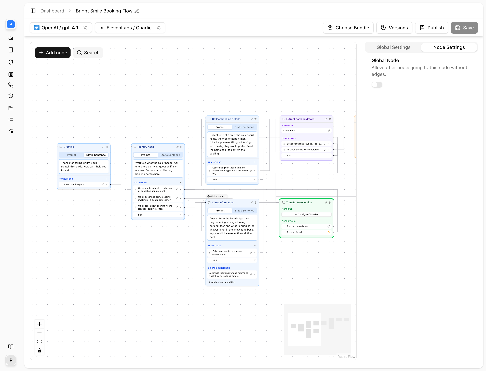

Transfer Call connects the caller to a phone number. One tool holds a directory of destinations, each with a description the model uses to choose between them and a transfer type that decides whether the person answering is briefed first. A typical use is a reception agent that puts sales enquiries through to the sales team with a warm introduction, and everything else through to the office line cold. On a Transfer Call node the directory can also come from the agent's linked [Contacts Directories](/core-concepts/contacts): every contact and department becomes a destination with its own availability window and transfer settings, and nothing has to be typed into the node.

## How it works

The model calls the tool with the destination it wants (and, for warm transfers, a one-line summary of why). The runtime then:

1. **Picks the directory entry.** If the directory has one entry, it is used whatever the model asked for. Otherwise the model's text is matched, case-insensitively, as a substring of each entry's **Name** and **Description**. No match or more than one match is a failure, and the model is told to say the declined line. When nothing in the directory fits what the caller asked for, the model is told to pass the literal flag `entry_does_not_exist` rather than guess; the tool then fails and the model is told "There is no entry found with that name in the directory."
2. **Speaks the announcement to the caller.** A **Static message** is spoken word for word. A **Prompt-based** announcement is written by a separate model call that knows only the destination name, the summary and your instructions, and is held to one or two sentences. Either way the line cannot be interrupted. Set to **None** (flow nodes only) nothing is said.
3. **Transfers.** What happens next depends on the entry's **Transfer Type**.

### Cold transfer

The caller's leg is redirected to the destination number and the agent leaves the call. The caller hears ringing from the destination. There is no feedback once the redirect has been accepted, so a cold transfer to a number that rings out leaves the caller with that number's own voicemail or busy tone. Use cold transfers only to lines that are reliably answered.

### Warm transfer

1. The caller is placed on hold: audio is muted in both directions and, with **Hold Audio** set to **Music**, hold music plays.
2. The runtime dials the destination on a separate leg and waits for an answer, for at most the agent's **Ring Duration** (30 seconds by default). No answer by then is a failure with reason "no answer".
3. When the destination answers, the runtime briefs them: "Hi, I have the caller on the line for you — [summary]. Are you available to take this call?" The summary is the one the model supplied when it called the tool. The person can ask a question and the briefing agent answers in one sentence from the last few turns of the conversation.
4. If they accept ("yes", "sure", "go ahead"), the briefing agent says "Connecting you to the customer now", the caller is taken off hold and bridged to the destination, and the agent leaves the call.
5. If they decline ("no", "busy", "wrong department"), or hang up during the briefing, the caller is taken off hold and the **Transfer Declined** line is spoken by the runtime itself, not by the model, so it is said exactly once even if the model is interrupted. The call then continues with the agent.
6. If no outcome is reached within 90 seconds of the destination answering, the transfer is treated as failed.

If the caller hangs up at any point, the destination leg is dropped immediately.

### Voicemail

With **Voicemail Detection** on, the briefing agent listens for a voicemail greeting on the destination leg:

- **Hang up**: the destination leg is dropped, the caller comes back to the agent and hears the declined line. The caller is never left talking to someone's voicemail.
- **Leave a message**: the **Static Message** text, or a message generated from your **Prompt** (kept under thirty seconds of speech and given the transfer summary for context), is spoken into the voicemail. The leg is then hung up and the caller is told "I've left them a message. Is there anything else I can help you with?", or your prompt-based declined line if you chose one.

With detection off, a destination that goes to voicemail is treated as a decline and the caller hears the declined line.

## Directory from linked contacts

On a Transfer Call node, the directory the model chooses from is built when the call starts: the node's **Custom Entries** first, then every contact and every department of each directory linked under the agent's **Contacts** settings. A contact entry is described to the model as "Use this number when transferring to [name]."; a department entry gets the same prefix followed by the department's own description. The model is then told "VALID DEPARTMENTS. The `department` argument MUST be exactly one of:" with one line per entry, so the names in your directories are what callers need to ask for, and the description you give a department is what makes "I need to talk to someone about my bill" land in Billing.

Custom entries and directory entries are matched the same way. Use custom entries for one-off destinations that do not belong in a directory, such as an after-hours answering service, and keep people and teams in a directory so their numbers and hours are maintained in one place. A node can have no custom entries at all and rely on the directories alone. See [Contacts Directory](/core-concepts/contacts).

The Transfer Call tool on a single-prompt agent, and a Transfer Call tool added under **Node Functions** on a Sub Agent node, dial only their own entries.

### Resolving a contact

A contact is dialled on the number its **Number to use** selects, the phone number when unset. Its **Type** decides warm or cold; when unset the transfer is cold. The contact's name is what the announcement names and what `{{department}}` resolves to in an announcement prompt.

### Availability and the unavailable outcome

When the chosen entry is a contact with an availability window and the current time, in the contact's own timezone, is outside it, the transfer is not attempted. Nothing is dialled, no announcement or declined line is spoken, and the flow leaves the node by its **Transfer unavailable** edge. The next node is told "[name] is not available right now, so the transfer was not attempted", that nothing has been said to the caller, and not to attempt the same transfer again unless the caller asks. That node decides what to say: offer a message, try a department, or read back when the person is next in from `{{transfer_target_availability_start}}`. If **Transfer unavailable** is not wired, the outcome takes **Transfer failed** instead. A contact with no window is always available.

### Departments

A department entry resolves to one of its members at the moment of the transfer. Only members inside their availability window are candidates; each is dialled on the number their own **Number to use** selects, with their own **Type**, defaulting to phone number and cold; and one candidate is picked at random per attempt, so repeated transfers to a busy team spread across it. A department with no available member is unavailable, with the outcome above.

### Attempt limit

Every transfer that does not connect, whether declined, unanswered, reaching voicemail, unavailable or failed for any other reason, adds one to the call-wide `transfer_attempts` variable, shared by every Transfer Call node in the flow. When the count reaches the agent's **Max Transfer Attempts** (2 unless changed under **Contacts**), a Transfer Call node skips the dial on entry and leaves by **Transfer failed**, telling the next node that the limit was reached, that nothing has been said to the caller, and not to offer another transfer for the rest of the call. A node with no **Transfer failed** destination ends the call instead, speaking the static **Transfer Declined Message** as its goodbye if there is one. This is what stops a caller cycling between "try Sales" and "try Support" indefinitely; branch on `{{transfer_attempts}}` with an equation condition to change course earlier.

### Variables published by a transfer

When a transfer resolves to a contact, directly or as the member chosen for a department, every field of that contact is stored as `transfer_target_<field>`: `transfer_target_name`, `transfer_target_phone_number`, `transfer_target_mobile_number`, `transfer_target_email_address`, `transfer_target_availability_start`, `transfer_target_availability_end`, `transfer_target_availability_timezone`, `transfer_target_transfer_type`, `transfer_target_transfer_number_type`, `transfer_target_id`, `transfer_target_contact_group_id` and `transfer_target_department_ids`. They are set before the availability check, so the node after a **Transfer unavailable** edge can say who was unavailable and when they are back. Values from an earlier transfer in the same call are cleared first. A custom entry sets none of them. See [Variables](/conversation-flows/variables#reserved-variables).

## Settings

Fields are listed in the order the **Transfer Call** dialog shows them.

| Setting | API field | Values | Default | Notes |
|---|---|---|---|---|
| **Tool Name** | `name` | Letters, digits, `_`, `-`; max 255 | none | Hidden on a Transfer Call node |
| **Description** | `description` | Up to 1,024 characters | none | When to transfer, and how to choose; see examples |
| **Transfer Announcement** | `announcement_type` | `static`, `prompt`; **None** on a node | `static` | What the caller hears before the transfer |
| **Announcement Message** | `announcement_message` | Free text | none | Spoken exactly |
| **Announcement Prompt** | `announcement_prompt` | Free text | none | May reference `{{department}}` and `{{summary}}` |
| **Transfer Declined** | `transfer_declined_type` | `static`, `prompt`; **None** on a node | `static` | What the caller hears when the transfer fails |
| **Transfer Declined Message** | `transfer_declined_message` | Free text | "I was unable to transfer your call." | Required when static |
| **Transfer Declined Prompt** | `transfer_declined_prompt` | Free text | none | Required when prompt-based |
| **Voicemail Detection** | `voicemail_detection` | on, off | off | Warm transfers only |
| **When voicemail is detected** | `voicemail_response_action_type` | `hangup`, `message`, `prompt` | `hangup` | **Hang up** or **Leave a message** (Static Message / Prompt tabs) |
| Voicemail text | `voicemail_response_text` | Free text | none | The message, or the prompt for it |
| **Hang up after message** | `voicemail_hangup_after_message` | on, off | off | Only with **Leave a message** |
| **Hold Audio** | `hold_audio` | `music`, `none`; max 50 characters | `music` | What the caller hears while on hold |
| **Custom SIP Headers** | `custom_sip_headers` | Header name and value pairs | none | See [SIP headers](/deploy/sip-headers) |
| **Phone Directory** | `phone_directory[]` | Zero or more entries | none | The **Custom Entries**; optional, since a node can rely on linked directories |

Under **Phone Directory** the dialog notes that any contact in the agent's contact directory will be used to transfer calls, and that a custom entry is for a one-off destination that is not in the directory. **Add Custom Entry** adds one; the entries are listed under a **Custom Entries** heading. Each has:

| Field | API field | Values | Notes |
|---|---|---|---|
| **Name** | `name` | Required | What the model asks for, for example "Sales" |
| **Phone Number** | `phone_number` | Required, E.164 such as `+61400000000` | Local formats are rejected |
| **Description** | `description` | Required | What this destination handles; used for matching |
| **Transfer Type** | `transfer_type` | **Warm**, **Cold** | Per entry, so one directory can mix both |

## Setting up a transfer

<Steps>
  <Step title="Add the tool or node">
    <Frame caption="The Edit Transfer Call dialog.">
      
    </Frame>
    Single-prompt agent: expand **Functions**, click **Add**, then **Transfer Call**. Conversation flow: drag a **Transfer Call** node onto the canvas and click its transfer definition to open the same dialog, or add it under **Node Functions** on a Sub Agent node.
  </Step>
  <Step title="Build the directory">
    For people and teams, put them in a [Contacts Directory](/core-concepts/contacts) and link it under the agent's **Contacts** settings; a Transfer Call node picks them up automatically. For anything else, under **Phone Directory** click **Add Custom Entry** and give each destination a **Name**, an E.164 **Phone Number**, a **Description** and a **Transfer Type**. Keep names short and distinct from each other across both sources; the match is a substring match, so avoid one name being contained in another.
  </Step>
  <Step title="Write the description">
    In **Description**, say when to transfer, list the valid destination names, and tell the model how to choose. The directory names are included in the prompt automatically, but the rules for choosing are not.
  </Step>
  <Step title="Choose what the caller hears">
    Set **Transfer Announcement** and **Transfer Declined**. Use a **Static message** for the declined line so the model cannot pad it.
  </Step>
  <Step title="Decide on voicemail and hold">
    Turn on **Voicemail Detection** for warm transfers to mobiles or lines with voicemail, and choose **Hang up** or **Leave a message**. Leave **Hold Audio** on **Music** unless silence is preferred.
  </Step>
  <Step title="Add the failure paths">
    On a Transfer Call node, connect the **Transfer failed** edge to a node that takes a message or offers a callback, and the **Transfer unavailable** edge to a node that says the person is not in and offers an alternative. In a single-prompt agent, say in the prompt what to offer when a transfer fails.
  </Step>
</Steps>

## Prompt examples

A description for a directory with several teams:

```text
Transfer the caller when they ask to speak to someone or when their
request needs a person. The destination is who the caller ASKED FOR,
never the caller's own name. Valid destinations: Sales, Accounts,
Support. Pick the closest match even if the transcript misspells it;
if nobody is close, ask which team they need. Do not say you are
transferring; the tool announces it. Outside 9am to 5pm, do not
transfer; offer to take a message instead.
```

A prompt-based announcement for a warm transfer:

```text
Tell the caller you are putting them through to {{department}} and that
you will stay on the line until someone picks up. One sentence.
```

A static declined line:

```text
I'm sorry, I wasn't able to reach them just now. Can I take a message so
they can call you back?
```

## In a conversation flow

<Frame caption="A Transfer Call node: Configure Transfer, and the fixed Transfer unavailable and Transfer failed rows.">
  
</Frame>

The Transfer Call node forces the transfer as soon as the flow enters it. Its card has two fixed transition rows that cannot be deleted or edited, only wired, and no other rows can be added:

- **Transfer unavailable**, described on the card as "Transition when the target contact is unavailable because it is outside of their availability window." It fires when the resolved contact, or every member of the resolved department, is outside their window; nothing was dialled and nothing was said.
- **Transfer failed**, the else edge. It fires when a transfer is declined, unanswered, reaches voicemail, matches no entry or more than one, or is skipped because the attempt limit was reached. The next node is told whether the caller has already heard the declined line, so it does not repeat it.

A successful transfer never transitions, because the call has left the agent. If **Transfer failed** is not wired, the flow returns to the node it came from. If **Transfer unavailable** is not wired, an unavailable destination takes **Transfer failed** instead; the unwired row is not stored on save and reappears when the flow is loaded.

Do not make a Transfer Call node a global node. That exposes the transfer as a tool on every node and lets the model jump straight to it, skipping any business-hours check. Reach the transfer through a Logic Split that checks the time, so the closed path cannot get there. See [Patterns](/conversation-flows/patterns).

## By API

```json
{
  "type": "transfer_call",
  "name": "transfer_to_team",
  "description": "Transfer when the caller asks for a person. Valid destinations: Sales, Support.",
  "announcement_type": "static",
  "announcement_message": "Please hold while I put you through.",
  "transfer_declined_type": "static",
  "transfer_declined_message": "I'm sorry, I wasn't able to reach them. Can I take a message?",
  "hold_audio": "music",
  "voicemail_detection": true,
  "voicemail_response_action_type": "hangup",
  "phone_directory": [
    {"name": "Sales", "phone_number": "+61400000001", "description": "New enquiries and quotes", "transfer_type": "warm"},
    {"name": "Support", "phone_number": "+61400000002", "description": "Existing customers with a problem", "transfer_type": "cold"}
  ]
}
```

`phone_directory` is optional: a node that relies on linked directories can omit it or send `null`. On a flow node the same fields sit under `config` with `"type": "transfer_call"`, and the node's `edges` carry the fixed **Transfer unavailable** row as a transition with `"type": "transfer_unavailable"`; see [Nodes](/conversation-flows/nodes#transfer-call). Directories are linked with the agent's `contacts_config`; see [Contacts Directory](/core-concepts/contacts#by-api) and [Update Agent](/api-reference/agents/update).

## FAQ

<AccordionGroup>
  <Accordion title="Warm or cold?">
    Warm when the person answering needs context or might not be available: the caller waits on hold, the runtime briefs the person, and the caller comes back to the agent if nobody accepts. Cold when the destination always answers and needs no context, such as a queue or an after-hours service: it is instant, but the agent is gone and cannot recover a failed transfer.
  </Accordion>
  <Accordion title="What number does the destination see?">
    The outbound leg is placed from the platform, so the destination sees a platform number rather than the original caller's number. On a warm transfer, the briefing is how the caller's identity and reason travel; include the caller's name in the summary rule in your description if staff need it.
  </Accordion>
  <Accordion title="The transfer went to the wrong person">
    The model passed something that substring-matched the wrong entry, often the caller's own name or a common word shared by two entries. Make names distinct, keep descriptions specific, and open the description with "the destination is who the caller asked for, never the caller's own name".
  </Accordion>
  <Accordion title="The agent said it was transferring but nothing happened">
    The model spoke a hand-off sentence instead of calling the tool. Add "do not say you are transferring; the tool announces it" to the description, and in a flow route to a Transfer Call node rather than relying on a conversation node to call the tool.
  </Accordion>
  <Accordion title="Why did the transfer fail?">
    Common reasons, in rough order: the destination did not answer within the ring duration; the person declined or hung up during the briefing; the destination went to voicemail; the model's destination text matched no entry or more than one, or it passed `entry_does_not_exist`; a directory contact has no number of the type their **Number to use** selects; the phone number is not in E.164 format. The declined line is spoken in every case; the model is also told the reason so it can respond.
  </Accordion>
  <Accordion title="The transfer was not attempted and nothing was said">
    Two outcomes dial nothing and speak nothing, leaving the next node to explain. Either the contact, or every member of the department, was outside their availability window, and the flow took **Transfer unavailable**; or the call had already reached **Max Transfer Attempts**, and the node left by **Transfer failed** with a note that the limit was hit. Check the windows and timezones on the contacts, and give the nodes after both edges a line that tells the caller what happens next.
  </Accordion>
  <Accordion title="Which number does a directory contact get dialled on?">
    The one their **Number to use** selects: phone number or mobile number. With neither transfer setting set, the phone number, cold. For a department, each available member is dialled on their own setting, and one member is chosen at random per attempt.
  </Accordion>
  <Accordion title="The agent keeps offering transfers that keep failing">
    Lower **Max Transfer Attempts** under the agent's **Contacts** settings; the default is 2. Once reached, every Transfer Call node skips the dial and the model is told not to offer another transfer. For a different response after the first failure, branch on `{{transfer_attempts}}` with an equation condition.
  </Accordion>
  <Accordion title="The caller heard the declined line twice">
    On warm transfers the runtime speaks the line itself and tells the model not to repeat it. If you still hear it twice, your prompt is instructing the model to apologise after every failed tool; remove that and let the declined line do the job.
  </Accordion>
  <Accordion title="Can I transfer only during business hours?">
    Yes, but not by asking the prompt to check the time. In a flow, route to the transfer through a Logic Split on the hour. In a single-prompt agent, state the hours in the description and accept that a prompt rule is less reliable than a structural one.
  </Accordion>
</AccordionGroup>

## Related

- [Tools overview](/build-an-agent/tools/overview)
- [Contacts Directory](/core-concepts/contacts) for contacts, departments and availability windows
- [Variables](/conversation-flows/variables) for `transfer_attempts` and `transfer_target_*`
- [SIP headers](/deploy/sip-headers)
- [Voicemail](/build-an-agent/voicemail)
- [Patterns](/conversation-flows/patterns) for hours-gated transfers
