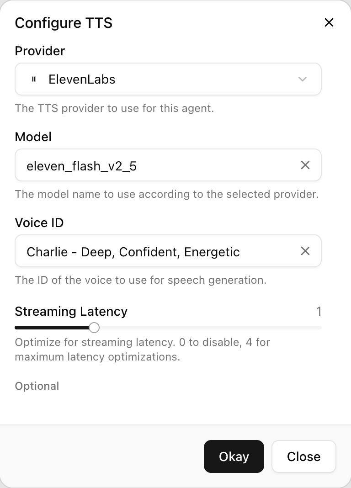

Text-to-speech turns the agent's words into audio. The voice sets the caller's impression of your business more than any other single setting, so pick it early and listen to it on a real phone line, not just in a browser. Open **Configure TTS** on the agent page to choose a provider, model and voice. The delivery settings that are not tied to a provider, such as background sound and turn-taking, are under **Speech Settings** and described in [Voice behavior](/build-an-agent/voice-behavior).

## How it works

1. The model's reply streams in as text. Before anything is synthesised, the text is cleaned: raw control tokens are stripped, and if output guardrails are on, the reply is grouped into chunks of at least two sentences and about 120 characters so each chunk can be checked with enough context. A chunk that fails a guardrail is replaced by the guardrail's response. See [Guardrails](/build-an-agent/guardrails).
2. Each chunk is sent to the provider you chose, with the voice and the per-provider options below, and the audio is streamed to the caller as it is produced.
3. Static text, such as a static welcome message, a static node instruction, a transfer announcement or a goodbye line, skips the model and goes straight to synthesis. Variables in static text are substituted literally first, so an unset variable is read out as its placeholder.
4. If the caller interrupts (see [Speech-to-text](/build-an-agent/stt)), synthesis stops and the unspoken remainder is discarded.

There is no fallback voice. If the provider cannot be reached when a call starts, the call fails rather than switching to another provider, so keep an eye on your provider's status if you self-select an unusual one.

## Providers and models

| Provider | Models (API name) | Voice field | Notes |
|---|---|---|---|
| ElevenLabs | Flash v2.5 (`eleven_flash_v2_5`), Turbo v2.5 (`eleven_turbo_v2_5`), v4 (`eleven_v4`), v4 Turbo (`eleven_v4_turbo`) | **Voice ID** | Default for new agents (Flash v2.5). Widest voice range. **Streaming Latency** applies to Flash and Turbo only. |
| Cartesia | Sonic 3.6, 3.5, 3, 2, Turbo, Sonic (`sonic-3.6`, `sonic-3.5`, `sonic-3`, `sonic-2`, `sonic-turbo`, `sonic`) | **Voice ID** | Fast and natural, with a strong set of Australian voices. Has **Speed** and **Emotion** controls. |
| Rime | Mist v3 (`mistv3`) | **Speaker** | Uses a named speaker rather than a voice id. Has **Streaming Latency** and **Speed Alpha**. |
| Deepgram | Flux TTS (`flux-tts`) | **Voice ID** | Offered only when enabled for your deployment; an agent already using it keeps it. |

New agents use ElevenLabs Flash v2.5. The dashboard shows the voices available for each provider with a short description. Listen to a few before choosing.

### Voices

The voice list is served per provider by the dashboard, so it can grow without a change here. As shipped:

- **ElevenLabs**: the full ElevenLabs voice list, shown by name. The header button shows the part of the name before the first dash.
- **Cartesia**: a curated set with an Australian emphasis, each with a short description, for example Arlo (service specialist), Bronte (trusted guide), Fraser (trusted communicator), Cooper (friendly mate), Grace (helpful hand), Heath (calm and composed), Aila (paced helper), Jasper (vibrant stylist), plus a range of general voices such as Barry, Paul, Olivia, Callum, Amelia and Liam.
- **Rime**: Eucalyptus and Marlu.
- **Deepgram**: Sharon (female, Australian; formal, calm, confident).

## Settings

Everything here lives under `tts_config`.

| Setting (UI label) | API field | Providers | Values | Default | Notes |
|---|---|---|---|---|---|
| **Provider** | `provider` | all | `elevenlabs`, `cartesia`, `rime`, `deepgram` | `elevenlabs` | |
| **Model** | `model` | all | A model name from the provider's list | `eleven_flash_v2_5` | Required whenever `provider` is sent. |
| **Voice ID** | `voice_id` | ElevenLabs, Cartesia, Deepgram | A voice id from the provider's list | an ElevenLabs voice | Required for those providers. |
| **Speaker** | `speaker` | Rime | `eucalyptus`, `marlu` | none | Required for Rime instead of `voice_id`. |
| **Streaming Latency** | `streaming_latency` | ElevenLabs, Rime | 0 to 4 | 1 | Required on models that support it; hidden on models that do not. 0 disables the optimisation, 4 is maximum. |
| **Speed** | `speed` | Cartesia | `0.6` to `1.5` in steps of `0.1` | `1.0` | Optional. |
| **Emotion** | `emotion` | Cartesia | One of anger, positivity, surprise, sadness, curiosity, each at lowest, low, default, high or highest, for example `positivity:high` | none | Optional. |
| **Speed Alpha** | `speed_alpha` | ElevenLabs, Rime | 0.7 to 1.2 (ElevenLabs), 0 to 2 (Rime), step 0.1 | 1.0 | Optional. Under 1.0 is slower. |
| (API only) | `speed` | Deepgram | `0.85`, `0.9`, `0.95`, `1.0`, `1.05`, `1.1`, `1.15` | `1.0` | Not shown in the dashboard. |

The API accepts `speed` as a number (`1.1`) or a string (`"1.1"`) and normalises it to the provider's token. Values the provider does not accept are rejected.

## Per-provider options

**Streaming Latency** (ElevenLabs Flash and Turbo, Rime Mist v3) trades a little quality for faster first audio. 1 is the default and a good balance; 3 or 4 is noticeably quicker to start but can clip the first syllable on some voices. On Rime, any value other than 1 is treated as "not latency-optimised".

**Speed** (Cartesia) scales the voice's natural pace. Most voices are best between 0.9 and 1.1. Drop to 0.8 for an agent that reads back phone numbers or reference codes; raise to 1.2 for a brisk confirmation line. Older Cartesia word speeds ("fast", "slow") are no longer accepted and fall back to 1.0.

**Emotion** (Cartesia) nudges the delivery. `positivity` or `positivity:high` suits a receptionist; `curiosity:low` suits an agent that asks a lot of questions. Levels at `highest` are theatrical and rarely right for a business line.

**Speed Alpha** (Rime; also accepted for ElevenLabs) is a multiplier where 1.0 is the model's nominal rate.

## Choosing a voice

<Steps>
  <Step title="Open the dialog">
    <Frame caption="The Configure TTS dialog for ElevenLabs.">
      
    </Frame>
    On the agent page, click the voice button in the header (it shows the current provider and voice). The **Configure TTS** dialog opens.
  </Step>
  <Step title="Pick a provider and model">
    Choose **Provider**, then search in **Model**. Changing provider clears the model, voice and speed, because they are provider-specific.
  </Step>
  <Step title="Pick a voice">
    Search in **Voice ID** (or **Speaker** for Rime). The list shows names; the id is stored.
  </Step>
  <Step title="Set the provider options">
    Fill in the required fields shown, then any under **Optional**.
  </Step>
  <Step title="Save and listen on a phone">
    Click **Okay**, save the agent, and call it. Phone audio is narrower than a browser preview, and voices that sound crisp in a browser can sound thin on a handset.
  </Step>
</Steps>

## Pronunciation and spelling

None of the offered providers is given markup from the agent: text is sent plainly, with speech-synthesis markup parsing turned off. So there is no tag to force a pronunciation. What works instead is writing the prompt so the model produces text that reads correctly out loud:

- **Spell out what must be spelled.** "Your reference is A B C one two three" rather than "ABC123". Ask for spaced digits in any extraction that will be read back, so a phone number is stored as "0 4 1 2 ..." and spoken digit by digit.
- **Say symbols as words.** "at", "dot", "dash", "per cent". The model will do this if the prompt tells it to.
- **Write numbers the way they are said.** "eight hundred and seventy five dollars", not "875".
- **Expand abbreviations.** "Road", "Street", "Avenue", not "Rd", "St", "Ave".
- **Keep sentences short.** Long sentences with several clauses are where voices lose the thread.

The agent prepends a built-in voice-output policy to every prompt that covers the basics (no markdown, lists, tables or JSON; say numbers naturally). For complete, copy-ready prompt patterns for phone numbers, emails, URLs and dates, see [Prompt examples](/core-concepts/prompt-examples).

## By API

```bash
curl -X PUT https://dashboard.colloqui.ai/api/v1/agents/{agent_id} \
  -H "Authorization: Bearer $API_KEY" \
  -H "Accept: application/json" \
  -H "Content-Type: application/json" \
  -d '{
    "tts_config": {
      "provider": "cartesia",
      "model": "sonic-3",
      "voice_id": "12e85709-099c-480a-ba3e-875c41a9611a",
      "speed": "0.9",
      "emotion": "positivity:low"
    }
  }'
```

An ElevenLabs configuration must include `streaming_latency` when the model supports it:

```json
{
  "tts_config": {
    "provider": "elevenlabs",
    "model": "eleven_flash_v2_5",
    "voice_id": "IKne3meq5aSn9XLyUdCD",
    "streaming_latency": 1,
    "speed_alpha": 1.0
  }
}
```

Voice ids and speakers are provider-specific strings validated against the dashboard's voice list, so copy them from an existing agent or from the dashboard. On a partial update that omits `provider`, the stored provider decides which fields are allowed. See [Update Agent](/api-reference/agents/update).

## Troubleshooting

**"The streaming latency field is required when provider is elevenlabs."** The model supports streaming latency and the field was omitted. Send an integer from 0 to 4.

**"The selected voice id is invalid."** The id does not belong to the chosen provider's list. Ids from other platforms are never valid here.

**"The selected provider is invalid" when choosing Deepgram.** Deepgram text-to-speech is not enabled for your deployment.

**The voice reads a phone number as one long number.** The text reached the voice as "0412345678". Store and speak it as spaced digits; see above and [Variables](/conversation-flows/variables).

**The first word of each reply is clipped.** Lower **Streaming Latency** to 1 or 0.

**The agent speaks over hold music or a transfer.** It should not; transfer announcements pause the agent and are not interruptible. If you hear the agent's reply after a failed transfer twice, the Transfer Declined message is set to a prompt type that repeats what the platform already said; use a static declined message. See [Transfer call](/build-an-agent/tools/transfer-call).

**Audio quality is dull on the phone.** Phone lines carry narrow-band audio. A voice with a lot of high-frequency sparkle loses the most; pick a warmer, lower voice for telephony.

## Related

- [Voice behavior](/build-an-agent/voice-behavior)
- [Speech-to-text](/build-an-agent/stt)
- [Prompt examples](/core-concepts/prompt-examples)
