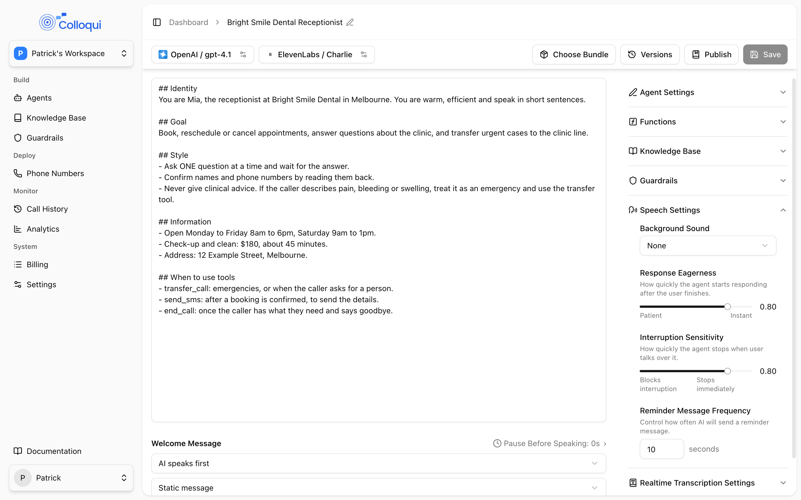
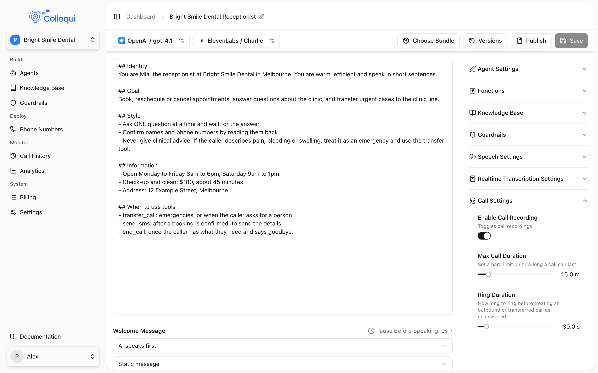

These settings shape how the call feels rather than what is said: how quickly the agent answers and yields, what the caller hears under the voice and while the agent is working, how a silent caller is handled, and how long a call may run. Most of them are under **Speech Settings** and **Call Settings** on the agent page. A message-taking line, for example, wants a short silence ladder so an abandoned call is released quickly, while a line that asks callers to find a document wants a patient one.

## Speech Settings

<Frame caption="The Speech Settings panel.">
  
</Frame>

| Setting (UI label) | API field | Values | Default | Notes |
|---|---|---|---|---|
| **Background Sound** | `tts_config.ambient_sound` | **None** (`none`), **Office Ambience** (`office_ambience`), **Keyboard Typing** (`keyboard_typing`), **Keyboard Typing 2** (`keyboard_typing2`) | `none` | |
| **Background Sound Volume** | `tts_config.ambient_sound_volume` | 0 to 1, step 0.01 | 1 in the dashboard | Behind the gear icon next to the sound. |
| **Response Eagerness** | `stt_config.responsiveness` | 0 to 1 | 0.8 | **Patient** to **Instant**. |
| **Interruption Sensitivity** | `stt_config.interruption_sensitivity` | 0 to 1 | 0.8 | **Blocks interruption** to **Stops immediately**. |
| **Reminder Message Frequency** | `tts_config.reminder_trigger_ms` | 1 to 60 seconds in the dashboard; 1,000 to 60,000 ms by API | not set | 0 clears it. |

### Response Eagerness and Interruption Sensitivity

Both are transcription settings that the panel shows alongside the voice settings, because they decide turn-taking. In short: eagerness sets the minimum silence after the caller stops before the agent replies (about 1.1 seconds minus the value, floored at 0.1 s), and sensitivity sets how long the caller must talk over the agent before it stops (same mapping; 0 switches interruption off). The full tables and the reasoning are on [Speech-to-text](/build-an-agent/stt).

### Background sound

**Background Sound** plays a low-level loop under the voice for the whole call: office ambience, or one of two keyboard-typing beds. It makes the agent sound like it is somewhere rather than nowhere, which some callers find more natural, and it masks the dead air while the agent thinks. The loop starts when the call connects and stops when it ends; it keeps playing under hold music and silence reminders.

**Background Sound Volume** sets the level from 0 to 1. Start low, around 0.2 to 0.3; the dashboard's starting value of 1 is loud on a handset. Leave the sound off for agents that read a lot of detail, because it reduces clarity on poor lines.

In a conversation flow, an Extract Variable node can also switch on **Play typing sound** for just the moment it is working, so the caller hears typing instead of silence while details are being recorded. If the agent already has a keyboard bed as its background sound, the node's overlay is skipped rather than doubled.

### Reminder Message Frequency

**Reminder Message Frequency** stores, in seconds, how often the agent may remind a caller who has gone quiet. The dashboard accepts 1 to 60 and stores milliseconds. The timing of the reminders a caller actually hears follows the silence ladder below.

## When the caller goes quiet

The agent runs a silence watchdog for the whole call. It counts seconds since the caller last said anything, and pauses while the agent is speaking, while the caller is on hold, while a tool is running, and while keypad digits are being collected, so a long agent reply or a transfer never counts against the caller.

| Silence since the caller last spoke | What the agent does |
|---|---|
| 10 s | Nudge: "Hello—still with me?" |
| 15 s | Reprompt: "If you need more time, just say 'one moment'. Otherwise, how can I help?" |
| 30 s | Final: "I'll end the call now. You can call back any time. Thank you." Then the call ends. |

These are the platform defaults, and the thresholds are cumulative. Any caller speech resets the ladder to the start; a reminder is spoken through the voice but is not added to the conversation, so the model never sees "Hello—still with me?" as something it said. The reminders are interruptible, and there is at least a one-second gap between steps so two cannot fire back to back. The watchdog is stopped when a transfer begins.

Design around it rather than against it:

- If a node asks a question and then hands off without speaking, the caller sits in silence until the 10-second nudge. Make sure every node that ends a turn either speaks or transitions to one that does.
- If callers are legitimately quiet (finding a card, checking a diary), say so in the prompt: "If the caller asks you to wait, say 'No problem, take your time' and wait." The caller's "one moment" resets the ladder.
- The final step hangs up. For an agent that must never hang up on a caller, put the instruction in the prompt and keep questions short enough that silence is rare; the ladder itself is not configurable per agent.

## When the agent goes quiet

The opposite gap is covered too. If the caller has finished speaking and roughly two seconds pass with no agent audio, which happens while a flow runs a chain of silent steps (extract a variable, evaluate a branch, call a custom function), the agent says a short filler such as "Just a moment.", "One moment." or "One second." It picks one at random, never the same one twice in a row, and says at most one per gap. The filler is not added to the conversation, so it does not show in the transcript the model sees or in the summary.

Two consequences for flow design:

- Callers often answer the filler ("okay"). That "okay" is a real caller turn and can trigger a transition on the node the call lands on. Keep the node after a silent chain static and short, and write its transitions so a bare acknowledgement does not count as an answer. See [Patterns](/conversation-flows/patterns).
- A custom function with a long timeout produces one filler and then silence. Keep timeouts short and give the node a **speak during execution** message if the wait is expected. See [Custom function](/build-an-agent/tools/custom-function).

## Interruptions per node

In a conversation flow, each Conversation and Sub Agent node has an **Allow interruptions** switch under **Node Settings**, on by default. Turn it off on nodes that read back details, quote terms, or give a safety message, so a cough or an "mm-hmm" cannot cut the line short and be mistaken for an answer. Transfer announcements and End Call goodbyes are never interruptible.

## Backchannel fields

The API accepts three fields under `tts_config` for the agent making small listening noises while the caller talks: `enable_backchannel` (boolean), `backchannel_frequency` (number) and `backchannel_words` (array of strings, each up to 255 characters). They are not shown in the dashboard and do not currently change what the caller hears. Leave them unset.

## Call Settings

<Frame caption="The Call Settings panel.">
  
</Frame>

| Setting (UI label) | API field | Values | Default | Notes |
|---|---|---|---|---|
| **Enable Call Recording** | `call_config.recording_enabled` | on/off | on | |
| **Max Call Duration** | `call_config.max_call_duration_ms` | 60,000 to 7,200,000 ms (1 minute to 2 hours), step 1 s | 3,600,000 (1 hour) | |
| **Ring Duration** | `call_config.ring_duration_ms` | 5,000 to 300,000 ms (5 s to 5 minutes), step 1 s | 30,000 (30 s) | |

**Enable Call Recording** stores audio of every call for playback and download in [Call History](/operate/call-history). Recordings are dual-channel, so the caller and the agent can be told apart. Turn it off if your jurisdiction or your customers' policies require it, and tell callers when it is on if the law where you operate requires that.

**Max Call Duration** is a hard limit. When it is reached the call ends regardless of what is happening. Set it lower for agents whose calls should be short, so a caller who leaves the line open does not run up usage; a message-taking line rarely needs more than 10 minutes.

**Ring Duration** is how long to ring before treating an outbound or transferred call as unanswered. On a warm transfer it caps how long the destination rings before the agent gives up and tells the caller the person is not available, so set it to what a human receptionist would tolerate: 20 to 30 seconds. A destination that goes to voicemail answers before the cap, which is what [Voicemail](/build-an-agent/voicemail) detection is for.

The agent's timezone, which affects what the agent knows about the date and time, is described on [Prompt](/build-an-agent/prompt).

## Setting it up

<Steps>
  <Step title="Open Speech Settings">
    On the agent page (for a flow, under **Global Settings**), expand **Speech Settings**.
  </Step>
  <Step title="Choose a background sound">
    Pick from **Background Sound**. If you choose one, click the gear icon and drag **Background Sound Volume** to around 0.25.
  </Step>
  <Step title="Tune turn-taking">
    Drag **Response Eagerness** and **Interruption Sensitivity**. See [Speech-to-text](/build-an-agent/stt) for what the numbers mean.
  </Step>
  <Step title="Set the call limits">
    Expand **Call Settings**. Switch **Enable Call Recording**, and drag **Max Call Duration** and **Ring Duration**.
  </Step>
  <Step title="Save and call it">
    Call the agent, stay silent for 30 seconds to hear the ladder, and talk over a reply to feel the interruption threshold.
  </Step>
</Steps>

## By API

```bash
curl -X PUT https://dashboard.colloqui.ai/api/v1/agents/{agent_id} \
  -H "Authorization: Bearer $API_KEY" \
  -H "Accept: application/json" \
  -H "Content-Type: application/json" \
  -d '{
    "tts_config": {
      "ambient_sound": "office_ambience",
      "ambient_sound_volume": 0.25,
      "reminder_trigger_ms": 10000
    },
    "stt_config": {
      "responsiveness": 0.7,
      "interruption_sensitivity": 0.6
    },
    "call_config": {
      "recording_enabled": true,
      "max_call_duration_ms": 900000,
      "ring_duration_ms": 25000
    }
  }'
```

See [Update Agent](/api-reference/agents/update).

## Troubleshooting

**The caller hears "Hello, still with me?" while they are thinking.** They were silent for 10 seconds. Tell the prompt how to handle "hold on", and consider whether the question needed a long think; break it into smaller questions.

**The agent hung up on a quiet caller.** 30 seconds of silence reached the final step. If callers are routinely put on hold by the caller's side (a receptionist fetching someone), that line needs a human, not an agent, or a prompt that keeps the caller engaged.

**"One moment" is said and then the caller's "okay" sends the flow somewhere odd.** The filler fired during a silent chain and the acknowledgement was routed. Make the landing node static and write its transitions to ignore bare acknowledgements.

**The background sound is louder than the voice.** Lower **Background Sound Volume**; the dashboard starts it at 1.

**A warm transfer gives up too quickly or rings for too long.** Adjust **Ring Duration**; it is the cap on the destination's ring.

**The call ended abruptly at exactly one hour.** **Max Call Duration** at its default. Raise it, up to two hours, or add an End Call tool so the agent closes long calls cleanly before the limit.

## Related

- [Speech-to-text](/build-an-agent/stt)
- [Text-to-speech](/build-an-agent/tts)
- [Voicemail](/build-an-agent/voicemail)
- [Call history](/operate/call-history)
