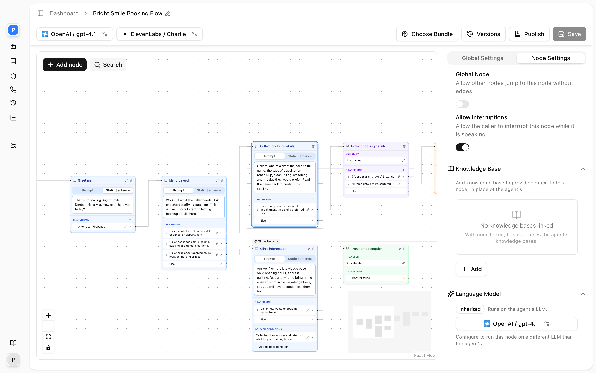
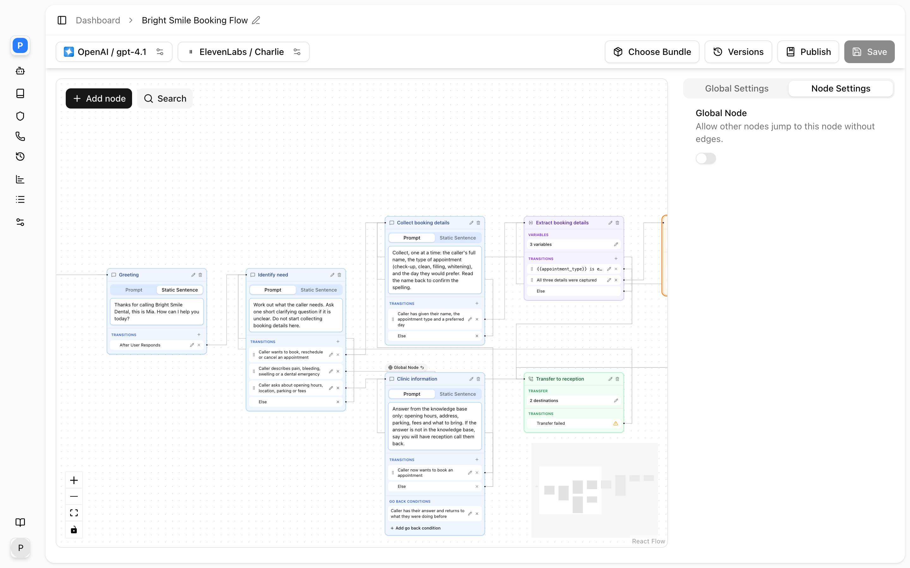
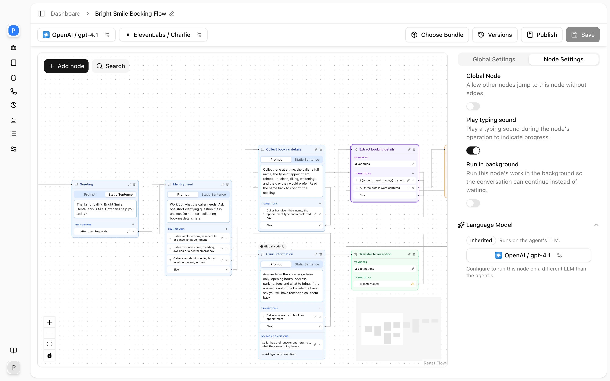
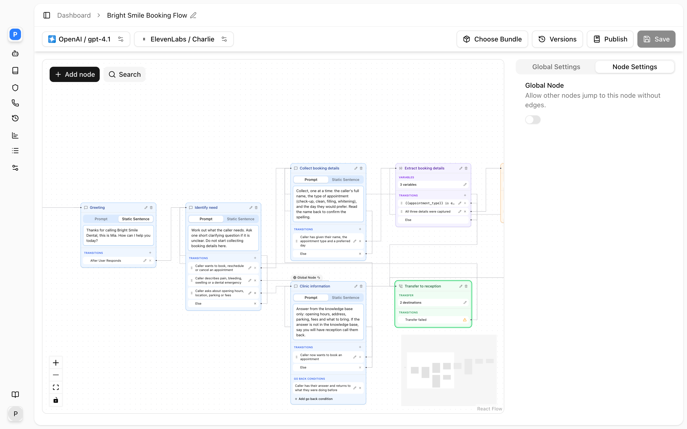
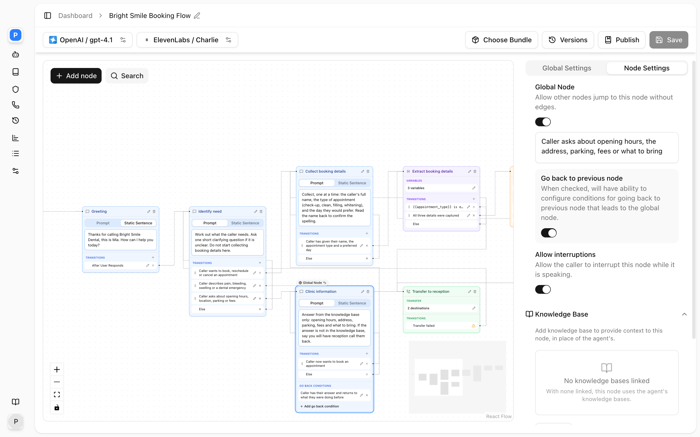

A node is one step of the call. Every node has a name and a way out; most have an instruction or a configuration block for the action they perform. This page covers what each of the eight types does at runtime, the settings on its card and in the **Node Settings** pane, and the transitions it allows. For how transitions are evaluated see [Edges and conditions](/conversation-flows/edges).

## What every node has

| Node | Instruction | Prompt / Equation / Else rows | Always / Skip | Configure dialog | Allow interruptions | Typing sound, Run in background | Knowledge Base | Language Model | Node Functions |
|---|---|---|---|---|---|---|---|---|---|
| Conversation | Prompt or static | Yes | Yes | No | Yes | No | Yes | Yes | No |
| Sub Agent | Prompt or static | Yes | Yes | No | Yes | No | Yes | Yes | Yes |
| Custom Function | No | Yes, Else fixed | No | Function | No | No | No | No | No |
| Extract Variable | No | Yes, Else fixed | No | Variables | No | Yes | No | Yes | No |
| Send SMS | No | Yes | Yes | Message | No | No | No | No | No |
| Logic Split | No | Yes, Else fixed | No | No | No | No | No | Yes | No |
| Transfer Call | No | Transfer unavailable and Transfer failed, both fixed | No | Transfer | No | No | No | No | No |
| End Call | Prompt or static | None | No | No | No | No | No | No | No |

"Else fixed" means the card always shows an **Else** row and does not let you delete it: these nodes act and then route, and the flow must have somewhere to go when nothing matches. A Transfer Call node goes further: its two rows are fixed and no others can be added. Any node type can be made a [global node](#global-nodes).

The **Node Settings** tab shows only the sections that apply to the selected node, so the table above is also what you will see there.

## Instruction

Nodes that speak have an instruction with two tabs:

- **Prompt**: the text is appended to the global prompt under a `## Current Step Instructions` heading, and the model phrases the words. The placeholder reads "Describe what the agent should say at this step".
- **Static Sentence**: the text is spoken word for word, with any `{{variable}}` substituted first. No model call is made to produce it, so it plays about two seconds sooner than a prompt reply and never pads. The placeholder reads "The exact sentence the agent will say".

A Conversation or Sub Agent node is born with a prompt instruction; an End Call node with a static one.

Use static for greetings, compliance lines, read-backs and farewells. Use prompt for anything that must adapt to the caller. Every prompt instruction on a node other than the start node should say that the call is already underway and the agent must not greet again, and should ask one question per turn. Nodes without those lines eventually greet mid-call or stack questions.

The runtime adds a line of its own in two cases. A static node with prompt transitions is told that its only job after speaking is to pick the matching transition, not to answer. A static or prompt node whose only transition is **Else** is told it must call that transition on the caller's next message. Neither replaces the structure described under [Patterns](/conversation-flows/patterns): a static question is still best exited through an always transition.

## Conversation

<Frame caption="Node Settings for a Conversation node.">
  
</Frame>

The workhorse. It speaks, listens and routes on what the caller says. On entry it speaks its static line or generates a reply from its prompt; after each caller turn it either transitions deterministically or lets the model reply and choose a transition. Its transitions are usually prompt conditions describing the caller's intent.

| Setting | Where | Values | Default |
|---|---|---|---|
| Name | Card header | Up to 255 characters | "Conversation" |
| Instruction | Card, **Prompt** / **Static Sentence** | Text | Prompt, empty |
| Transitions | Card | Prompt, Equation, Else, or one Always/Skip | None |
| **Allow interruptions** | Node Settings | On / off | On |
| **Global Node** | Node Settings | Off, or a condition | Off |
| **Knowledge Base** | Node Settings | Linked knowledge bases | None linked: uses the agent's |
| **Language Model** | Node Settings | Inherited, or a provider and model | Inherited |

A prompt instruction that holds up in production names the wrong behaviour as well as the right one:

```text
The call is ALREADY UNDERWAY and you have already greeted the caller.
Do NOT greet them again and do NOT re-introduce yourself.
ONE QUESTION PER TURN.

STEP 1: Ask "May I have your full name?" Then STOP and wait.
STEP 2: Ask "And the best number to reach you on?" Then STOP and wait.

ASK FOR EACH DETAIL AT MOST TWICE. If the second reply still does not
give it, say "No problem" and hand off by calling the transition.
Do NOT reply with words only when handing off; the next step speaks.
```

The start node is always a Conversation (or Sub Agent) node. It greets the caller once per call using its own instruction; the **Welcome Message** fields on the agent's Prompt settings are not used by flows.

## Sub Agent

A Conversation node that can also call tools inline. The card adds a **Node Functions** section with the same **Add function** menu and dialogs as the agent-level tools: Send SMS, End Call, Transfer Call, Extract Variable, Custom Function. Only Sub Agent nodes may carry tools; the API rejects `llm_config.tools` on any other type.

Use it when one step must do several things in no fixed order, such as "what would you like to change?" after a read-back, where the model should extract whichever field the caller corrects. The instruction names the tools:

```text
Ask what needs to be corrected. Once the caller gives the new value,
call the extract tool to update that field. Then hand off: the next
step reads the details back again. Do NOT read them back yourself.
```

When one of the node's own tools writes a variable, the node's equation transitions are re-checked immediately, so a Sub Agent can extract and move on in the same turn. Everything under Conversation applies here too.

## Custom Function

<Frame caption="A Custom Function node selected.">
  
</Frame>

Calls your API, silently, as soon as it is entered. The card shows a **Configure function** button that opens the same dialog as the [Custom function](/build-an-agent/tools/custom-function) tool: method, endpoint, headers, query, parameters, response variables, timeout and the speak-during and speak-after options.

What happens on entry:

1. If **speak during execution** is on, the message is spoken while the request runs.
2. If the parameter schema has fields the model must fill, one silent model call composes them from the conversation. Fields with a `const` value are filled from variables without a model call.
3. The request is sent. Response variables are read from the body by JSON path and stored, on success only.
4. The node routes: equation transitions first, then any prompt transitions by one silent classification over the result, then **Else**.
5. The result, or a failure notice saying nothing was created, sent or booked, is carried into the next node.

| Setting | API field | Notes |
|---|---|---|
| Endpoint, method | `config.api_endpoint`, `config.http_method` | May contain `{{variables}}` |
| Timeout | `config.timeout` | Milliseconds |
| Response variables | `config.custom_function_variables` | Name to JSON path, e.g. `$.data.id` |
| Speak during execution | `config.speak_during_execution`, `_message` | Message required when on |
| Transitions | `edges`, `else_edge` | Always and Skip are rejected on this type |

Branch on the saved response variables with equations: `{{booking_id}} exists` is the success path, and **Else** is the failure path, which must lead to a node that does not claim success. A failed request stores no variables, so every equation is false and the flow lands on Else.

## Extract Variable

<Frame caption="An Extract Variable node selected.">
  
</Frame>

Reads recent conversation and saves named variables. It speaks nothing. The card shows **Configure Variables**, which opens the same dialog as the [Extract variable](/build-an-agent/tools/extract-dynamic-variable) tool with the tool name and description hidden: for each variable a **Name**, **Type** (string, number, integer, boolean, enum) and **Description**, plus **Choices** for an enum.

What happens on entry: one silent model call is given the extraction instruction, the recent conversation, the results carried from earlier nodes, the node's own variables as already stored ("reuse these values unless the conversation changed them"), and the current date when the agent has a timezone. The values come back typed, are stored, and the node routes on **Else** (or on a prompt transition if you add one, which costs a second silent call that rarely decides anything).

| Setting | Where | Notes |
|---|---|---|
| Variables | **Configure Variables** | The description on each variable is the extraction prompt |
| **Play typing sound** | Node Settings | Loops a keyboard sound from entry until the node hands off |
| **Run in background** | Node Settings | See below |
| **Language Model** | Node Settings | A faster model here shortens the silence |

The extractor sees only recent conversation, on the order of the last twenty messages, not the whole call. Extract soon after a value is spoken. If a value from earlier is needed later, have a conversation node restate it once so it is back in view.

An enum value that is not one of the choices is dropped rather than stored, and a match is case-insensitive but stored with the configured spelling. Variables are required by default: a variable described as "leave blank if not given" still forces the model to produce something, so describe the fallback instead ("if not given, use an empty string").

**Run in background** is offered on this node type only. Turning it on keeps the Else row and deletes any prompt or equation transitions, after a confirmation dialog that counts them, because a background node routes on Else alone. Treat it as experimental and test it on a throwaway agent before relying on it; never use it on the start node, which must be a speaking node.

## Send SMS

<Frame caption="A Send SMS node selected.">
  
</Frame>

Sends a text and moves on. The card shows **Configure message**, the same dialog as the [Send SMS](/build-an-agent/tools/send-sms) tool: content type, content, and whether to send to the caller's number or a different mobile.

What happens on entry: with a static content type the text is sent with variables substituted. With a prompt content type one silent model call composes the body from the conversation and the content prompt. The node then routes on the send result: equation transitions, then prompt transitions by silent classification, then **Else**. A body that could not be composed counts as a failed send.

Place the node after the variables it references have been set. A never-set `{{variable}}` is sent as its placeholder text.

## Logic Split

Routes without speaking and without acting. Its card is just its transitions. On entry it evaluates equation transitions in order, then classifies any prompt transitions with one silent call over the conversation and the current variable values, then takes **Else**.

Use it after an Extract Variable or Custom Function node to decide the next step deterministically, and after a static question to route the caller's reply without giving the model a speaking turn. The second use is the more important one: a static node that asks "Is that correct?" exits on an always transition into a Logic Split whose prompt rows catch corrections, disputes and confirmations in that order.

| Setting | Notes |
|---|---|
| Transitions | Equation rows first, then prompt rows, then the fixed Else |
| **Language Model** | Used for the prompt rows' classification |

A Logic Split cannot take an always or skip transition.

## Transfer Call

<Frame caption="A Transfer Call node selected.">
  
</Frame>

Transfers to a destination in its directory. The card shows **Configure transfer**, the same dialog as the [Transfer call](/build-an-agent/tools/transfer-call) tool: the custom entries, announcement, declined message, hold audio, SIP headers and voicemail handling. The directory the model chooses from is the node's **Custom Entries** plus every contact and department of the directories linked under the agent's **Contacts** settings, so a node can have no custom entries at all. See [Contacts Directory](/core-concepts/contacts).

On entry the transfer starts immediately. A successful transfer ends the flow. Otherwise the node leaves by one of two fixed transition rows, which cannot be deleted or edited, only wired, and which no other rows can join:

- **Transfer unavailable** ("Transition when the target contact is unavailable because it is outside of their availability window."): the contact, or every member of the department, is off shift. Nothing was dialled and nothing was said; the next node is told who was unavailable. An unwired row is not saved and is drawn again on load; while unwired, this outcome takes **Transfer failed**.
- **Transfer failed**, the else edge: declined, unanswered, voicemail, no matching entry, or skipped because the call has reached the agent's **Max Transfer Attempts**. The next node is told whether the caller has already heard the declined line. Unwired, the flow returns to the node it came from, except that the attempt limit ends the call instead.

If voicemail detection is set to hang up, or to hang up after a message, the call ends at voicemail and neither transition is taken; the card shows a warning icon when that is the case.

Every non-successful outcome adds one to the call-wide `transfer_attempts` variable, shared by all Transfer Call nodes, and a transfer that resolves a directory contact publishes `transfer_target_*` variables for the nodes that follow. See [Variables](/conversation-flows/variables#reserved-variables).

Both transitions must lead somewhere useful, usually a node that offers to take a message or names an alternative. Do not make a Transfer Call node global: it would be offered from every node and bypass any hours check in front of it.

## End Call

Terminal. The card has only the instruction. With **Static Sentence** the farewell is spoken exactly; with **Prompt** the model writes a closing from the text. The node then hangs up. It has no transitions and no source handle. It is the only node that should say goodbye; put that rule in the global prompt as well.

## Global nodes

<Frame caption="A global node: the Global Node badge on the card and the Go Back Conditions section.">
  
</Frame>

Any node can be made global from the **Node Settings** tab by switching on **Global Node** ("Allow other nodes jump to this node without edges") and describing the condition. The condition is required; an empty one fails on save.

A global node is added as a transition to every speaking node that does not already have an edge to it, with the description "available from any step, call it whenever the caller's most recent message matches this condition". Use it for things a caller can say at any time: asking for a person, asking to stop, asking an off-topic question.

Write the condition defensively, as a full description of when to fire and when not to:

```text
Fire ONLY when the caller clearly asks to end the call and there is NO
pending action. Do NOT fire when the caller is confirming details, giving
information, or saying "yes, that's all" in answer to a question. Fire
when the caller says "I have to go", "that's enough", or hangs up on the
idea of continuing.
```

The common failure is a global node firing in the middle of a task because the caller said "yes, go ahead, that's all".

### Go back conditions

Switch on **Go back to previous node** to add a **Go Back Conditions** list on the card, with **Add go back condition**. Each is a prompt condition with no destination: at runtime the destination is the speaking node the caller jumped from, and the model is offered it as a transition described as "call this whenever the caller's concern leaves this step's scope". A global node reached from a silent node has no previous node and gets no go-back transition.

Prefer explicit transitions out of a global node. If you use a go-back condition, make it require that the caller has actually replied; otherwise the model can bounce straight back on entry, the origin node's global condition fires again, and the two ping-pong in silence until loop protection stops it.

## Node settings

| Setting | Nodes | What it does |
|---|---|---|
| **Allow interruptions** | Conversation, Sub Agent | "Allow the caller to interrupt this node while it is speaking." Off makes the node's lines play to the end. Default on. |
| **Play typing sound** | Extract Variable | "Play a typing sound during the node's operation to indicate progress." Default off. |
| **Run in background** | Extract Variable | "Run this node's work in the background so the conversation can continue instead of waiting." Default off. Removes the node's conditional transitions. |
| **Knowledge Base** | Conversation, Sub Agent | "Add knowledge base to provide context to this node, in place of the agent's. With none linked, this node uses the agent's knowledge bases." A knowledge base must be fully ingested to be linked. |
| **Language Model** | Conversation, Sub Agent, Extract Variable, Logic Split | Badge **Inherited** or **Override**. **Configure** opens the same dialog as the agent's LLM settings; **Reset** returns to the agent's model. The override also applies to the node's silent calls. |

Attach a knowledge base to the answering node only. A knowledge base on the agent is searched on every turn of every node, which slows collection steps and gives them material to wander into.

## By API

An Extract Variable node with a typing sound and an Else transition:

```json
{
  "id": "01JCX5R2A5M1Q9W3V7K8Y2T4ZD",
  "name": "Extract Details",
  "type": "extract_dynamic_variable",
  "instruction": null,
  "enable_typing_sound": true,
  "config": {
    "type": "extract_dynamic_variable",
    "name": "extract_details",
    "description": "Save the caller's name and callback number.",
    "variables": [
      { "name": "caller_name", "type": "string", "description": "The caller's full name as given." },
      { "name": "callback_number", "type": "string", "description": "Digits only, exactly as the caller said them, spaced one digit at a time." }
    ]
  },
  "edges": [],
  "else_edge": {
    "id": "extract-details-else",
    "destination_node_id": "01JCX5R2A5M1Q9W3V7K8Y2T4ZE",
    "transition_condition": { "type": "prompt", "prompt": "Else" }
  }
}
```

A Transfer Call node with no custom entries, relying on the agent's linked directories, with both fixed rows wired:

```json
{
  "id": "01JCX5R2A5M1Q9W3V7K8Y2T4ZG",
  "name": "Transfer to Staff",
  "type": "transfer_call",
  "instruction": null,
  "config": {
    "type": "transfer_call",
    "announcement_type": "static",
    "announcement_message": "Please hold while I put you through.",
    "transfer_declined_type": "static",
    "transfer_declined_message": "I'm sorry, I wasn't able to reach them.",
    "phone_directory": null
  },
  "edges": [
    {
      "id": "transfer-staff-unavailable",
      "destination_node_id": "01JCX5R2A5M1Q9W3V7K8Y2T4ZH",
      "transition_condition": { "type": "transfer_unavailable" }
    }
  ],
  "else_edge": {
    "id": "transfer-staff-else",
    "destination_node_id": "01JCX5R2A5M1Q9W3V7K8Y2T4ZJ",
    "transition_condition": { "type": "prompt", "prompt": "Else" }
  }
}
```

A per-node override on a Conversation node: a different model and its own knowledge base.

```json
{
  "llm_config": {
    "provider": "azure",
    "model": "gpt-4.1",
    "temperature": 0.2,
    "knowledge_base_ids": ["01JCX5R2A5M1Q9W3V7K8Y2T4ZF"]
  }
}
```

A node with no `llm_config` inherits everything. A `config` block must carry a `type` equal to the node's type. A `global_node_settings` object makes the node global; omit it, or send null, for an ordinary node.

## Related

- [Edges and conditions](/conversation-flows/edges)
- [Variables](/conversation-flows/variables)
- [Patterns](/conversation-flows/patterns)
- [Extract variable](/build-an-agent/tools/extract-dynamic-variable), [Custom function](/build-an-agent/tools/custom-function), [Transfer call](/build-an-agent/tools/transfer-call), [Send SMS](/build-an-agent/tools/send-sms)
