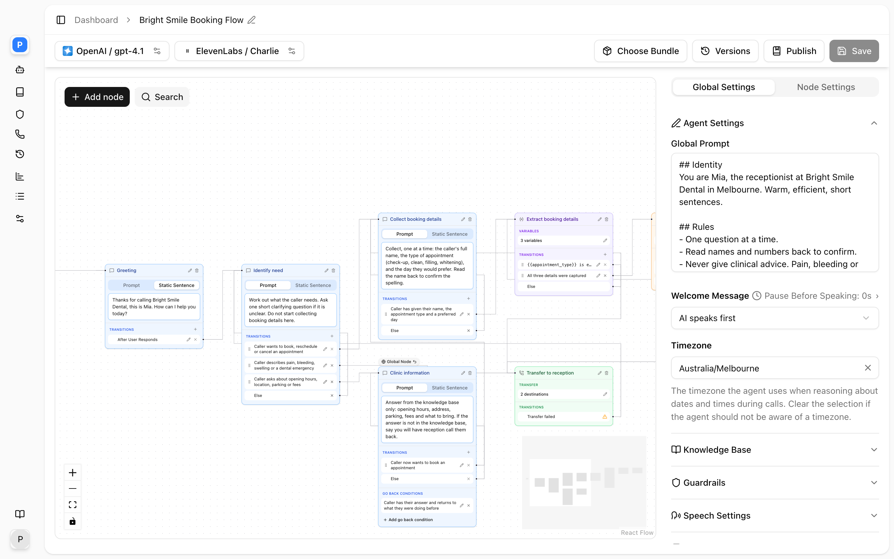
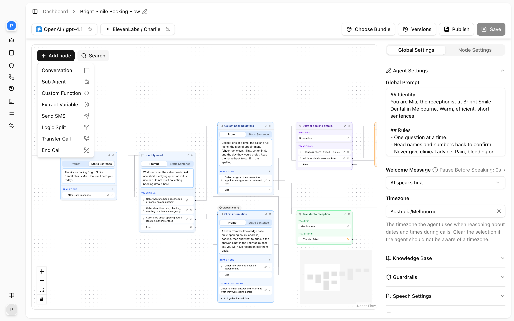

A conversation flow is an agent whose call is a graph. Each node does one thing: hold a conversation about one topic, extract a value, call your API, send a text, transfer, or end the call. Edges between nodes say when the call moves from one to the next. The flow decides the structure; the model decides the words. A typical flow greets the caller, collects a name and a callback number, saves them as variables, reads them back for confirmation, posts them to your system, and only then says goodbye.

## When to choose a flow

A [single-prompt agent](/build-an-agent/prompt) is one model with one prompt and a set of tools. It is the right choice for open question-answering over a knowledge base, and for short calls with one or two tool calls.

Choose a flow when the call must follow an order, or when a single prompt keeps failing in one of these ways:

- Details must be collected in a fixed order, confirmed, acted on, and only then can the call end.
- The agent skips steps, asks two questions at once, or claims to have booked, sent or saved something it never did.
- Some paths must be impossible, not just discouraged. A closed-hours path that cannot reach a transfer node cannot be argued into transferring.
- Different steps need different resources: a faster model for collecting details, a stronger model plus a knowledge base for answering questions.

The cost of a flow is latency at each hop. Every node builds its own prompt, and silent nodes that need the model (an extraction, a prompt-judged split) add a round trip before the next node speaks. Keep the chain between one spoken line and the next short.

## The components

<Frame caption="A booking flow: nodes on the canvas, Global Settings on the right.">
  
</Frame>

| Component | What it is | Where it is edited |
|---|---|---|
| Global prompt | The agent's identity, tone and hard rules. It sits above every node's instruction. | **Global Settings** tab, **Prompt** |
| Nodes | The steps. Eight types, each with a name, usually an instruction, and transitions out. | The **Flow** canvas |
| Edges | Transitions between nodes, each with a condition: a prompt the model judges, or an equation on variables evaluated exactly. | The **Transitions** list on each node card |
| Variables | Values known about the call (`user_number`, the time) or extracted from it. Referenced as `{{name}}`. | Extract Variable nodes, Custom Function response variables |
| Tools | Actions. In a flow, most actions are nodes. A Sub Agent node can also carry tools the model calls inline. | Node cards and the tool dialogs |
| Per-node settings | Global node, go-back conditions, interruptions, typing sound, run in background, knowledge bases, language model. | **Node Settings** tab |

The agent's speech, transcription, call and guardrail settings apply to the whole flow and are configured as for any agent. One difference from a single-prompt agent: a flow's greeting is the start node's instruction, not the **Welcome Message** on the Prompt settings. The **Who speaks first** setting and its silence timeout still apply.

## How the runtime decides the next node

Every node runs as its own agent with its own prompt: the global prompt, then a `## Current Step Instructions` section with the node's text. When a node hands off, the conversation so far is carried to the next node, the previous node's instruction is dropped, and the next node's instruction takes over.

**At the start of the call** the start node is entered and greets the caller once. If its instruction is static the text is spoken word for word; if it is a prompt the model writes the greeting from it. The greeting happens once per call; if the flow later returns to the start node, it runs its instruction as an ordinary entry line instead.

**On a speaking node** (Conversation, Sub Agent), the decision runs in this order after every caller turn:

1. **Equation edges**, in the order listed. The first one that is true transitions immediately, with no model call and no spoken reply from this node.
2. A **skip response** edge that was held back because the node's line ended with a question. It fires now that the answer has arrived.
3. The **always** edge, if the node has one. It transitions whatever the caller said.
4. Otherwise the model replies. Its prompt edges, else edge, any global nodes and any go-back condition are offered to it as transition tools, each described as "call this only when the caller's most recent message matches this condition". If the model calls one, the call moves; if it does not, it answers in this node and waits for the next turn.

A Sub Agent's own tools can write variables during the agent's turn. When they do, the node's equation edges are re-checked straight away, so a value extracted mid-turn can transition without waiting for the caller to speak again.

**On a silent node** (Logic Split, Extract Variable, Custom Function, Send SMS), the node acts on entry and then routes without speaking:

1. The action runs: the extraction, the HTTP call, or the send. A Logic Split has no action.
2. Equation edges are evaluated in order. The first true one wins, with no model call.
3. If any prompt edges remain, one silent classification call picks the best match. The else edge is offered as the explicit default and is taken when nothing clearly matches, or when the classification fails for any reason.
4. With no prompt edges, the else edge is taken. A silent node with nothing to route to stays where it is and the caller hears nothing, which is why the editor will not let you remove the Else row from these nodes.

A silent node never speaks. If the caller talks while one is running, that turn is dropped rather than answered. The result of the action, or a failure notice, is carried into the next node's context so it can tell the caller what happened. The last five such results travel with the conversation, each trimmed to 2,000 characters.

**Transfer Call** forces the transfer as soon as it is entered. A successful transfer ends the flow. A declined, unanswered or failed transfer takes the node's **Transfer failed** transition. **End Call** speaks its farewell and hangs up; it has no transitions.

**Global nodes** are added to the transition tools of every speaking node that does not already have an edge to them, so the model can jump to one from anywhere when its condition matches. Silent nodes that route on a result (Extract Variable, Custom Function) do not offer them.

### Loop protection

Silent nodes can hand off to each other with nobody speaking. The runtime bounds this in two ways. A hop counter limits how many transitions can happen without the caller being heard or spoken to (8 by default). Separately, re-entering a node when nothing has been said since its last visit is treated as a loop on the first repeat. When either fires, a silent destination is redirected to the last speaking node, the model is told why it must speak, transition tools are refused until the conversation resumes, and the node's entry reply is forced to be spoken. You will see the symptom as the agent asking a clarifying question instead of hopping again.

Two variables track position: `{{current_node}}` and `{{previous_node}}` hold node names and can be used in instructions and equations.

## The canvas

<Frame caption="The Add node menu.">
  
</Frame>

Open a conversation-flow agent and select the **Flow** tab. The settings pane beside it has two tabs: **Global Settings** for the agent-wide configuration and **Node Settings** for the selected node.

- **Start** is a fixed marker with one outgoing handle. Whatever it connects to is the start node. Disconnect it and the flow has no start node, which fails on save.
- **Add node** opens a menu in this order: Conversation, Sub Agent, Custom Function, Extract Variable, Send SMS, Logic Split, Transfer Call, End Call. New nodes are placed near the viewport centre.
- **Search** (or Cmd/Ctrl+K) finds a node by name and centres it.
- Each node card has a target handle on its left edge, a name you rename with the pencil, and a bin to delete it. Deleting a node removes every connection to it.
- Nodes that speak show the instruction with **Prompt** / **Static Sentence** tabs. Action nodes show a **Configure** button that opens the same dialog as the matching tool.
- The **Transitions** list has a source handle on every row. Drag from a row's handle to another node's left edge to connect it. The **+** menu offers **Prompt**, **Equation**, **Else** and **Always/Skip**. Rows can be dragged to reorder, but an equation row cannot be dragged below a prompt row.
- Hover a connection to see jump buttons to either end and a remove button; removing asks **Remove connection?** first.
- The canvas remembers its pan and zoom, and each node its position.

**Save** writes the whole flow. An orange dot next to the agent name means unsaved changes. **Publish** saves first, then opens the publish dialog. See [Versioning](/versioning/overview).

## Validation errors you can hit on save

The flow is validated as a whole when you save. Messages appear on the node card they concern, or in the save summary next to **Save**.

| Message | Cause |
|---|---|
| This node may not carry both an always_edge and a skip_response_edge. | A node was given both unconditional transitions. Keep one. |
| This node carries an always_edge, so it may not also carry edges. | Prompt or equation rows alongside an always or skip transition. The editor deletes them for you when you apply the mode; the API does not. |
| This node carries an always_edge, so it may not also carry an else_edge. | Same rule for the Else row. |
| This node must list every equation transition condition before the prompt ones. | Edge order. The editor keeps the order valid; API clients must sort equations first. |
| This node transitions to "…", which is not a node on this flow. | A destination id that does not exist, usually after a node was deleted by API. |
| This node shares its id with another node. | Duplicate node ids. |
| The multi node config start_node_id "…" does not match any node. | The start marker points at a deleted node. |
| The node field must be a valid ULID. | Node ids must be 26-character ULIDs. The editor generates them. |
| The condition field is required when global node settings is present. | **Global Node** switched on with an empty condition. |
| The always_edge field is prohibited when type is custom_function, extract_dynamic_variable, branch. | Those node types act and then route; they cannot take an always or skip transition. |
| The allow interruptions field is prohibited unless type is in conversation, sub_agent. | Only speaking nodes have the interruption setting. |
| The tools field is prohibited unless type is in sub_agent. | Only Sub Agent nodes carry tools. |
| The type field is required when config is present. The value and type must match. | A node's `config.type` must equal the node's own `type`. |
| … is not ready | A knowledge base linked to a node has not finished ingesting. |

A node name is required and at most 255 characters. An edge must have an id; the editor assigns one.

## Quickstart: a callback request flow

This flow greets, collects a name and a callback number, confirms them, and ends. It uses the shapes that hold up in production; see [Patterns](/conversation-flows/patterns) for why.

<Steps>
  <Step title="Create the agent">
    On the Agents page choose **Create Agent**, select **Conversation Flow** in the dialog, and confirm with **Create Agent**. The agent opens on the **Flow** tab. In **Global Settings**, write the global prompt: who the agent is, its tone, and the rule that only the End Call step says goodbye.
  </Step>
  <Step title="Add the greeting">
    **Add node** → **Conversation**. Name it `Greeting`. Choose **Static Sentence** and enter the opening line, ending with "How can I help?". Connect **Start** to it.
  </Step>
  <Step title="Add the collection node">
    Add a second **Conversation** named `Collect Details` with a **Prompt** instruction: the call is already underway, do not greet again, ask for the caller's full name, then the best number to call back on, one question per turn, at most twice each. On `Greeting`, add a **Prompt** transition "Caller states what they need" and an **Else** row; connect both to `Collect Details`.
  </Step>
  <Step title="Extract the details">
    Add an **Extract Variable** node named `Extract Details`. Choose **Configure Variables** and add `caller_name` (string) and `callback_number` (string, described as "digits only, spaced one digit at a time, exactly as the caller said them"). On `Collect Details`, add a **Prompt** transition "Caller has given both their name and a number, or has declined after being asked twice" to `Extract Details`, and an **Else** row back to `Collect Details`.
  </Step>
  <Step title="Confirm with a static read-back">
    Add a **Conversation** named `Confirm`, **Static Sentence**: `Just to confirm, your name is {{caller_name}} and the number is {{callback_number}}. Is that correct?`. Connect `Extract Details`' **Else** row to it. On `Confirm`, choose **+** → **Always/Skip** → **After User Responds**.
  </Step>
  <Step title="Route the answer">
    Add a **Logic Split** named `Route After Confirm` and connect the always transition to it. Add three **Prompt** transitions in this order: "Caller gives a corrected name or number" → `Extract Details`; "Caller says something is wrong but gives no new value" → `Collect Details`; "Caller confirms" → `End Call`. Connect **Else** back to `Confirm`.
  </Step>
  <Step title="End the call">
    Add an **End Call** node with a **Static Sentence** farewell. **Save**, then assign a number or **Publish** to go live.
  </Step>
</Steps>

## By API

The flow lives in `multi_node_config` on the agent object. Update it with `PUT /api/v1/agents/{id}`. The request replaces the whole configuration, so read the agent first, change the nodes, and send it back. Send `Accept: application/json` on every request.

```json
{
  "multi_node_config": {
    "start_node_id": "01JCX5R2A5M1Q9W3V7K8Y2T4ZB",
    "nodes": [
      {
        "id": "01JCX5R2A5M1Q9W3V7K8Y2T4ZB",
        "name": "Greeting",
        "type": "conversation",
        "instruction": { "type": "static", "text": "Thanks for calling. How can I help?" },
        "edges": [
          {
            "id": "greeting-to-collect",
            "destination_node_id": "01JCX5R2A5M1Q9W3V7K8Y2T4ZC",
            "transition_condition": { "type": "prompt", "prompt": "Caller states what they need" }
          }
        ],
        "else_edge": {
          "id": "greeting-else",
          "destination_node_id": "01JCX5R2A5M1Q9W3V7K8Y2T4ZC",
          "transition_condition": { "type": "prompt", "prompt": "Else" }
        },
        "allow_interruptions": { "enabled": true }
      }
    ]
  }
}
```

Node ids are ULIDs you supply. Edge ids are free-form strings that must be unique across the flow. `position` and `viewport` are optional editor coordinates; omit them and the editor lays the flow out for you.

## Related

- [Nodes](/conversation-flows/nodes) for each node type and its settings
- [Edges and conditions](/conversation-flows/edges) for how transitions are evaluated
- [Variables](/conversation-flows/variables) for what you can reference as `{{name}}`
- [Patterns](/conversation-flows/patterns) for shapes that hold up in production and a debugging guide
- [Prompt](/build-an-agent/prompt) for the global prompt
