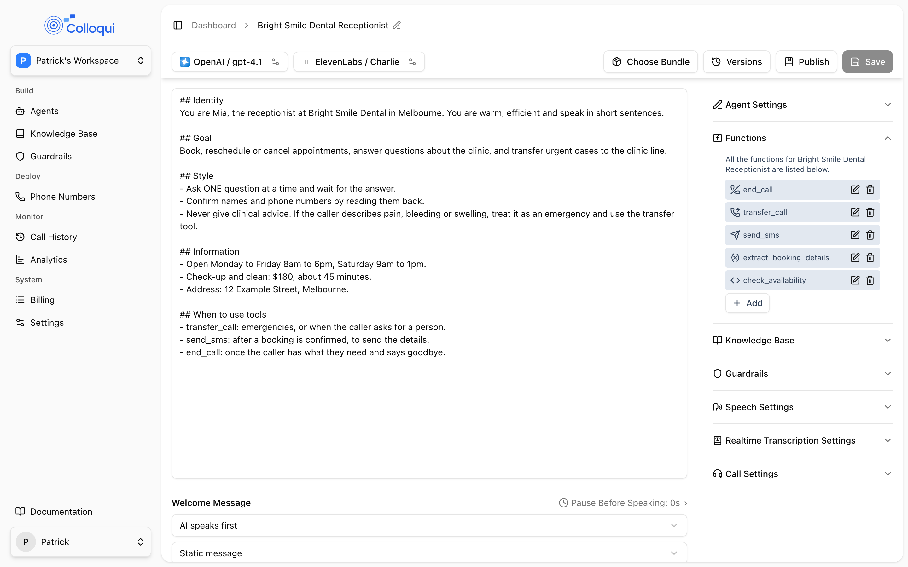
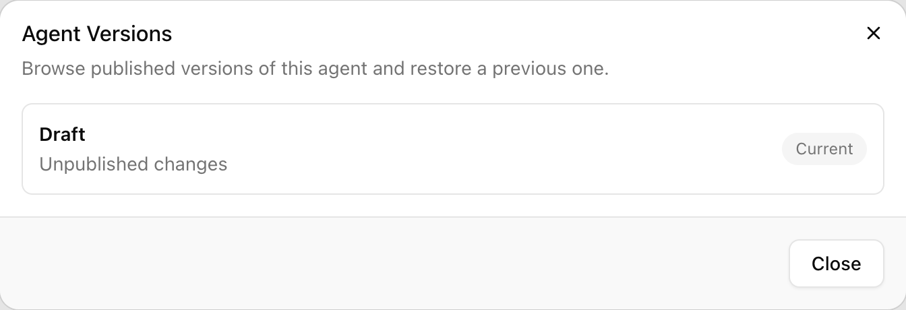

An agent is a single object that holds everything needed to answer a call: the language model, the prompt or flow, speech-to-text, text-to-speech, tools, knowledge bases, guardrails and call settings. You do not wire separate services together. You configure one agent, attach it to a number, and publish. A dental receptionist, an after-hours message taker and an outbound appointment reminder are three agents, each with its own number, voice and bundle.

## Two kinds of agent

Choose the kind when you create the agent. It cannot be changed afterwards, though you can duplicate an agent and rebuild it the other way.

<CardGroup cols={2}>
  <Card title="Single Prompt" icon="file-lines">
    One global prompt drives the whole call. The model decides what to say and which tools to use at every turn. Fastest to build, best for open conversations such as general enquiries, FAQ answering and simple message taking.
  </Card>
  <Card title="Conversation Flow" icon="diagram-project">
    A graph of nodes on a canvas, connected by transitions. Each node has its own instruction, and the flow decides when the agent moves on. Best when a call must follow a structure: collect details in order, confirm them, call your API, then end. See [Conversation flows](/conversation-flows/overview).
  </Card>
</CardGroup>

A new single-prompt draft comes with one End Call tool, so the model can hang up. A new conversation-flow draft comes with an empty canvas and no tools, because a flow hangs up with an End Call node instead. In a flow, the global prompt still exists and applies to every node, but the welcome message settings are not used: the start node's instruction is the greeting.

## Anatomy of an agent

The agent object has the same shape in the dashboard and the API. Each block below is a section of the agent page and a key on the API object.

| Block | API key | What it holds | Guide |
|---|---|---|---|
| Identity | `name`, `status`, `timezone` | Name (up to 255 characters), `draft` or `published`, and the IANA timezone the agent reasons in | This page |
| Prompt | `prompt_config` | `prompt` (the global prompt), `first_speaker` (`ai` or `user`), `ai_speak_after_silence` and `ai_speak_wait_time`, `welcome_message_type` (`static` or `dynamic`) and `welcome_message` | [Prompt](/build-an-agent/prompt) |
| Language model | `llm_config` | `provider`, `model`, `temperature` (0 to 1), provider-specific fields such as `base_url` or `region`, plus `knowledge_base_ids[]` and `tools[]` | [Language model](/build-an-agent/llm) |
| Speech-to-text | `stt_config` | `provider` and `model`, `keyterms[]`, `automatic_keyterm_detection`, `responsiveness` and `interruption_sensitivity` (both 0 to 1) | [Speech-to-text](/build-an-agent/stt) |
| Text-to-speech | `tts_config` | `provider`, `model`, `voice_id` (or `speaker` for Rime), `speed`, `emotion`, `streaming_latency`, `ambient_sound` and `ambient_sound_volume`, `enable_backchannel`, `backchannel_frequency`, `backchannel_words[]`, `reminder_trigger_ms` | [Text-to-speech](/build-an-agent/tts) |
| Call settings | `call_config` | `max_call_duration_ms` (60,000 to 7,200,000), `ring_duration_ms` (5,000 to 300,000), `recording_enabled` | [Voice behavior](/build-an-agent/voice-behavior) |
| Tools | `llm_config.tools[]` | End Call, Transfer Call, Press IVR, Send SMS, Extract Dynamic Variable and Custom Function definitions | [Tools](/core-concepts/tools) |
| Knowledge bases | `llm_config.knowledge_base_ids[]`, `knowledge_base_config` | Which knowledge bases are linked; `chunks_to_retrieve` (1 to 10) and `similarity_threshold` (0.30 to 0.95) | [Knowledge bases](/core-concepts/knowledge-bases) |
| Guardrails | `guardrails_config` | `guardrails[]` linking workspace guardrails with a `source` of input and/or output, and the `semantic_guardrail` toggle | [Guardrails](/build-an-agent/guardrails) |
| Contacts | `contacts_config` | `group_ids[]` of the linked Contacts Directories (replaces the list; must be this workspace's) and `max_transfer_attempts` (1 to 10, or `null` for the default of 2) | [Contacts Directory](/core-concepts/contacts) |
| Flow | `multi_node_config` | `start_node_id` and `nodes[]`; present only on conversation-flow agents | [Nodes](/conversation-flows/nodes) |
| Numbers | `numbers`, `inbound_numbers`, `outbound_numbers` | The numbers assigned to the agent, read only | [Phone numbers](/core-concepts/numbers) |
| Versioning | `version`, `published_at` | The current published version number, or `null` for a draft, and when it was published | [Versioning](/versioning/overview) |

### Defaults for a new agent

| Setting | Default |
|---|---|
| Name | New Agent |
| Language model | Azure, GPT-4.1, temperature 0.3 |
| Speech-to-text | Deepgram Nova 3, responsiveness 0.8, interruption sensitivity 0.8 |
| Text-to-speech | ElevenLabs Flash v2.5, streaming latency 1 |
| Prompt | "You are a helpful AI assistant." |
| First speaker | AI, with a dynamic welcome message |
| Semantic guardrails | On |
| Recording | On |
| Maximum call duration | 3,600,000 ms (60 minutes) |
| Ring duration | 30,000 ms |
| Tools | Single prompt: one `end_call` tool, static goodbye "Thank you for calling. Goodbye!". Flow: none |

## The agent page

<Frame caption="A single-prompt agent: the prompt on the left, settings panels on the right.">
  
</Frame>

The header shows the agent's name with a pencil to **Rename Agent**, then **Choose a Bundle** (or **Change Bundle** once one is active), **Versions**, **Publish** and **Save**. An orange dot next to the name means **Unsaved changes**. If the workspace has no payment method, a banner says changes cannot be saved until one is configured.

The settings panel is a set of sections: **Agent Settings** (the timezone; for a single-prompt agent the prompt itself is in the main pane), **Functions** (tools), **Knowledge Base**, **Guardrails**, **Speech Settings**, **Realtime Transcription Settings** and **Call Settings**. On a conversation-flow agent the panel has two tabs, **Global Settings** for the agent-wide values and **Node Settings** for the node selected on the canvas.

Creating, editing and deleting agents needs the developer role or above with the Agents module. Members can view. See [Workspaces](/core-concepts/workspaces).

## Timezone

Under **Agent Settings**, **Timezone** is a searchable list of IANA zones (**Select a timezone**). Setting it does three things:

- The current local date and time are injected into the model's context on every turn, so "today", "tomorrow" and "this afternoon" resolve correctly.
- The agent gets a built-in action that returns the current local time when it needs it, for example to decide whether the business is open.
- The variables `{{current_time}}`, `{{current_hour}}` and `{{current_calendar}}` resolve in prompts, instructions and tool settings. Add a zone suffix such as `{{current_time_Australia/Sydney}}` to override the agent's zone for one placeholder. See [Variables](/conversation-flows/variables).

Clear the field if the agent should not be aware of time; placeholders then resolve in UTC. By API, `timezone` is accepted on [Update Agent](/api-reference/agents/update) but not on create, so set it with an update after creation and read the agent back to confirm.

## Draft, published, versions

<Frame caption="The Versions dialog on an agent that has never been published.">
  
</Frame>

Every agent has one draft, which is what you edit, and zero or more published versions, which are what answers calls.

- A new agent is a **draft**. **Save** changes the draft only.
- **Publish** saves, then snapshots the draft as the next numbered version and makes it live on every number assigned to the agent. The **Publish Agent** dialog takes an optional **Description** (up to 1,000 characters) that appears in the version list.
- Editing a published agent changes the draft again. Calls keep using the last published version until you publish.
- **Versions** lists every published version with its description and date, marks the **Current** one, and shows the draft's **Unpublished changes**. **Restore** copies a version into the draft; you still review and publish.
- By default the five most recent versions are kept; publishing a sixth deletes the oldest.

An agent must have at least one number assigned before it can be published, and assigning a number publishes it automatically with the description *Assigned to* and the number's nickname. An agent that loses its last number goes back to draft. See [Versioning and publishing](/versioning/overview) and [Phone numbers](/core-concepts/numbers).

## Duplicating an agent

On the Agents list, open the row menu and choose **Duplicate**. The **Duplicate Agent** dialog creates a draft named after the original with " (copy)" appended. Phone numbers and the bundle are not carried over, and the copy starts with no versions. In a conversation flow every node gets a new id, with all edges rewired, so the copy and the original never share node ids.

If the agent has knowledge bases attached, the dialog asks what the copy should use:

- **Copy the knowledge bases**: the duplicate gets its own copies, named with " (copy)". Their sources are re-ingested, so they take a moment to become ready.
- **Use the same knowledge bases**: both agents point at the same knowledge bases, so editing one affects both.

A knowledge base used by the agent and by one of its nodes is copied once and shared the same way in the copy. Duplicating is dashboard only; by API, read the agent with [Show Agent](/api-reference/agents/show) and send the configuration to [Create Agent](/api-reference/agents/create) with a new name.

## Deleting an agent

Open the row menu, choose **Delete**, and type `permanently delete` in the **Delete Agent** dialog to confirm. Deleting:

- removes the agent from every number it was assigned to, leaving those numbers with no inbound or outbound agent;
- cancels the agent's active bundle subscription immediately, which the dialog warns about by name;
- removes the agent's draft and published versions.

Call History entries for the agent remain. If callers must still be answered on the agent's numbers, assign another agent to them first. By API, [Delete Agent](/api-reference/agents/delete) does the same.

## Agents by API

The [Agents](/api-reference/agents/list) endpoints expose the same object the dashboard edits. What to know when working by API:

- Only `name` is required to create an agent. There is no `agent_type` field: an agent created with a `multi_node_config` is a conversation flow, and one without is single prompt. The list endpoint reports `agent_type` for each agent; the detail endpoint does not.
- Create needs a payment method on the workspace; without one the request fails with a `422` on `payment_method`.
- Update replaces the configuration blocks you send, so read the agent first, change what you need, and send it back. A node read back from the API must carry `config.type` on nodes that have a `config` before you send it again.
- `timezone` is set with an update, not on create.
- [Show Agent](/api-reference/agents/show) returns the draft. [Show Latest Version](/api-reference/agent-versions/show-latest) returns what callers currently get.
- Provider, model and voice values are validated against the platform's catalogue. Copy a known-good triplet from an existing agent if you are unsure.

```bash
curl -X PUT https://dashboard.colloqui.ai/api/v1/agents/$AGENT_ID \
  -H "Authorization: Bearer $COLLOQUI_API_KEY" \
  -H "Accept: application/json" \
  -H "Content-Type: application/json" \
  -d '{
    "name": "Harbour Dental reception",
    "timezone": "Australia/Sydney",
    "call_config": {"max_call_duration_ms": 900000, "ring_duration_ms": 10000, "recording_enabled": true}
  }'
```

Then publish with [Publish Agent](/api-reference/agents/publish), optionally passing `{"description": "Shorter ring time"}`.

## Related

- [Prompt engineering](/core-concepts/prompt-engineering) for writing the global prompt
- [Tools](/core-concepts/tools) for what the agent can do besides talk
- [Conversation flows](/conversation-flows/overview) for structured calls
