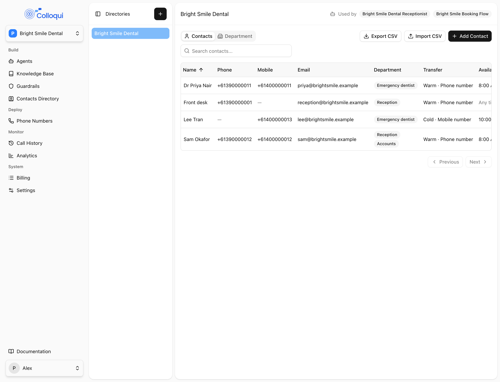
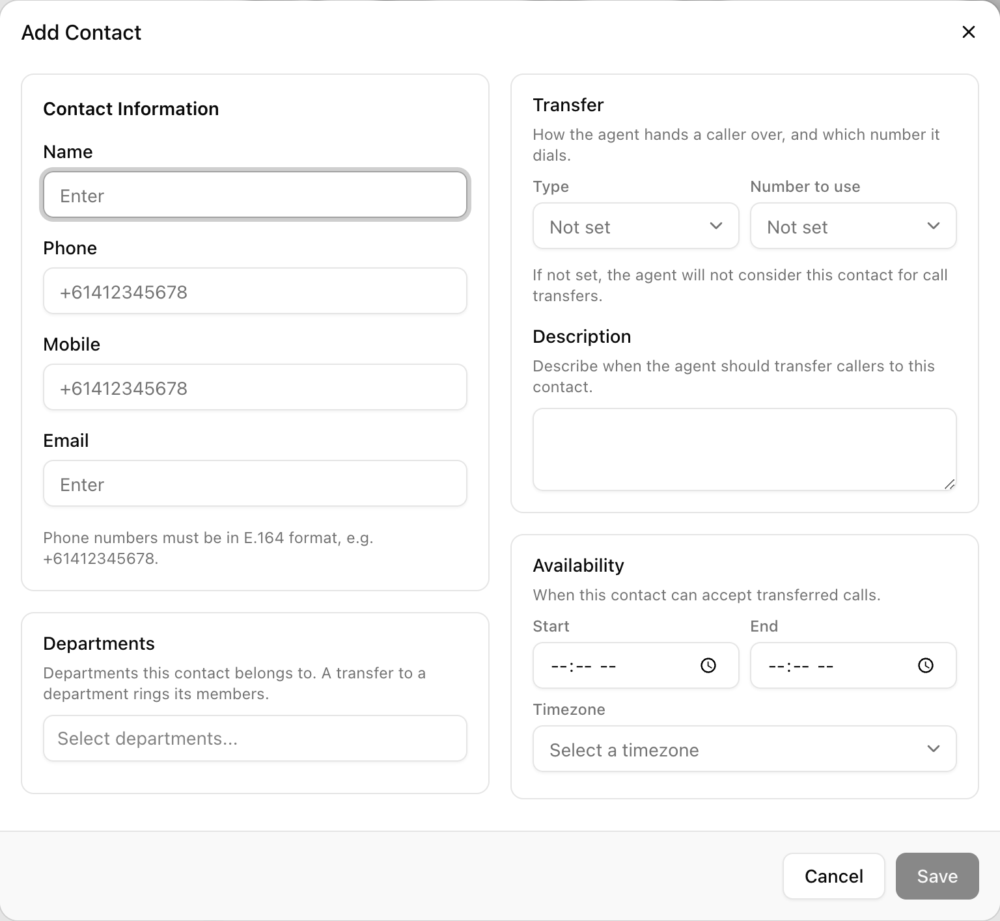
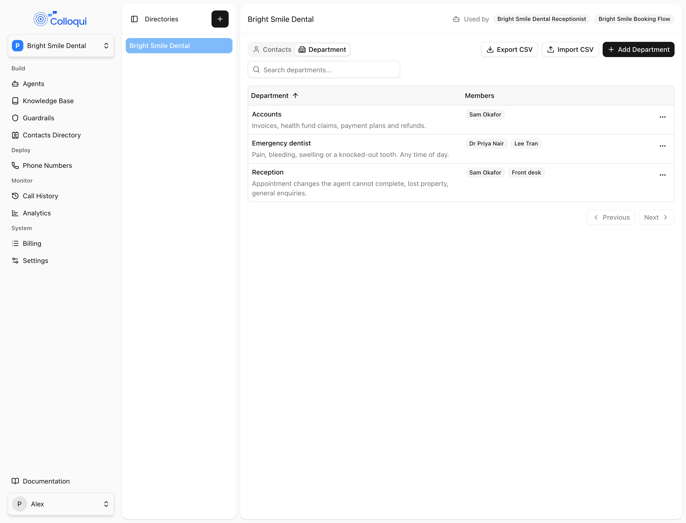
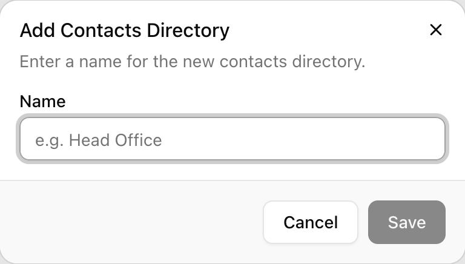
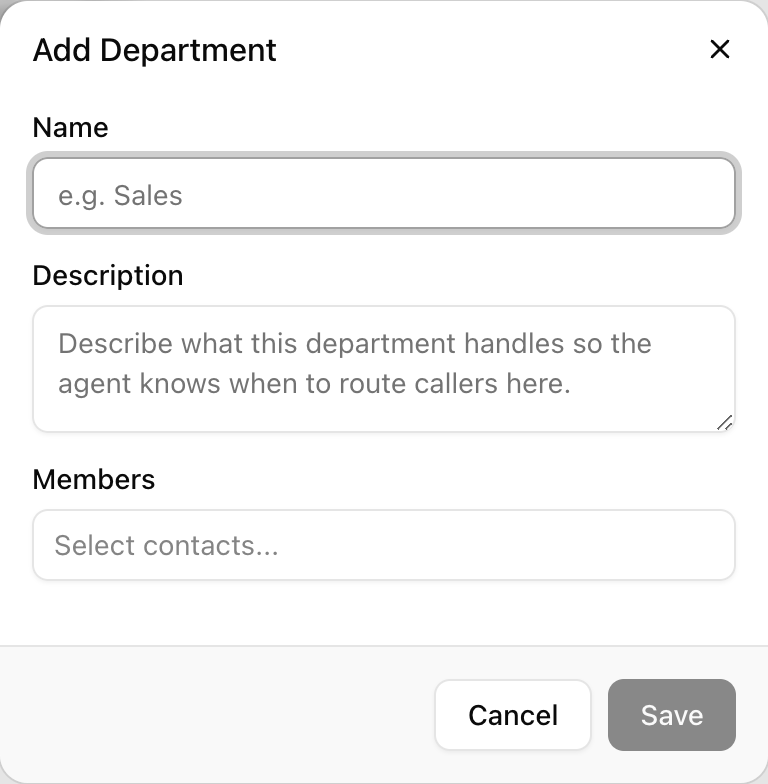
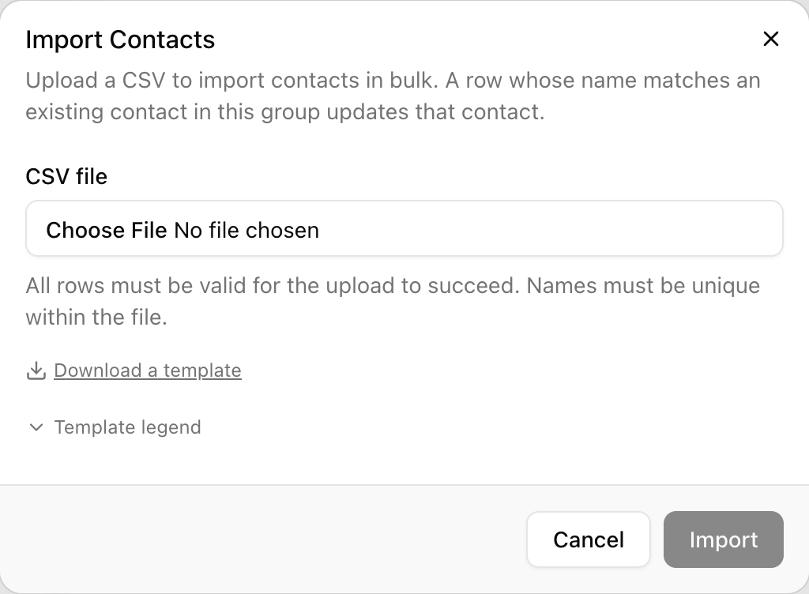
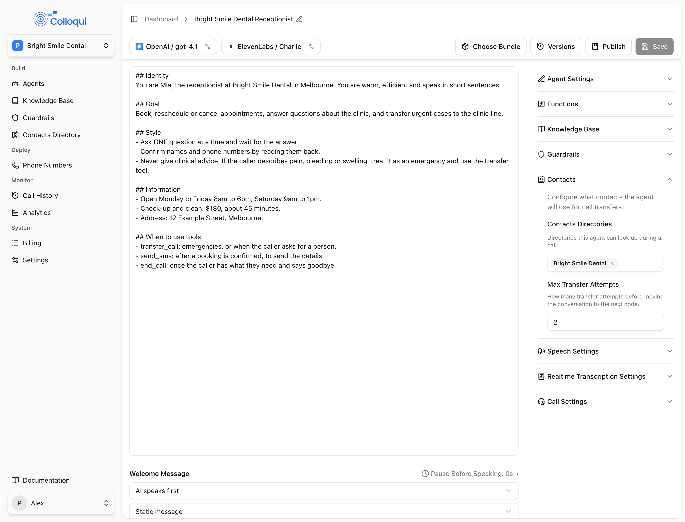

A Contacts Directory is a workspace-level address book: contacts (people) and departments (named teams of contacts). The API calls it a contact group. An agent is linked to one or more directories under its **Contacts** settings; from then on a Transfer Call node can put a caller through to any contact or department in those directories without a number being typed into the node, a Send SMS tool or node can text them, and any prompt or message can read a contact's details as a variable. Contacts carry an availability window, so the agent routes a caller elsewhere when the person is off shift instead of dialling, and a department rings one of its members who is on shift.

## Directories, contacts and departments

<Frame caption="A contacts directory: the Contacts tab with phone, mobile, email, department, transfer settings and availability per contact.">
  
</Frame>

| Object | API name | What it holds |
|---|---|---|
| Directory | contact group | A name (up to 255 characters). Belongs to one workspace. Deleting a directory removes its contacts and departments. |
| Contact | contact | A person: name, phone, mobile, email, an availability window, transfer settings, a description, and the departments they belong to. Lives in exactly one directory and cannot be moved. |
| Department | department | A named team with a description and member contacts from the same directory. |

A contact and a department are both transfer destinations. Transferring to a contact dials that person; transferring to a department dials one of its available members.

## Contact settings

<Frame caption="The Add Contact dialog: Contact Information, Transfer, Departments and Availability.">
  
</Frame>

Fields as the **Add Contact** dialog groups them.

| Section | Setting | API field | Values | Notes |
|---|---|---|---|---|
| **Contact Information** | **Name** | `name` | Required, up to 255 characters | What the caller asks for and what the model matches on; also the key the CSV import updates by |
| | **Phone** | `phone_number` | E.164, such as `+61340270077` | Optional |
| | **Mobile** | `mobile_number` | E.164, such as `+61412345678` | Optional. The number SMS goes to |
| | **Email** | `email_address` | Valid email, up to 255 characters | Optional. Available as a variable; not used by any tool |
| **Availability** | **Start**, **End** | `availability_start`, `availability_end` | `HH:MM` | Both or neither. End may be earlier than start for an overnight window |
| | **Timezone** | `availability_timezone` | IANA name, picked with **Select a timezone** | Required when a window is set |
| **Transfer** | **Type** | `transfer_type` | `warm`, `cold` | Shown as **Not set** until chosen |
| | **Number to use** | `transfer_number_type` | `phone_number`, `mobile_number` | Set together with **Type**; the chosen number must exist on the contact |
| **Departments** | | `department_ids[]` | Departments in the same directory | |
| **Description** | | `description` | Up to 5,000 characters | Notes the model reads when deciding whether to route a caller to this contact |

Every detail is optional in the API; the dashboard's import insists on a phone, mobile or email per contact. The contacts table shows Name, Phone, Mobile, Email, Department, Availability (**Any time** when no window is set) and Transfer. Clicking a row opens the contact, with **Copy as variable** beside Phone, Mobile and Email for the `{{contacts.<id>.<field>}}` placeholder described under [Variables](/conversation-flows/variables#reserved-variables).

### Availability windows

A window says when the contact can accept a transferred call. It is evaluated in the contact's own timezone at the moment of the transfer, so a Sydney receptionist's 09:00 to 17:00 holds regardless of the agent's or the caller's timezone. The start minute is inside the window and the end minute is outside it. A contact with no window is available at all times.

An end earlier than the start is an overnight window. A night-shift supervisor with **Start** 22:00, **End** 06:00 and **Timezone** Australia/Perth is available from ten at night until six the next morning, Perth time, and unavailable during the day.

When a transfer resolves to a contact outside their window, nothing is dialled. In a flow the Transfer Call node leaves by its **Transfer unavailable** edge, so the next node can offer a message or an alternative. See [Transfer call](/build-an-agent/tools/transfer-call#availability-and-the-unavailable-outcome).

### Transfer settings per contact

**Type** decides whether the person is briefed before the caller is bridged (warm) or the caller is redirected (cold); the mechanics are on the [Transfer call](/build-an-agent/tools/transfer-call) page. **Number to use** decides which of the contact's numbers is dialled. Both are optional and come as a pair: saving one without the other fails with "Transfer type and number to use must be set together.", and choosing a number the contact does not have fails with "Number to use is set to mobile number, but the contact has no mobile number." A contact with neither set is dialled on their phone number, cold.

<Note>
The **Add Contact** dialog says a contact with no transfer settings "will not be considered for call transfers". Treat **Type** and **Number to use** as required for anyone the agent should be able to transfer to: set them, and the behaviour is the same whichever way the platform resolves the gap.
</Note>

### Descriptions as routing hints

The model chooses a destination by matching what the caller asked for against each entry's name and description. A contact's description is where you say what that person handles: "Handles billing disputes and refunds. Not new sales." lets "I have a question about my invoice" reach the right person without the caller knowing a name. Keep descriptions short and distinct; two entries that share a phrase can both match, and an ambiguous match fails the transfer.

## Departments

<Frame caption="The Department tab lists each department with its description and members.">
  
</Frame>

The **Add Department** dialog takes a **Name** (placeholder "e.g. Sales"), a **Description** ("Describe what this department handles so the agent knows when to route callers here.") and **Members** ("Select contacts..."). The departments table lists each department with its description and member names, or **No members**.

When a transfer goes to a department, only members inside their availability window are candidates. Each is dialled on their own **Number to use** with their own **Type** (phone number and cold when unset), and one candidate is chosen at random per attempt. A department with no available member is unavailable, exactly like a contact outside their window. The department's description is the routing hint the model reads for it. A text to a department goes to every member's mobile, on shift or not; see [Send SMS](/build-an-agent/tools/send-sms#sending-to-contacts-and-departments).

## Creating a directory

<Steps>
  <Step title="Open Contacts Directory">
    In the sidebar under **Build**, click **Contacts Directory**. Directories are listed on the left; with none selected the page reads "Select a contacts directory to view its contacts."
  </Step>
  <Step title="Add a directory">
    <Frame caption="Add Contacts Directory.">
      
    </Frame>
    Click **Add contacts directory** (the **+** button). The **Add Contacts Directory** dialog asks for a **Name** ("Enter a name for the new contacts directory.", placeholder "e.g. Head Office"). The directory's actions menu later offers **Rename Contacts Directory** and delete.
  </Step>
  <Step title="Add departments, then contacts">
    <Frame caption="Add Department: name, description and members.">
      
    </Frame>
    On the **Department** tab, **Add Department** for each team first, so you can pick them when you add contacts and a CSV import can assign memberships by name. Then on the **Contacts** tab, **Add Contact** and fill in the sections above. Give anyone who should not be dialled around the clock a window, and set **Transfer** on anyone whose mobile should be dialled or who should be briefed first.
  </Step>
  <Step title="Link it to an agent">
    The directory shows **Used by** and the agents linked to it, or "Not used by any agent yet. Link it from an agent's Contacts settings." Linking is done on the agent, as described below.
  </Step>
</Steps>

## Importing and exporting

<Frame caption="Import Contacts takes a CSV; Download a template gives you the columns.">
  
</Frame>

Both tabs have **Import CSV** and **Export CSV**. Import takes a `.csv` or `.txt` file of at most 5 MB and 1,000 rows under a header row that must include `name`; unrecognised columns are ignored. A row whose name matches an existing contact or department updates it; any other row creates one. Every row is validated with the dialog's rules and nothing is written unless all pass, so a file is either fully imported or not at all. Errors are listed per row, up to 20.

Contacts columns: `name`, `phone_number`, `mobile_number`, `email_address`, `availability_start`, `availability_end`, `availability_timezone`, `transfer_type`, `transfer_number_type`, `description`, plus an optional `department` column holding one department name per line inside the cell. Department names must already exist; unknown names are skipped with a warning and the contact is still imported.

```csv
name,phone_number,mobile_number,email_address,availability_start,availability_end,availability_timezone,transfer_type,transfer_number_type,description,department
Jane Citizen,+61340270077,+61412345678,jane@example.com,09:00,17:00,Australia/Melbourne,warm,phone_number,Handles billing enquiries,"Sales
Support"
Sam Nguyen,,+61400000002,,22:00,06:00,Australia/Perth,cold,mobile_number,Night-shift supervisor,Support
```

On an update, an empty cell keeps the current value and a cell holding only `-` clears it, so a file can change one column without touching the rest. A new contact takes every cell as written. The departments file has `name` and `description`; memberships are set only through the `department` column of the contacts file. Export writes the same columns the importer reads, so the way to edit in bulk is export, change, import.

## Linking to an agent

<Frame caption="The Contacts panel on the agent page: Contacts Directories and Max Transfer Attempts.">
  
</Frame>

On the agent page, expand **Contacts**. **Contacts Directories** ("Select contacts directories...") links one or more directories. **Max Transfer Attempts** is how many failed transfers a call may make before the flow stops offering them, 1 to 10; new agents default to 2, and an empty field also means 2.

Linking a directory has three effects:

- **Transfer Call nodes** in a conversation flow gain every contact and department as a destination, alongside any **Custom Entries** typed into the node. See [Transfer call](/build-an-agent/tools/transfer-call#directory-from-linked-contacts).
- **Send SMS** tools and nodes can send to **Contacts / Departments** picked from the linked directories.
- **Variables** of the form `{{contacts.<contact_id>.<field>}}` resolve for any contact in a linked directory, and a transfer that resolves a contact publishes `transfer_target_*` variables.

The Transfer Call tool on a single-prompt agent, and one added under **Node Functions** on a Sub Agent node, dial only the entries typed into them. To transfer to directory contacts, use a Transfer Call node.

## How changes reach live agents

A change to a directory is pushed to the agents that use it. Each call reads a snapshot of the agent's directories when it starts and works from it for the whole call, so an edit applies to the next call, not to calls in progress.

## Permissions

Directories are a workspace module, `contacts`. Seeing them needs that module; owners and admins always have it.

| Action | Owner, Admin | Developer | Member |
|---|---|---|---|
| View directories, contacts and departments | Yes | With module | With module |
| Create, rename and delete a directory | Yes | No | No |
| Add, edit, import and remove contacts and departments | Yes | With module | No |

A developer or member whose **Agent Access** is limited to specific agents sees only the directories those agents use, and a developer can edit the contents of those directories only. See [Workspaces](/core-concepts/workspaces#modules-and-agent-access).

## By API

Directories are contact groups in the API. Contacts and departments are listed and created under their group, then addressed by their own id.

| Action | Endpoints |
|---|---|
| Directories | [List](/api-reference/contact-groups/list), [Create](/api-reference/contact-groups/create), [Show](/api-reference/contact-groups/show), [Update](/api-reference/contact-groups/update), [Delete](/api-reference/contact-groups/delete) on `contact-groups` |
| Contacts | [List](/api-reference/contacts/list) and [Create](/api-reference/contacts/create) on `contact-groups/{id}/contacts`; [Show](/api-reference/contacts/show), [Update](/api-reference/contacts/update), [Delete](/api-reference/contacts/delete) on `contacts/{id}` |
| Departments | [List](/api-reference/contact-departments/list) and [Create](/api-reference/contact-departments/create) on `contact-groups/{id}/departments`; [Show](/api-reference/contact-departments/show), [Update](/api-reference/contact-departments/update), [Delete](/api-reference/contact-departments/delete) on `contact-departments/{id}` |

Create a directory, then a contact in it (a department is created the same way under `contact-groups/{id}/departments` with `name`, `description` and `contact_ids`):

```bash
curl -X POST https://dashboard.colloqui.ai/api/v1/contact-groups \
  -H "Authorization: Bearer $COLLOQUI_API_KEY" \
  -H "Content-Type: application/json" \
  -d '{"name": "Head Office"}'

curl -X POST https://dashboard.colloqui.ai/api/v1/contact-groups/{group_id}/contacts \
  -H "Authorization: Bearer $COLLOQUI_API_KEY" \
  -H "Content-Type: application/json" \
  -d '{
    "name": "Jane Citizen",
    "phone_number": "+61340270077",
    "mobile_number": "+61412345678",
    "availability_start": "09:00",
    "availability_end": "17:00",
    "availability_timezone": "Australia/Melbourne",
    "transfer_type": "warm",
    "transfer_number_type": "phone_number",
    "description": "Handles billing disputes and refunds.",
    "department_ids": ["{department_id}"]
  }'
```

A contact comes back with its fields, `contact_group_id`, `department_ids[]` and timestamps; a department with `contact_ids[]`; a directory with `agent_ids[]` of the agents linked to it. Membership can be set from either side, `department_ids` on a contact or `contact_ids` on a department, and the ids must belong to the same directory. Updates are partial: a field you omit is unchanged.

Link directories to an agent with `contacts_config` on [Update Agent](/api-reference/agents/update). `group_ids` replaces the list and must name directories in the agent's workspace; `max_transfer_attempts` is 1 to 10, or `null` for the default of 2.

```json
{
  "contacts_config": {
    "group_ids": ["{group_id}"],
    "max_transfer_attempts": 2
  }
}
```

## FAQ

<AccordionGroup>
  <Accordion title="The agent transferred to someone who had gone home">
    The contact has no availability window, so they count as available at all times. Set **Start**, **End** and **Timezone** on the contact, and check the timezone: a window entered in the wrong zone is off by hours.
  </Accordion>
  <Accordion title="The agent said nobody was available when someone was">
    For a department, at least one member must have a window that covers now, or no window at all. For a contact, confirm the window is in their own timezone, and remember an end earlier than the start means overnight.
  </Accordion>
  <Accordion title="Why does my single-prompt agent ignore the directory?">
    The Transfer Call tool on a single-prompt agent dials only the entries typed into it. Directory contacts and departments are destinations for Transfer Call nodes in a conversation flow. SMS to contacts and the `contacts.` variables work on both agent types.
  </Accordion>
  <Accordion title="Can a developer create a directory?">
    No. Creating, renaming and deleting directories is for owners and admins. A developer with the Contacts module can add, edit and remove contacts and departments inside a directory used by an agent they can access.
  </Accordion>
</AccordionGroup>

## Related

- [Transfer call](/build-an-agent/tools/transfer-call) for how a directory becomes the node's destinations
- [Send SMS](/build-an-agent/tools/send-sms) for texting contacts and departments
- [Variables](/conversation-flows/variables) for `transfer_target_*` and `contacts.<id>.<field>`
- [Edges and conditions](/conversation-flows/edges) for the **Transfer unavailable** transition
- [Workspaces](/core-concepts/workspaces) for modules and roles
