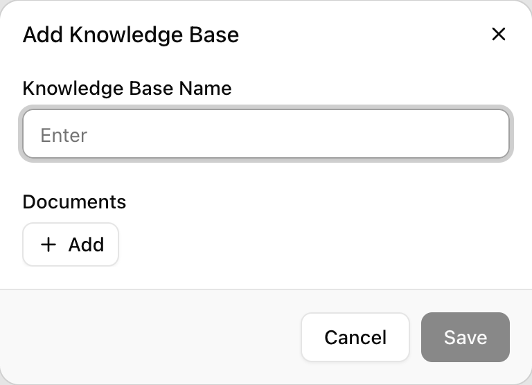
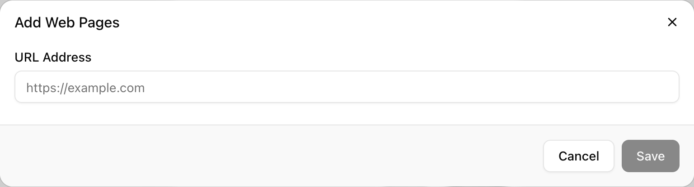
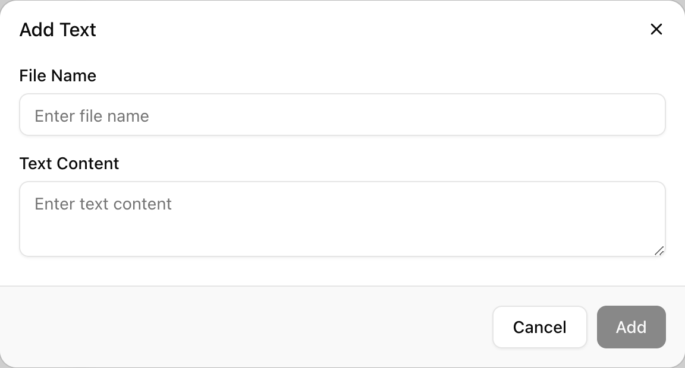
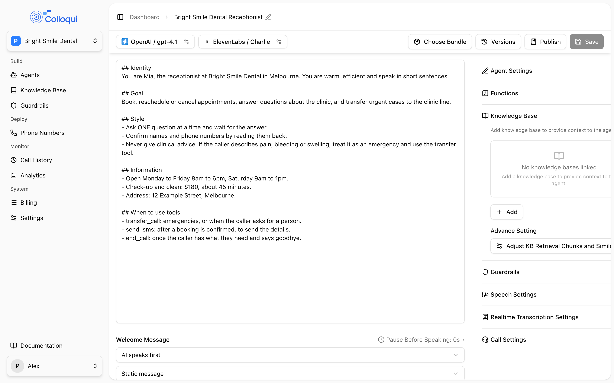

A knowledge base is a collection of content the agent can search during a call. When the caller asks something the prompt does not cover, the agent retrieves the most relevant passages and answers from them rather than from the model's general knowledge. A clinic's agent with its services page, a price list PDF and a pasted FAQ attached can answer "do you do teeth whitening and what does it cost" from the actual content, and say it does not know when the content does not cover a question.

## Sources

A knowledge base holds any mix of three source types.

| Source | How it is added | Limits |
|---|---|---|
| Web pages | Enter a site URL. Colloqui reads the site's sitemap, lists the pages it found, and you choose which to include | Up to 100 pages per crawl; a site with no sitemap yields the one page you entered |
| Files | Upload documents | `.txt`, `.pdf`, `.doc`, `.docx`, `.csv`; 100 MB each |
| Text | Paste content with a title | Title up to 255 characters |

Web page sources can be re-crawled, manually or on a schedule, to pick up changes. Files and text are static; to update them, remove the source and add it again.

## How ingestion works

After you add a source, its content is fetched, split into chunks, and indexed for retrieval. Each source has a status:

| Status | Meaning |
|---|---|
| `pending` | Queued; ingestion has not started |
| `processing` | Being fetched, chunked and indexed |
| `ingested` | Ready to retrieve from |
| `failed` | Ingestion failed; the error is shown on the source |

Ingestion usually finishes within a few minutes. The knowledge base page polls for status while any source is pending or processing, and shows the banner "We're processing your knowledge base sources. They'll be ready for your agent to use in just a few minutes." If a source has not reached a final status after ten minutes the page shows it as failed. A source that fails to start is retried up to three times with short delays before being marked `failed`; after that, fix the cause (a page that does not load, a file that cannot be read) and add it again.

<Warning>
Every source in a knowledge base must be `ingested` before the knowledge base can be linked to an agent. Saving an agent that links a knowledge base with a pending, processing or failed source fails with "The knowledge base is not ready. Please wait a few minutes for all items to be processed." Knowledge bases already linked to the agent are exempt, so adding a new source to one an agent already uses does not break saving that agent.
</Warning>

## Creating a knowledge base

<Steps>
  <Step title="Open Knowledge Base and click Add">
    <Frame caption="The Add Knowledge Base dialog.">
      
    </Frame>
    The **Add Knowledge Base** dialog asks for a **Knowledge Base Name**, then offers three ways to add **Documents**: **Add Web Pages** (crawl and sync your website), **Upload Files** and **Add Text** (add articles manually).
  </Step>
  <Step title="Add web pages">
    <Frame caption="Add Web Pages crawls a site and lets you pick the pages to keep.">
      
    </Frame>
    Enter the **URL Address**, for example `https://example.com`, and let the crawl run. Colloqui looks for `sitemap.xml`, `sitemap_index.xml` or `/sitemap` on the site and lists what it finds. Tick the pages to include; the dialog shows "N of M pages selected" and has **Select all**. Leave **Automatically re-crawl the selected pages on a schedule to keep their content up to date** ticked unless the content never changes.
  </Step>
  <Step title="Add files and text">
    <Frame caption="Add Text takes a title and the text itself.">
      
    </Frame>
    **Upload Files** accepts the five file types above. **Add Text** asks for a **File Name** and the **Text Content**.
  </Step>
  <Step title="Save and wait for ingestion">
    The knowledge base page lists every source with its status. Wait until all are ingested before linking it to an agent.
  </Step>
</Steps>

On an existing knowledge base, **Edit Knowledge Base** renames it and adds sources. Each source has a remove button (**Remove Document**), and a web page source also has a re-crawl button and a **Manage Pages** dialog where you can change which pages are included and the auto re-crawl setting. Re-crawling and page changes reset that source to `pending` and re-ingest it. **Delete Knowledge Base** removes the knowledge base, its sources and their indexed content; unlink it from any agents first.

## Re-crawling

Web page sources with auto re-crawl on are checked every hour. A source is re-crawled when it is ingested, at least an hour old, and was last crawled more than 24 hours ago (by default). Re-crawling replaces the source's indexed content with the current page content. You can also re-crawl a source by hand at any time, except while it is already pending or processing. The source shows its last crawl time.

## Linking to an agent

<Frame caption="The Knowledge Base panel on the agent page, with the retrieval settings under Advance Setting.">
  
</Frame>

A knowledge base does nothing until an agent uses it. On the agent page, expand **Knowledge Base** and link one or more. Linking needs the developer role or above with the Knowledge base module.

On a **single-prompt agent**, linked knowledge bases are available on every turn.

In a **conversation flow**, you can link a knowledge base to the agent, to individual nodes under **Node Settings**, or both. A knowledge base linked to a node is only retrieved from while the call is in that node, and entering the node always runs a fresh retrieval against that node's knowledge bases rather than reusing results from the previous node. This matters more than it sounds: a knowledge base attached to the whole agent gives nodes that should be collecting details something to wander off into. The usual pattern is one node that answers questions with the knowledge base attached, and nothing attached anywhere else. See [Nodes](/conversation-flows/nodes).

### Retrieval settings

Under **Knowledge Base**, **Advance Setting** opens **Adjust KB Retrieval Chunks and Similarity**:

| Setting | API field | Range | Notes |
|---|---|---|---|
| **Chunks to Retrieve** | `knowledge_base_config.chunks_to_retrieve` | 1 to 10 | How many passages are handed to the model per question, across all linked knowledge bases |
| **Similarity Threshold** | `knowledge_base_config.similarity_threshold` | 0.30 to 0.95 | How closely a passage must match before it counts; higher is stricter |

The same two settings apply to every knowledge base the agent links, at the agent level and at node level. See [Knowledge base tuning](/build-an-agent/knowledge-base-tuning) for how to choose values.

## How retrieval works during a call

Knowing when retrieval runs explains most "why did it answer that" questions.

1. **Each caller turn is classified.** Greetings, confirmations and closings ("hi", "yes", "okay", "thanks", "bye"), and anything under three characters, skip retrieval. Questions, requests for information ("tell me", "I need", "looking for") and any message of five or more words trigger a search. A follow-up such as "tell me more" or "what else" reuses the previous results for up to three turns instead of searching again. A message that refers back with "it", "that" or "this" ("how much does it cost") is searched as the previous question plus the new one, so the subject is not lost.
2. **Every linked knowledge base is searched at once.** Results are merged by score and the best **Chunks to Retrieve** passages above the **Similarity Threshold** are kept. The passages are trimmed to roughly 2,000 characters in total by default; the first passage is always included.
3. **The passages are placed in the model's context just ahead of the caller's latest message**, framed as information the agent already knows. The framing tells the model not to read the passages out or quote them, to answer in its own words, to state only facts that appear in them, and to say it does not have those details when the question is not covered. In a flow it also reminds the model that a matching transition still takes priority over answering.
4. **The model answers.** If nothing was retrieved, the model sees only the prompt and conversation, so the prompt should say what to do when the agent does not know. See [Knowledge base tuning](/build-an-agent/knowledge-base-tuning).

Retrieval adds a short delay to the turns where it runs, which is the main reason to link knowledge bases only where they are needed.

## Writing content that retrieves well

Retrieval works on chunks of text, so content that reads well in chunks retrieves well.

- Keep one topic per heading. A page that mixes opening hours, parking and refunds under one heading retrieves poorly for all three.
- Put the answer near the question. A FAQ format works well.
- Avoid pages that are mostly navigation, headings with no body, or tables of links. Crawled marketing pages often look like this, and they produce confident, empty answers. Prefer a pasted text source over a scraped page when the page is thin.
- Say it the way callers ask it. A chunk that says "we are open 8 to 6 on weekdays" matches "what time do you open" better than a table of hours.

## By API

Use the [Knowledge Bases](/api-reference/knowledge-bases/list) endpoints. Creation is `multipart/form-data` rather than JSON because it accepts file uploads. `name` is required; `urls`, `texts` and `files` are optional.

```bash
curl -X POST https://dashboard.colloqui.ai/api/v1/knowledge-bases \
  -H "Authorization: Bearer $COLLOQUI_API_KEY" \
  -H "Accept: application/json" \
  -F 'name=Harbour Dental' \
  -F 'urls=[{"base_url":"https://harbourdental.example","urls":["https://harbourdental.example/services","https://harbourdental.example/fees"],"auto_recrawl":true}]' \
  -F 'texts=[{"title":"Parking","text":"Free parking is behind the building, entry from Short Street."}]' \
  -F 'files[]=@price-list.pdf'
```

- Each entry in `urls` has a `base_url`, an optional list of page `urls` to include (the base URL alone is ingested when omitted), and `auto_recrawl`.
- Each entry in `texts` has a `title` (up to 255 characters) and `text`.
- `files[]` entries must be one of the five file types and at most 100 MB.

[Add Sources](/api-reference/knowledge-bases/add-sources) takes the same `urls`, `texts` and `files` fields on an existing knowledge base. [Delete Source](/api-reference/knowledge-bases/delete-source) takes the source type (`texts`, `urls` or `files`) and the source's id. [Show Knowledge Base](/api-reference/knowledge-bases/show) returns each source with its status, so poll it until every source is `ingested` before linking.

Link a knowledge base to an agent by including its id in the agent's `llm_config.knowledge_base_ids`, or in a node's `llm_config.knowledge_base_ids` for a per-node link, and tune retrieval with `knowledge_base_config`. Check for an existing knowledge base with the same name before creating another, because duplicates are allowed and split your content between them.

## Related

- [Knowledge base tuning](/build-an-agent/knowledge-base-tuning) for choosing chunks and threshold
- [Nodes](/conversation-flows/nodes) for per-node knowledge bases
- [Prompt engineering](/core-concepts/prompt-engineering) for telling the agent what to do when it does not know
