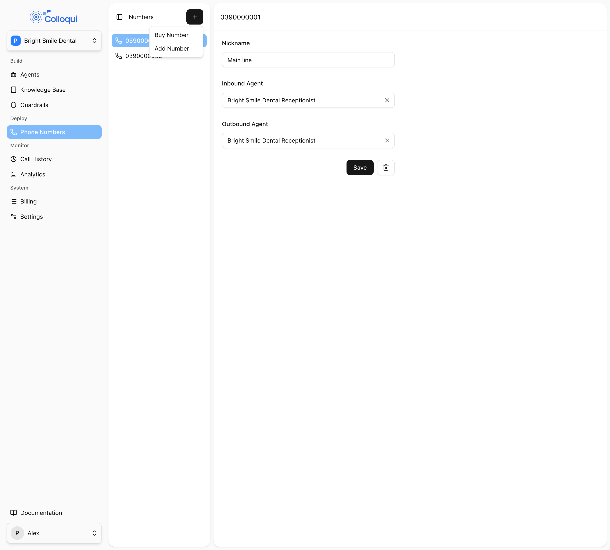
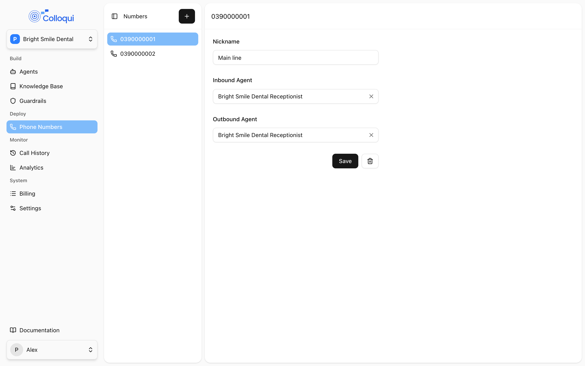

A phone number is what makes an agent reachable. Each number has an **Inbound Agent**, which answers calls to it, and an **Outbound Agent**, which handles calls placed from it. A number with neither is spare. Colloqui numbers are Australian: you can buy one from the available pool or register a number you already own and route it to Colloqui at your carrier. A dental practice with a main line, an after-hours line and a staff line is three numbers, each pointing at the agent that should answer it.

## Getting a number

<Frame caption="Buy Number and Add Number on the Numbers page.">
  
</Frame>

Open **Phone Numbers** and click **Add Number**. The menu has two options.

### Buy Number

**Buy Number** lists numbers from the available pool under **Number**; pick one and optionally give it a **Nickname**. The number is created in your workspace immediately and is usable as soon as the dialog closes. If the list shows **No numbers available**, the pool is exhausted; contact support.

How buying is billed depends on the workspace:

- If the workspace already has an active bundle on an agent, the number is added to that subscription and the prorated amount is charged on the existing monthly invoice. A payment method must be on file; without one the page shows the payment-method banner and buying is disabled.
- If no bundle is active yet, the number is created unbilled and starts billing when you first activate a bundle.

If the card is declined the dialog shows **Payment failed. Please try again.** and no number is created. See [Billing](/workspace/billing).

### Add Number

**Add Number** registers a number you already own: enter the **Number** and an optional **Nickname**. The number must be a valid Australian number of at most 12 characters, written either nationally (`03 4027 0077`) or in international form (`+61 3 4027 0077`); it is stored in national format. A number that already exists in Colloqui is rejected with **Number already exists.** Colloqui registers the number on its trunk so it can accept calls for it; you then route the number to Colloqui at your carrier. Until the carrier side is done, calls to the number do not reach Colloqui. See [Numbers](/deploy/numbers) for the routing details.

Buying and adding numbers needs the developer role or above with the Phone numbers module.

## Number settings

Select a number from the **Phone Number** list to open its details.

| Setting | API field | Values | Notes |
|---|---|---|---|
| **Nickname** | `nickname` | Up to 255 characters | Optional when creating, required when saving changes. Appears in version descriptions when the number is assigned |
| **Inbound Agent** | `inbound_agent_id` | An agent in this workspace, or none | Answers calls to the number |
| **Outbound Agent** | `outbound_agent_id` | An agent in this workspace, or none | Handles calls placed from the number |

Click **Save** to apply, or **Delete** to remove the number.

<Note>
Give every number a nickname when you create it. Saving the details page, and [Update Number](/api-reference/numbers/update) by API, require `nickname` even when nothing else changed, and a number with no nickname is described by its digits in version history.
</Note>

## Assigning an agent

<Steps>
  <Step title="Select the number">
    Open **Phone Numbers** and choose the number from the **Phone Number** list.
  </Step>
  <Step title="Choose the agent">
    <Frame caption="Nickname, Inbound Agent and Outbound Agent for a number.">
      
    </Frame>
    Under **Inbound Agent**, pick the agent that should answer. Set **Outbound Agent** too if the number will be used for outbound calls. The lists only show agents you have access to.
  </Step>
  <Step title="Save">
    From the next call, the number is answered by that agent's latest published version.
  </Step>
</Steps>

Saving an assignment has side effects you should know about, because they change what is live:

1. **The newly assigned agent is published.** If it was a draft or had unpublished changes, its draft is snapshotted as a new version described as *Assigned to* followed by the number's nickname, and that version goes live. There is no separate confirmation, so never assign a number to an agent whose draft you would not publish as it stands.
2. **The agent that previously held the number is re-evaluated.** If it still has at least one other number, it is republished with the same description. If it has none, it is **reverted to draft**, because an agent with no number cannot be reached, and its configuration is taken off the air.
3. **Clearing an agent** from a number does the same for that agent: republished if it has other numbers, reverted to draft if not.

Changing the inbound agent is therefore the way to swap which agent answers a line, and it is immediate.

## One agent, many numbers

An agent can be assigned to as many numbers as you like, so one receptionist can answer several lines. Each number is independent: reassigning one does not affect the others. Inside a call, the agent knows which line was called through the `agent_number` variable and who is calling through `user_number`, so a single agent can greet differently per line. See [Variables](/conversation-flows/variables).

## Deleting a number

Click **Delete** on the number's details and confirm in the **Delete Number** dialog. Deleting:

- releases the number from Colloqui's trunk, so calls to it no longer connect;
- removes it from the workspace subscription, which stops its monthly charge;
- publishes a new version of each agent that held it, described as *Number ... deleted*, or reverts the agent to draft if that was its last number.

A deleted number cannot be restored from the dashboard. If the agent must stay reachable, assign it another number first.

## By API

The [Numbers](/api-reference/numbers/list) endpoints list, create, show, update and delete numbers. The list is scoped to the key's workspace.

- [Create Number](/api-reference/numbers/create) registers a number you own, the same as **Add Number**: `number` (required, a valid Australian number) and optional `nickname`. Buying from the pool is dashboard only.
- [Update Number](/api-reference/numbers/update) assigns agents: `nickname` (required), `inbound_agent_id` and `outbound_agent_id` (each an agent id or `null`). An agent you cannot access fails with "The selected inbound agent doesn't belong to you." The publish and revert-to-draft side effects above apply exactly as in the dashboard.
- [Delete Number](/api-reference/numbers/delete) releases the number with the same effects as the dashboard.

```bash
curl -X PUT https://dashboard.colloqui.ai/api/v1/numbers/$NUMBER_ID \
  -H "Authorization: Bearer $COLLOQUI_API_KEY" \
  -H "Accept: application/json" \
  -H "Content-Type: application/json" \
  -d '{
    "nickname": "Main line",
    "inbound_agent_id": "01m5twyp326sn8hznd4eypqjjm",
    "outbound_agent_id": "01m5twyp326sn8hznd4eypqjjm"
  }'
```

The number object carries `id`, `number`, `nickname`, `inbound_agent_id`, `outbound_agent_id`, `workspace_id`, `created_at` and `updated_at`. Read the number back after an update to confirm the assignment, and read the agent to confirm its `status` and `version`.

## Troubleshooting

<AccordionGroup>
  <Accordion title="Calls to the number are not answered">
    Check that the number has an **Inbound Agent**, that the agent is published (open **Versions** on the agent and look for a **Current** version), and, for a number you brought yourself, that your carrier is routing it to Colloqui. A number bought from the pool needs no carrier setup.
  </Accordion>
  <Accordion title="Number must be a valid phone number">
    The value was not recognised as an Australian number. Enter it with the area code, for example `03 4027 0077` or `+61 3 4027 0077`, and keep it to 12 characters.
  </Accordion>
  <Accordion title="An agent I did not touch went back to draft">
    It lost its last number, usually because someone moved that number to another agent or deleted it. Assign a number to publish it again.
  </Accordion>
  <Accordion title="Assigning a number created a version I did not ask for">
    That is expected: assigning publishes the agent with the description *Assigned to* and the nickname. The version is an exact copy of the draft at that moment, so no second publish is needed.
  </Accordion>
</AccordionGroup>

## Related

- [Numbers](/deploy/numbers) for carrier routing when you bring your own number
- [Versioning and publishing](/versioning/overview) for what publishing and reverting to draft mean
- [Billing](/workspace/billing) for how numbers are charged
