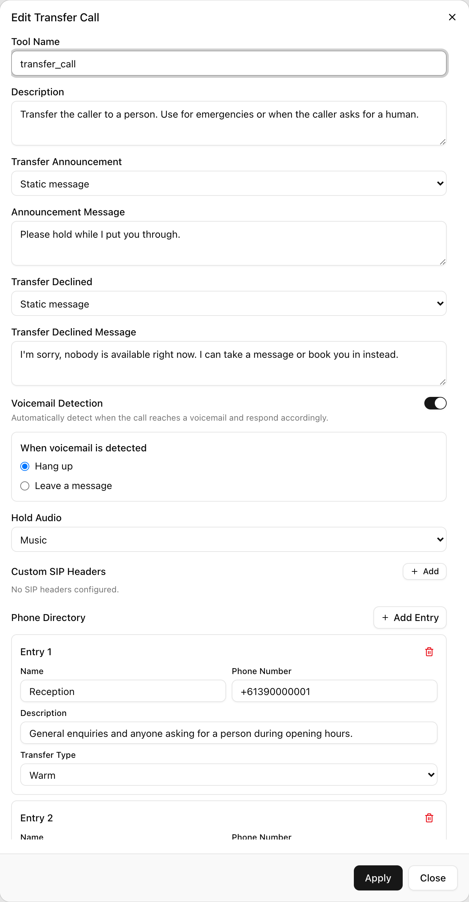

A tool is something the agent can do besides talk: hang up, transfer the caller, press keys on a phone menu, send a text, save what the caller said as a variable, or call your own API. Each tool has a name, a description that tells the model when to use it, and settings specific to its type. A receptionist agent with a Transfer Call tool, a Send SMS tool and an Extract Dynamic Variable tool can route a caller to the right person, text them the address, and record their name and callback number without any of that being hard-coded into the conversation.

Colloqui has six tool types, and they are the same whether you are building a single-prompt agent or a conversation flow. This page is the mental model; each tool has its own page with every setting.

## The six tools

<Frame caption="The Transfer Call tool dialog.">
  
</Frame>

| Tool | API type | What it does | Page |
|---|---|---|---|
| End Call | `end_call` | Says a goodbye, fixed or model-written, and hangs up. Leave both blank for a silent hang-up | [End call](/build-an-agent/tools/end-call) |
| Transfer Call | `transfer_call` | Connects the caller to one of the destinations in a phone directory, as a warm or cold transfer, with an announcement and a line for when the transfer is declined. Can detect voicemail | [Transfer call](/build-an-agent/tools/transfer-call) |
| Press IVR | `press_ivr` | Sends keypad digits into a phone menu, with a pause-detection delay of 1 to 6 seconds | [Press IVR](/build-an-agent/tools/press-ivr) |
| Send SMS | `send_sms` | Texts the caller's number or a fixed mobile number, with fixed or model-written content | [Send SMS](/build-an-agent/tools/send-sms) |
| Extract Dynamic Variable | `extract_dynamic_variable` | Saves one or more typed values (string, number, integer, boolean, enum) from the conversation as variables | [Extract variable](/build-an-agent/tools/extract-dynamic-variable) |
| Custom Function | `custom_function` | Makes an HTTP request to your API with model-filled parameters and saves the response as variables | [Custom function](/build-an-agent/tools/custom-function) |

## Where tools attach

**Single-prompt agent.** Tools are a list on the agent. Open the agent, expand **Functions**, and click **Add** to choose **Send SMS**, **End Call**, **Transfer Call**, **Extract Dynamic Variable** or **Custom Function**. Each opens a dialog with a **Tool Name**, a **Description** and the tool's own fields; **Add Tool** saves it to the list. The model sees every tool on every turn and decides when to call one. A new single-prompt agent already has an End Call tool. Press IVR has no dialog and is added by API.

**Conversation flow, dedicated nodes.** Transfer Call, Send SMS, Extract Variable, Custom Function and End Call each exist as a node type. A node runs its action as soon as the flow reaches it; the model does not decide whether to run it, only how to fill in what the action needs. The node carries the same settings as the tool, minus the name and description, because the node has its own name and the flow's edges decide when it runs. This is the way to make an action deterministic: a flow that must call your booking API before confirming cannot skip it, because the Custom Function node is the only path to the confirmation node.

**Conversation flow, Sub Agent node.** A Sub Agent node is a conversation node that also carries a tool list. Open **Node Functions** on the node to add any of the five dialog tools. Inside that node the model decides when to call them, exactly as in a single-prompt agent, and the tools disappear when the flow moves on. Plain Conversation nodes cannot carry tools. See [Nodes](/conversation-flows/nodes).

A single-prompt agent's Transfer Call tool is also special in one way: its phone directory is loaded once for the whole agent, so there is one transfer action with every destination in it, rather than one tool per destination.

## Naming rules

| Rule | Detail |
|---|---|
| Characters | Letters, digits, `_` and `-`; must start with a letter, `_` or `-` |
| Length | Up to 255 characters |
| Uniqueness | Names must be distinct within one tool list |
| Description | Optional, up to 1,024 characters |

The name is what the model calls, so make it a verb phrase it will recognise: `send_address_sms`, `book_appointment`, `transfer_to_staff`. If two tools do similar things, their names and descriptions together must make the difference obvious.

## How the model decides to call a tool

Every tool is handed to the model as a function definition: its name, its description, and the parameters the model must fill. For most tools the parameters are fixed by the type. Transfer Call asks for the destination and a one-line summary of the caller's need; Press IVR asks for the digits; a prompt-based Send SMS asks for the message text; Extract Dynamic Variable asks for one value per variable; Custom Function asks for whatever parameters you marked as model-filled.

A single-prompt agent also gets a generated section appended to its prompt, so the model has a plain-language summary alongside the function definitions:

- Custom functions are listed under a tool-usage heading, numbered, each with your description and the parameters the model must gather. The section tells the model to use these tools rather than answer from memory, to call dependent tools in order, and, if a tool fails, to retry at most once with corrected information before telling the caller the action could not be completed and offering an alternative.
- The other tools are listed under an available-actions heading. End Call is described as ending the call when the conversation is complete. Transfer Call shows your description followed by the destination names. Send SMS shows your content prompt and a note that the recipient is already known, so the model must not ask for or invent a number. Extract Dynamic Variable lists each variable with its type and description.

This is why the description matters so much on a single-prompt tool: it is the trigger condition. Write it as one, and say when not to act:

```text
Transfer the caller to reception when they ask to speak to a person, or
when they have a question you cannot answer from the knowledge base. Do
not transfer for a question you can answer yourself.
```

If a tool fires too often or never, the fix is nearly always a more specific description rather than a rule elsewhere in the prompt. In a flow node the description is not needed, because the flow, not the model, decides.

<Tip>
If the agent has a timezone set, it also receives a built-in action that returns the current local date and time. You do not configure it; the model calls it for questions about today, tomorrow or opening hours. See [Agents](/core-concepts/agents).
</Tip>

## Tools that speak

Some tools say something while they work. Each such line is either a **Static message**, spoken word for word, or **Prompt-based**, where you describe what to say and the model phrases it.

| Tool | Speech it can produce |
|---|---|
| End Call | A goodbye, static or prompt-based, before hanging up |
| Transfer Call | An announcement before the transfer and a declined line if it fails, each static or prompt-based; a warm transfer also briefs the person answering |
| Custom Function | **Speak during execution**, said before the request is sent so the caller is not left in silence, and **Speak after execution**, said after a successful response |
| Send SMS, Extract Dynamic Variable, Press IVR | Nothing of their own; the model speaks next, after the result comes back |

Use a static message for anything that must be said exactly, such as a compliance line, and a prompt when the wording should adapt to the conversation. Prefer static for short lines, because a prompt-based line invites padding.

## Tools that fail

A transfer can be declined or ring out. An API call can time out or return an error. An SMS to a landline is rejected before it is even sent. Every tool returns a result to the model as JSON: a success carries the data the model needs, a failure carries an error and, for most tools, an instruction about what to tell the caller. Two safeguards are built in:

- A Custom Function that receives an HTTP error is reported back as a terminal error telling the model not to retry with the same inputs. A second consecutive HTTP error in the same call makes the agent say a fixed apology and suppresses any further reply on that turn, so a flaky API cannot loop.
- In a flow, a failed result forwarded into the next node is framed as a failed action, stating that nothing was created, sent or booked, so the next node does not claim success.

Still say what to do next. In a single-prompt agent, add a line such as "If a tool reports an error, tell the caller it could not be done and offer to take a message. Never say an action succeeded unless the tool result says so." In a flow, give every Custom Function, Send SMS and Transfer Call node an else edge to a node that does not claim success. Each tool page covers its own failure modes.

## Variables in tool settings

Tool settings can reference a variable by wrapping its name in double curly braces, for example `{{user_number}}`. The value is substituted when the tool runs. This works in SMS content and the recipient number, in a Custom Function's endpoint, headers, query parameters and fixed parameter values, and in tool and variable descriptions. A variable that has not been set is left as its literal placeholder, so make sure every path that reaches the tool sets the variables it uses. See [Variables](/conversation-flows/variables).

## By API

Tools are the `llm_config.tools` array on the agent. Every entry has `name`, `type` and an optional `description`, then the fields for its type. A Sub Agent node carries the same array under its own `llm_config.tools`; other node types carry their action in `config` instead.

```json
{
  "llm_config": {
    "tools": [
      {
        "type": "send_sms",
        "name": "send_address_sms",
        "description": "Send the caller our street address by SMS when they ask for directions. Send it only once per call.",
        "content_type": "static",
        "content": "Harbour Dental is at 12 Marine Parade, Manly. Parking is behind the building.",
        "send_to": "caller_number"
      },
      {
        "type": "end_call",
        "name": "end_call",
        "description": "End the call once the conversation is complete or the caller asks to hang up.",
        "goodbye_type": "static",
        "goodbye_message": "Thank you for calling. Goodbye!"
      }
    ]
  }
}
```

See [Tools overview](/build-an-agent/tools/overview) for the full comparison of the six tools, [Update Agent](/api-reference/agents/update) for the request, and [Nodes](/conversation-flows/nodes) for the node forms.
