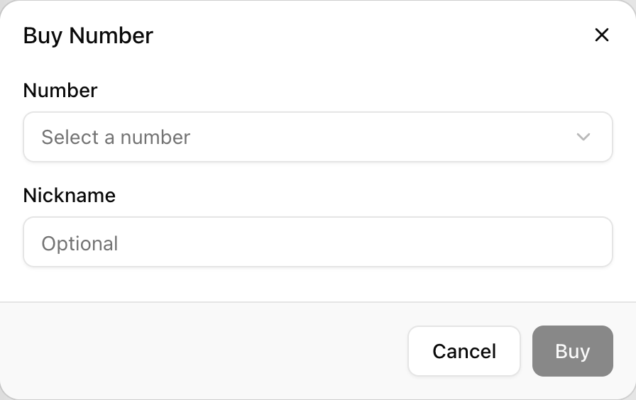
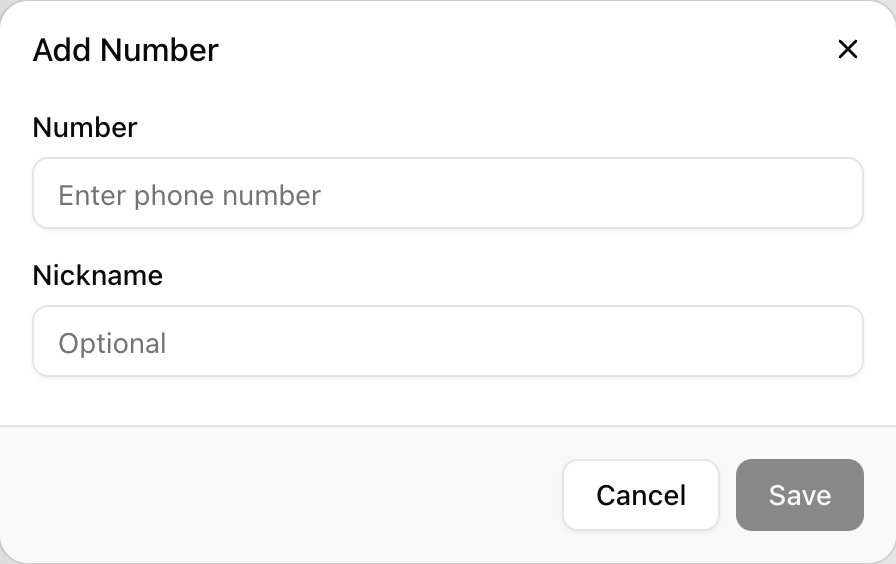

An agent answers calls only through a number assigned to it. **Numbers** is where you buy numbers from Colloqui, register numbers you already own, give each one a nickname, and decide which agent answers it. A typical setup is one purchased number per agent, with the agent set as the number's **Inbound Agent**; a receptionist agent that fronts several departments can hold several numbers and greet differently on each.

## How it works

When a call arrives on a number that Colloqui is hosting, the platform looks up which agent is assigned to that number as its inbound agent and starts that agent's latest published version. The dialled number and the caller's number are passed into the call as the `agent_number` and `user_number` variables, together with `call_id` and `direction`, so prompts and tools can use them. If the number has no inbound agent, there is nothing to start and the call is not answered.

Numbers are Australian. Validation accepts Australian numbers written either nationally (`0340270077`) or with the country code (`+61340270077`) and stores them in national form, which is how they appear in the list and in the API. A number can exist in only one workspace at a time.

Every number carries two assignments, **Inbound Agent** and **Outbound Agent**. Inbound is the one that matters for answering calls today. Outbound records which agent is meant to use the number for calls it places; see [Outbound calls](#outbound-calls) below for what that currently covers.

Assignment is tied to publishing. Giving an agent a number publishes it; taking an agent's last number away unpublishes it. The rules are spelled out under [Assignments and publishing](#assignments-and-publishing).

## Settings

| Setting (UI label) | API field | Values | Default | Notes |
|---|---|---|---|---|
| **Number** | `number` | valid Australian phone number, 1 to 12 characters | required | Normalised to national format. Must not already exist in any workspace. |
| **Nickname** | `nickname` | text, 1 to 255 characters | optional on create, required on update | Used in the `Assigned to <nickname>` version description. |
| **Inbound Agent** | `inbound_agent_id` | agent id or empty | empty | Must be an agent in the same workspace. Answers calls to the number. |
| **Outbound Agent** | `outbound_agent_id` | agent id or empty | empty | Must be an agent in the same workspace. |

The API object also includes `id`, `workspace_id`, `created_at` and `updated_at`, plus provisioning fields (`oneview_id`, `livekit_trunk_id`, `livekit_dispatch_id`) that are set by the platform and can be ignored.

## Buying a number

Numbers are offered from Colloqui's pool and are billed monthly to the workspace for as long as you hold them.

<Steps>
  <Step title="Open Numbers">
    Click **Numbers** in the sidebar, then the **+** button at the top of the list and choose **Buy Number**.
  </Step>
  <Step title="Check the payment method">
    If the workspace already has an active bundle but no card on file, the dialog shows **Payment method required** with a **Configure Payment Method** link instead of the form. Add a card and come back. A workspace with no bundle yet can buy a number without a card; the number is added to billing when the first bundle is activated.
  </Step>
  <Step title="Pick a number">
    <Frame caption="The Buy Number dialog.">
      
    </Frame>
    The **Number** dropdown lists what is available ("Loading numbers..." while it fetches, "No numbers available" if the pool is empty). Select one.
  </Step>
  <Step title="Nickname and buy">
    Enter an optional **Nickname** such as "Support Line" and click **Buy**. The button reads "Processing..." while the purchase is charged. If the charge fails the dialog shows "Payment failed. Please try again."; nothing is added.
  </Step>
</Steps>

The number appears in the list immediately, routed to Colloqui and ready for an agent. Its monthly charge is added to the workspace's existing subscription invoice, prorated from the day of purchase.

## Bringing your own number

You can register a number you already own so that an agent can answer it. Colloqui adds the number to its inbound trunk; you then route the number to Colloqui at your carrier.

<Steps>
  <Step title="Add the number">
    <Frame caption="The Add Number dialog for a number you already own.">
      
    </Frame>
    Click **+** and choose **Add Number**. In the **Add Number** dialog enter the **Number** ("Enter phone number") and an optional **Nickname**, then click **Save**. A number that fails validation shows "Number must be a valid phone number."; one already registered shows "Number already exists."
  </Step>
  <Step title="Route the number to Colloqui">
    Forward the number from your carrier or PBX to Colloqui's trunk. The exact steps depend on your carrier. Contact support with the number and your carrier's name and they will provide the trunk address and any authentication to configure. Until this is done, calls to the number do not reach Colloqui.
  </Step>
  <Step title="Assign an agent">
    Select the number in the list and set its **Inbound Agent**, as described below. Then call it.
  </Step>
</Steps>

Registering the number takes a moment on Colloqui's side. If a test call made seconds after saving is not answered, wait a minute and try again before troubleshooting the carrier side.

## Assigning agents

<Steps>
  <Step title="Select the number">
    Click the number in the list on the left. The detail form shows its **Nickname**, **Inbound Agent** and **Outbound Agent**.
  </Step>
  <Step title="Choose the agents">
    Use **Select an inbound agent** to pick the agent that should answer calls, and optionally **Select an outbound agent**. Both lists contain every agent in the workspace; each has a clear control to remove the assignment.
  </Step>
  <Step title="Save">
    Click **Save**. A toast confirms "Number updated successfully." The inbound agent is now live on the number and answers the next call.
  </Step>
</Steps>

## Assignments and publishing

Saving a number's agents triggers these checks for every agent that was added to or removed from the number:

| Change | What happens |
|---|---|
| Agent gains the number | The agent's current draft is published as a new version described `Assigned to <nickname>` (or `Assigned to <number>` when there is no nickname). If the agent was already published with no unpublished changes, this still mints a version. |
| Agent is removed but still has another number | The agent is republished with the same `Assigned to ...` description. |
| Agent is removed and has no numbers left | The agent goes to `draft`, and its live configuration is withdrawn. It cannot be published until it gets a number back. |

The same logic runs when a number is deleted, with the description `Number <number> deleted`.

<Warning>
Assigning a number is a publish. Whatever is in the agent's draft at that moment goes live, including half-finished edits. Finish and test the draft before attaching a number, or attach a test number first.
</Warning>

An agent can hold several numbers. Inside the call, `agent_number` is the number that was dialled, so one agent can branch on it:

```text
If {{agent_number}} is 0340270077, you are answering for the Melbourne office.
If {{agent_number}} is 0280000000, you are answering for the Sydney office.
```

## Outbound calls

The **Outbound Agent** field is stored and respected by the publishing rules above: an agent whose only number assignment is as an outbound agent counts as having a number and can be published. There is, however, no dashboard control or public API endpoint for placing an outbound call from a number. Calls today originate from the caller dialling in; the `direction` variable inside a call is always `inbound`. Transfers are the exception: a warm or cold transfer dials out to the destination on Colloqui's trunk as part of the inbound call. See [Transfer call](/build-an-agent/tools/transfer-call).

## Deleting a number

Select the number and click the bin icon next to **Save**. The **Delete Number** dialog asks "Are you sure you want to delete "0340270077"? This action cannot be undone." Confirming:

1. Clears the number's inbound and outbound agents.
2. Deletes the number from the workspace and removes it from Colloqui's inbound trunk.
3. Republishes or unpublishes the affected agents using the rules above (description `Number <number> deleted`).
4. For a purchased number, stops the monthly charge. The next invoice is credited for the unused part of the month.

A deleted number cannot be recovered from the dashboard. For a purchased number, buying it again, if it is still in the pool, treats it as a new purchase.

## By API

| Action | Endpoint |
|---|---|
| List numbers | [List Numbers](/api-reference/numbers/list): `GET /api/v1/numbers` |
| Register a number you own | [Create Number](/api-reference/numbers/create): `POST /api/v1/numbers` |
| Read one | [Show Number](/api-reference/numbers/show): `GET /api/v1/numbers/{id}` |
| Assign agents or rename | [Update Number](/api-reference/numbers/update): `PUT /api/v1/numbers/{id}` |
| Delete | [Delete Number](/api-reference/numbers/delete): `DELETE /api/v1/numbers/{id}` |

Buying from the pool is dashboard-only; `POST /api/v1/numbers` registers a number you already own, exactly like **Add Number**.

Assign an agent to a number. `nickname` is required on every update, even when it is unchanged:

```bash
curl -X PUT https://dashboard.colloqui.ai/api/v1/numbers/$NUMBER_ID \
  -H "Authorization: Bearer $COLLOQUI_API_KEY" \
  -H "Accept: application/json" \
  -H "Content-Type: application/json" \
  -d '{
    "nickname": "Support Line",
    "inbound_agent_id": "01HZXK3B6Y9R8F5QWES6V4M2N7",
    "outbound_agent_id": null
  }'
```

The response is the number object:

```json
{
  "data": {
    "id": "01m5twyk2f0v3n8q7k1r9e4xyz",
    "number": "0340270077",
    "nickname": "Support Line",
    "inbound_agent_id": "01HZXK3B6Y9R8F5QWES6V4M2N7",
    "outbound_agent_id": null,
    "workspace_id": "01m5twyqd2epnde7e5fjrkx7xr",
    "created_at": "2026-10-26T01:24:46.000000Z",
    "updated_at": "2026-11-03T02:10:12.000000Z"
  }
}
```

Updating through the API publishes and unpublishes agents exactly as the dashboard does. A number in another workspace, or an agent id from another workspace, is rejected: "The selected inbound agent doesn't belong to you."

List calls are cursor-paginated (`per_page` 1 to 100, `cursor`), and the list is scoped to the API key's workspace.

## Troubleshooting

**Calls to the number are not answered.** Check, in this order: the number has an **Inbound Agent**; that agent shows `published` status (an agent that lost its last number is in `draft` and off the air); for a number you brought yourself, the carrier forward is in place. A purchased number needs none of the carrier work.

**The agent answered with an old greeting after I assigned the number.** Assignment publishes the draft as it stood. If the greeting was edited after that, publish again from the agent page.

**My other agent dropped to draft when I moved a number.** That is the "last number" rule. Give the old agent another number if it should keep answering, or leave it in draft if it is retired.

**Buy Number shows "Payment method required".** The workspace has an active bundle, so a purchase charges immediately and needs a card. Use **Configure Payment Method** and retry.

**"Number already exists."** The number is already registered, possibly in another workspace you belong to. Numbers are unique across Colloqui.

**I cannot see the number from the API.** `GET /api/v1/numbers` returns only the workspace the API key was created in. Create a key in the right workspace or switch workspace in the dashboard before creating one.

## Related

- [Versioning and publishing](/versioning/overview): what assignment publishes
- [Numbers concept](/core-concepts/numbers)
- [Transfer call](/build-an-agent/tools/transfer-call): dialling out during a call
- [Billing](/workspace/billing): number charges and the payment method requirement
