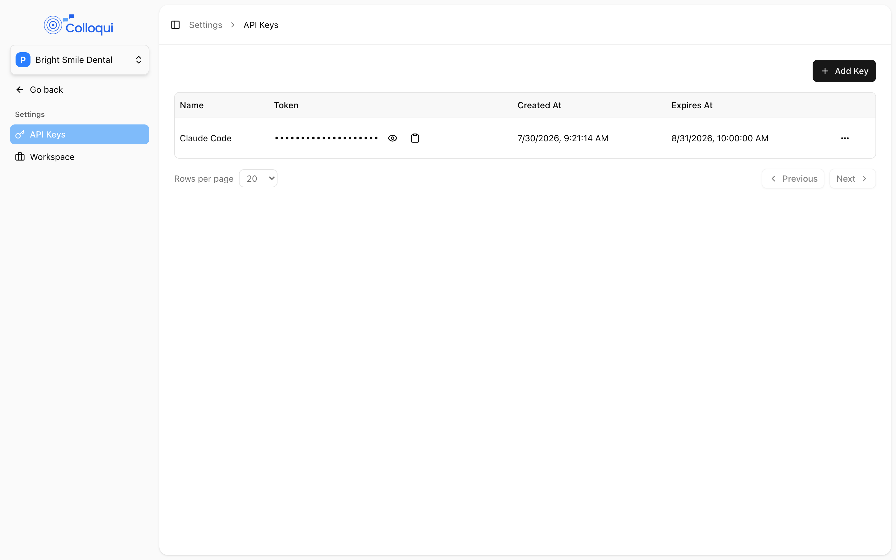

Every API request is authenticated with a Bearer token. Keys are created in the dashboard, belong to the workspace that was active when you created them, and act with the permissions of the user who created them. This page covers creating and revoking keys, the headers every request needs, how responses, errors and pagination are shaped, and the login endpoint for the rare case where you need to mint keys programmatically.

## Create an API key

Only workspace owners and admins can see or create keys. Developers and members do not have the **Settings** entry in the sidebar.

<Steps>
  <Step title="Switch to the right workspace">
    Use the workspace switcher at the top of the sidebar. A key is bound to the workspace that is current when it is created and cannot be moved afterwards.
  </Step>
  <Step title="Open Settings → API Keys">
    Click **Add Key**. The **Create API Key** dialog has two optional fields: **Name**, which should say where the key will be used, and **Expires At**, a date from today onward.
  </Step>
  <Step title="Click Create">
    <Frame caption="Settings → API Keys lists each key with its token, creation and expiry dates.">
      
    </Frame>
    The key appears in the table with its **Name**, **Token**, **Created At** and **Expires At**. The token is masked; use the eye icon to show it and the clipboard icon to copy it.
  </Step>
</Steps>

<Warning>
If you leave **Expires At** blank, the key is not permanent: by default it is issued with the platform's standard token lifetime rather than living forever. Set an explicit expiry date so you know when it ends, and watch for 401 responses from a key that worked yesterday.
</Warning>

A key with no name is called `Generated Token - ` followed by the creation time. The token stays visible on the API Keys page for as long as the key exists, so you can copy it again later; treat access to that page as access to the key.

## Make a request

Send the key in the `Authorization` header and always ask for JSON:

```bash
curl https://dashboard.colloqui.ai/api/v1/agents \
  -H "Authorization: Bearer $COLLOQUI_API_KEY" \
  -H "Accept: application/json"
```

For requests with a body, also send `Content-Type: application/json`:

```bash
curl -X POST https://dashboard.colloqui.ai/api/v1/agents \
  -H "Authorization: Bearer $COLLOQUI_API_KEY" \
  -H "Accept: application/json" \
  -H "Content-Type: application/json" \
  -d '{"name": "Harbour Dental reception"}'
```

<Warning>
Send `Accept: application/json` on every request, including GET. Without it, a request that fails validation returns an HTTP 302 redirect with no error body, which is easy to mistake for an authentication problem.
</Warning>

Three more rules that save debugging time:

- A `POST`, `PUT` or `PATCH` with `Content-Type: application/json` and a body that is not valid JSON is rejected with `400` and `{"message": "Invalid JSON payload", "error": "..."}` before anything else runs.
- Send a descriptive `User-Agent`. Requests from HTTP libraries with a generic default user agent can be blocked at the edge with a `403` that has nothing to do with your key.
- The base URL is `https://dashboard.colloqui.ai` with no trailing slash; every endpoint is under `/api/v1/`.

## Responses

A successful response wraps the result in a `data` key:

```json
{
  "data": {
    "id": "01m5twyp326sn8hznd4eypqjjm",
    "name": "Harbour Dental reception",
    "status": "draft"
  }
}
```

Create endpoints return `201`, deletes and logout return `204` with no body, and everything else returns `200`.

### Pagination

List endpoints use cursor pagination. Pass `per_page` (1 to 100, 20 by default) and, to move through the set, the `cursor` from the previous response's `meta`:

```json
{
  "data": [],
  "meta": {
    "per_page": 20,
    "next_cursor": "eyJpZCI6IjAxbTV0...",
    "prev_cursor": null,
    "next_page_url": "https://dashboard.colloqui.ai/api/v1/agents?cursor=eyJpZCI6IjAxbTV0...",
    "prev_page_url": null
  }
}
```

`next_cursor` is `null` when you have reached the end. Cursors are opaque; do not build them yourself.

### Date range filters

[List Call Histories](/api-reference/call-history/list) accepts `date_from` and `date_to`, each a date or date-time; `date_to` must not be earlier than `date_from`. Combine them with `per_page` and `cursor`:

```bash
curl "https://dashboard.colloqui.ai/api/v1/call-histories?date_from=2026-11-01&date_to=2026-11-03&per_page=100" \
  -H "Authorization: Bearer $COLLOQUI_API_KEY" \
  -H "Accept: application/json"
```

## Errors

| Status | When | Body |
|---|---|---|
| `400` | The JSON body could not be parsed | `{"message": "Invalid JSON payload", "error": "Syntax error"}` |
| `401` | Missing, revoked or expired key | `{"message": "Unauthenticated."}` |
| `403` | The key's user is not allowed to do this, for example a member creating an agent | `{"message": "This action is unauthorized."}` |
| `404` | No object with that id in a workspace you belong to | `{"message": "..."}` |
| `422` | Validation failed | `{"message": "...", "errors": {"field": ["..."]}}` |

A `422` carries every failing field under `errors`, keyed by its dotted path, while `message` shows only the first problem followed by "(and N more errors)". Always read `errors` in full:

```json
{
  "message": "The LLM provider field is required. (and 2 more errors)",
  "errors": {
    "llm_config.provider": ["The LLM provider field is required."],
    "multi_node_config.nodes.0.id": ["The node field must be a valid ULID."],
    "tts_config.streaming_latency": ["The streaming latency field is required when provider is elevenlabs."]
  }
}
```

The API does not currently enforce a per-key request rate limit, so you should not see `429` from Colloqui itself. Build clients to back off on `429` and `5xx` anyway, and keep polling loops (ingestion status, call history) to a few requests a minute.

## Workspace scoping

An API key reads and writes the workspace it was created in:

- List endpoints (`/agents`, `/numbers`, `/knowledge-bases`, `/guardrails`, `/call-histories`, `/webhooks`, `/api-keys`) return only that workspace's objects. There is no parameter to select a different workspace; a `workspace_id` query parameter is ignored.
- Create endpoints create in that workspace.
- Fetching an object by id works for any workspace you are a member of, because access is checked against the object's own workspace and your membership of it.
- [List Workspaces](/api-reference/workspaces/list) is the exception: it returns every workspace your user belongs to.

To work in another workspace, create a key there. If you are removed from a workspace, keys you created in it stop being useful for it.

## Revoking a key

Delete the key from **Settings → API Keys** (row menu → **Delete** → **Delete API Key**), or call [Revoke API Key](/api-reference/api-keys/revoke) with the key's `id` from [List API Keys](/api-reference/api-keys/list). Revocation is immediate: the next request with that key gets `401`. A key can only be revoked from the workspace it belongs to; revoking from another workspace returns `422` with "The specified token does not exist or does not belong to this user workspace."

## Managing keys by API

[Create API Key](/api-reference/api-keys/create) takes the same two optional fields as the dialog and returns the plain token once in the `token` field:

```bash
curl -X POST https://dashboard.colloqui.ai/api/v1/api-keys \
  -H "Authorization: Bearer $COLLOQUI_API_KEY" \
  -H "Accept: application/json" \
  -H "Content-Type: application/json" \
  -d '{"name": "CI deploys", "expiration": "2027-11-04"}'
```

```json
{
  "data": {
    "id": 42,
    "name": "CI deploys",
    "token": "kfhex67Y19kDP1ZR7RZE0ejnbCfTDJg90UETediObe97b7b7",
    "created_at": "2026-11-04T01:10:00+00:00",
    "expires_at": "2027-11-04T00:00:00+00:00"
  }
}
```

`expiration` must be in the future. The new key is bound to the same workspace as the key that created it.

## Logging in with email and password

If you are building something that must obtain a key without a person opening the dashboard, [Login](/api-reference/authentication/login) exchanges an email and password for a short-lived login token:

```bash
curl -X POST https://dashboard.colloqui.ai/api/v1/auth/login \
  -H "Accept: application/json" \
  -H "Content-Type: application/json" \
  -d '{"email": "you@example.com", "password": "...", "workspace_id": "01kfy63vz7v5w25nk0xa3xsj5g"}'
```

- `workspace_id` is optional. Without it the token is bound to your default workspace; with it, to that workspace, which must be one you belong to.
- A wrong password returns `422` with `errors.password`; an unknown `workspace_id` returns `422` with `errors.workspace_id`.
- The login token expires after the platform's standard lifetime. Use it to call [Create API Key](/api-reference/api-keys/create) for a long-lived key bound to the same workspace, then discard it with [Logout](/api-reference/authentication/logout), which revokes the token that made the request.

This is the only way to obtain a key for a workspace other than the one your existing key is bound to without using the dashboard. For your own scripts and integrations, a key from the dashboard is simpler.

## Related

- [API reference](/api-reference/introduction) for every endpoint
- [Workspaces](/core-concepts/workspaces) for roles and what each can do
- [Agents](/core-concepts/agents) for the object most requests work on
