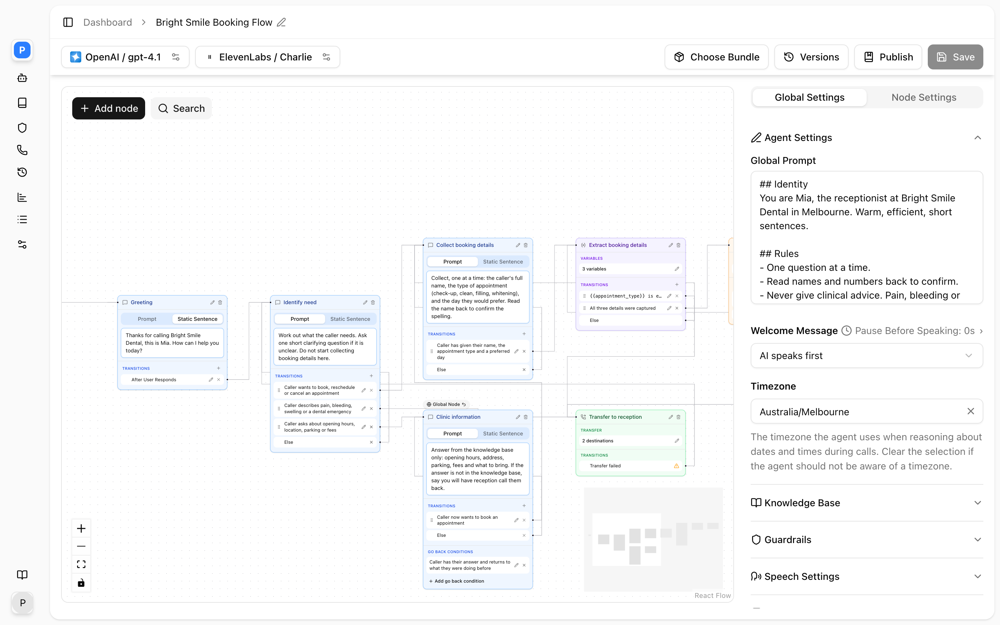

Colloqui is a platform for AI phone agents. You describe how an agent should behave, give it a voice, attach a phone number, and it answers calls: it listens, understands, replies in speech, and takes actions such as transferring the caller, sending an SMS, saving details, or calling your own API. Everything is managed from the dashboard at [dashboard.colloqui.ai](https://dashboard.colloqui.ai) and from a REST API that exposes the same objects.

A typical first agent is a receptionist for a clinic. It greets the caller, works out whether they want to book, change or cancel an appointment, collects their name and phone number, answers questions about opening hours from a knowledge base, and either transfers to the front desk or ends the call politely. That agent is one object in Colloqui, built in about fifteen minutes. The [Quickstart](/get-started/quickstart) walks through it.

## Two kinds of agent

<Frame caption="A conversation-flow agent open in the editor.">
  
</Frame>

Every agent is one of two types. You choose when you create it and cannot change it afterwards, though you can duplicate an agent and rebuild it the other way.

<CardGroup cols={2}>
  <Card title="Single Prompt" icon="file-lines">
    One global prompt drives the whole call. At every turn the model reads the prompt and the conversation so far, decides what to say, and decides whether to use a tool. Fastest to build. Best for open conversations: general enquiries, FAQ answering, message taking.
  </Card>
  <Card title="Conversation Flow" icon="diagram-project">
    The call is a graph of nodes on a canvas. Each node has its own instruction and its own exits, and the flow decides when the agent moves on. Best when the call must follow a structure: collect details in order, confirm them, call your API, then end. See [Conversation flows](/conversation-flows/overview).
  </Card>
</CardGroup>

Both types share the same voice, transcription, language model, knowledge base, guardrail and call settings. The difference is only in how the conversation itself is described: one prompt, or a flow of nodes.

## What lives in a workspace

Everything you create belongs to a workspace. A workspace is the unit of team membership and billing, and nothing is shared across workspaces. Inside one you will find:

| Object | What it is | Guide |
|---|---|---|
| Agents | The thing that answers calls: prompt or flow, model, voice, transcription, tools, knowledge bases, guardrails and call settings in one object | [Agents](/core-concepts/agents) |
| Phone numbers | Australian numbers, bought from Colloqui or brought from your carrier. Each has an inbound agent and an outbound agent | [Phone numbers](/core-concepts/numbers) |
| Knowledge bases | Web pages, files and pasted text the agent can answer from | [Knowledge bases](/core-concepts/knowledge-bases) |
| Guardrails | Rules that block or redirect what callers say and what the agent says | [Guardrails](/build-an-agent/guardrails) |
| Call history | Every call with its transcript, recording, duration, cost and extracted data | [Call history](/operate/call-history) |
| Analytics | Call volume and performance across agents | Dashboard |
| Webhooks | Endpoints you register to receive events | [Webhooks](/operate/webhooks) |
| API keys | Bearer tokens bound to the workspace they were created in | [Authentication](/get-started/authentication) |
| Members | People with a role: owner, admin, developer or member, optionally limited to certain modules and agents | [Workspaces](/core-concepts/workspaces) |
| Billing | The payment method, the bundle each agent runs on, and invoices | [Billing](/workspace/billing) |

Most customers need exactly one workspace. Agencies create one per client.

## How a call flows

Understanding the order of events makes every other page easier to read.

1. **A call arrives on a number.** The number's **Inbound Agent** is looked up. Calls to a number with no inbound agent are not answered. Colloqui lets the line ring for the agent's ring time (30 seconds by default) before connecting.
2. **The published version is loaded.** Calls always run the agent's latest published version, never the draft you are editing. An agent cannot be published until it has a number, and assigning a number publishes it for you.
3. **Someone speaks first.** If the agent speaks first it says its welcome message, either a fixed sentence or one the model generates from the prompt. If the caller speaks first the agent waits, with an optional timeout after which it speaks anyway. In a conversation flow the start node's instruction is the greeting.
4. **The turn loop runs.** Each time the caller finishes speaking, their words are transcribed, checked against any input guardrails, and handed to the model together with the prompt, the conversation so far, and, if the agent has a knowledge base and the message looks like a question, the most relevant passages from it. The model's reply is checked against output guardrails, converted to speech and played. How quickly the agent responds and how easily the caller can interrupt it are settings on the agent.
5. **Tools run when needed.** In a single-prompt agent the model decides when to call a tool: end the call, transfer, send an SMS, extract a variable, or call your API. In a flow, dedicated nodes run their action as soon as the flow reaches them, and the flow's transitions decide what happens next.
6. **The call ends.** The agent hangs up through an End Call tool or node, the caller hangs up, a transfer connects the caller elsewhere, or the maximum call duration (60 minutes by default) is reached.
7. **The record is written.** Call History gets the transcript, the dual-channel recording if recording is on, the duration, the cost, any extracted variables and tool results. Webhooks you registered are notified of events as they ship.

Outbound calls use the number's **Outbound Agent** in the same way from step 2 onward.

## Draft, publish, version

Every agent has one draft, which is what you edit, and a history of published versions, which is what answers calls. Saving changes the draft only. **Publish** snapshots the draft as the next numbered version, with an optional description, and makes it live on every number assigned to the agent. Earlier versions can be restored into the draft. See [Versioning and publishing](/versioning/overview).

## Dashboard and API

The dashboard and the API edit the same objects. Anything you can do on the agent page you can do with [Update Agent](/api-reference/agents/update), and the agent object you get back is the one the dashboard shows. Two things to know before you script against it:

- Every request needs a Bearer API key and the header `Accept: application/json`. Without the header a failed request redirects instead of returning an error. See [Authentication](/get-started/authentication).
- An API key belongs to one workspace. List endpoints return only that workspace's objects.

## Where to go next

<CardGroup cols={2}>
  <Card title="Quickstart" icon="rocket" href="/get-started/quickstart">
    Account to live phone call in about fifteen minutes.
  </Card>
  <Card title="Agents" icon="robot" href="/core-concepts/agents">
    Every setting an agent has, and how drafts and versions work.
  </Card>
  <Card title="Prompt engineering" icon="pen-to-square" href="/core-concepts/prompt-engineering">
    Patterns that make voice prompts reliable.
  </Card>
  <Card title="Conversation flows" icon="diagram-project" href="/conversation-flows/overview">
    Build structured calls as a graph of nodes.
  </Card>
  <Card title="Tools" icon="wrench" href="/core-concepts/tools">
    Transfer, SMS, extract variables, call your API.
  </Card>
  <Card title="API reference" icon="code" href="/api-reference/introduction">
    Every endpoint, with request and response shapes.
  </Card>
</CardGroup>

If you are coming from another voice-agent platform, [Migrating from Retell](/migrate/from-retell) maps the concepts and fields.
