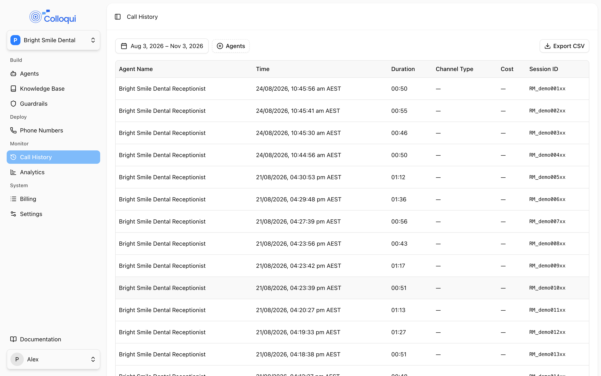
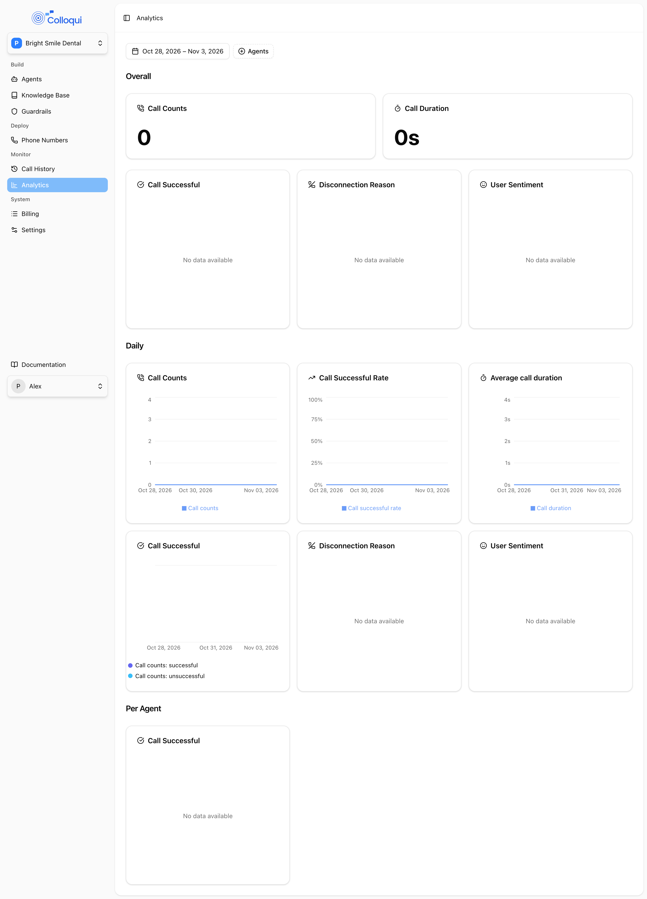

**Call History** lists every call your agents have handled, one row per call, and opens each one into a detail panel with the transcript, the recording and an automatic analysis of how the call went. Use it to check what a caller actually said before changing a prompt, to listen to a transfer that did not connect, or to export a month of calls for a client report. **Analytics** sits beside it and turns the same rows into counts, rates and daily charts.

## How a call becomes a row

1. **Call starts.** When a caller connects to a number, Colloqui creates the row with the agent, the caller's number (`from`), the dialled number (`to`), the start time and a status of `ongoing`.
2. **Call ends.** When the caller's leg leaves, the row is updated with the end reason and the status becomes `ended`. If the caller hung up themselves the outcome is set to `successful`; any other ending leaves the outcome empty until the analysis fills in more detail.
3. **Duration and usage.** Shortly after the call, the precise start and end times are fetched and the duration is written. This is also when the call's minutes are reported to the agent's bundle. Because of this delay, a call that ended a minute ago can show no duration yet.
4. **Recording.** If recording is enabled on the agent, the dual-channel recording is processed and normalised. The row's recording status moves from `processing` to `ready`, or to `failed` if processing did not succeed. With recording off, the status is `not_available`.
5. **Analysis.** The transcript is analysed after the call and the result is attached to the row a few minutes later: summaries, outcome, sentiment and a set of flags, listed under [Analysis fields](#analysis-fields).

Rows are kept for as long as the workspace exists; there is no automatic deletion of call history.

## The list

<Frame caption="The Call History list with the date range and agent filters.">
  
</Frame>

| Column | Meaning |
|---|---|
| **Agent Name** | The agent that answered. |
| **Time** | Start time, in your browser's timezone. |
| **Duration** | `mm:ss`, or `hh:mm:ss` for calls of an hour or more. Empty until the post-call update runs. |
| **Channel Type** | `phone_call` for calls on a number. |
| **Cost** | The call's cost, shown to three decimals, when one is recorded. |
| **Session ID** | The call's unique id. The same value is `call_id` inside the call and `session_id` in the API. |

Filters sit above the list:

- **Date range.** Presets **Today**, **Last 7 days**, **Last 4 weeks**, **Last 3 months**, **Week to date**, **Month to date** and **Year to date**, or pick a range on the calendar. With no range chosen the list shows the last 3 months.
- **Agent.** Pick one or more agents; the list shows every agent you have access to.

Rows are ordered newest first and paginated with **Rows per page** and next/previous controls.

Members whose access has been limited to specific agents (see [Workspace settings](/workspace/overview)) see only calls for those agents, in the list, the export and Analytics alike.

## Export

**Export CSV** downloads every call matching the current date range and agent filter, oldest first, as `call-history-<from>-to-<to>.csv`. The columns are:

`Session ID, Agent Name, Agent ID, Channel Type, Direction, From, To, Start Time, End Time, Duration, Cost, Call Successful, Call Status, User Sentiment, Disconnect Reason`

Times are ISO 8601, duration is formatted as in the list, cost has three decimals, and the last two columns come from the analysis so they are empty for calls not yet analysed. The export is not limited by the page size.

## A call

Click a row to open it. Use the up and down arrows at the top of the panel to step through the list without closing it.

**Header.** The agent name with a copy button for its id, the **Session ID** with a copy button, `Phone Call: <from> → <to> (inbound)`, the start and end times with the duration in brackets, and **Cost**. Copy the Session ID when raising a support request.

**Recording.** A player with a download button when the recording is ready. The panel shows "Call recording is processing…" while it is being prepared and "Call recording is disabled" when the agent had recording off. Downloads are named after the Session ID, as `.wav` for a normalised recording or `.ogg` for the source.

**Conversation Analysis** has two parts:

- **Preset Analysis**, always shown: **Call Successful** (the outcome: `successful` when the caller ended the call normally), **Call Status** (`ongoing` or `ended`), **User Sentiment** and **Disconnection Reason** ("The reason the call ended"), the last two from the analysis once it arrives.
- **AI Analysis**, present when the analysis has arrived. The full set of fields is returned by the API (below); the dashboard currently shows the preset rows.

**Tabs.** **Transcription** shows the call turn by turn, including **Tool Result** entries so you can see what the agent did (a transfer, an SMS, a custom function and its HTTP status) as well as what it said; "No transcription available." appears for calls not yet analysed. **Data** lists Session ID, Agent, Channel, Direction, From, To, Duration, Cost, Status, Outcome and End Reason.

## Recording statuses

| Status | Meaning |
|---|---|
| `processing` | The call has ended and the recording is being prepared. Reopen the call in a minute. |
| `ready` | Normalised, dual-channel recording available to play and download. |
| `not_available` | Recording was disabled on the agent when the call ran. |
| `failed` | Processing did not complete. The source recording is served if it exists; otherwise contact support with the Session ID. |

Recording is on by default for new agents and is controlled per agent under call settings; see [Voice behavior](/build-an-agent/voice-behavior).

## Analysis fields

The analysis is produced from the transcript after the call and attached to the row as `analysis`. In the API it carries:

| Group | Fields |
|---|---|
| Summary | `summary_concise`, `summary_detailed`, `call_outcome`, `call_outcome_confidence`, `call_type`, `primary_reason`, `disconnect_reason` |
| Sentiment | `overall_sentiment`, `overall_sentiment_score`, `customer_sentiment`, `customer_sentiment_score`, `agent_sentiment`, `agent_sentiment_score`, `sentiment_trajectory` |
| Topics | `keywords`, `topics`, `customer_intent` |
| Compliance | `compliance_score`, `compliance_disclosures_missed`, `compliance_regulatory_flags` |
| Churn and upsell | `churn_risk_level`, `churn_risk_score`, `churn_recommended_actions`, `upsell_detected`, `upsell_detection_confidence`, `upsell_opportunities` |
| Effort and escalation | `customer_effort_score`, `repeat_contact_indicator`, `customer_effort_friction_points`, `escalation_risk_level`, `was_escalated`, `escalation_handled_well`, `escalation_triggers` |
| Agent performance | `agent_professionalism`, `agent_empathy`, `agent_resolution_effectiveness`, `agent_product_knowledge`, `agent_overall_confidence`, `agent_strengths`, `agent_improvement_areas` |
| Conversation | `conversation_estimated_duration`, `conversation_speaker_balance`, `conversation_holds_or_transfers`, `conversation_resolution_speed`, `conversation_rapport_quality` |
| Follow-up | `action_items`, `emerging_issues` |
| Transcript | `transcript_preview`, `transcript_full` (a JSON string of turns) |
| Processing | `model_used`, `processing_time_ms`, `cost_estimate_usd` |

`customer_sentiment` is what the dashboard shows as **User Sentiment** and is the field Analytics counts. `disconnect_reason` is the **Disconnection Reason**. Fields are free text or arrays as produced by the analysis; treat values as labels rather than a fixed enumeration.

## Analytics

<Frame caption="The Analytics page.">
  
</Frame>

**Analytics** uses the same date range and agent filters as Call History, defaulting to the last 7 days, and shows these cards:

| Card | What it measures |
|---|---|
| **Call Counts** | Number of calls in the range, with a daily bar chart. |
| **Average call duration** and **Call Duration** | Mean duration of calls that have a duration, overall and per day. |
| **Call Successful** | Calls with outcome `successful` against the rest, as a total and per day. |
| **Call Successful Rate** | Successful calls as a percentage of all calls, per day. |
| **Call Successful** (by agent) | Successful calls, total calls and the rate for each agent, highest first. |
| **Disconnection Reason** | Breakdown of the end reason recorded when the caller's leg left, overall and per day. |
| **User Sentiment** | Breakdown of `customer_sentiment` across analysed calls, overall and per day. |

"Successful" throughout means the caller ended the call themselves rather than the call being ended by the agent, a transfer, a timeout or an error. It is a proxy for "the caller got what they came for and hung up", so read it alongside the summaries rather than on its own.

## By API

| Action | Endpoint |
|---|---|
| List calls | [List Call Histories](/api-reference/call-history/list): `GET /api/v1/call-histories` |
| Read one call with analysis | [Show Call History](/api-reference/call-history/show): `GET /api/v1/call-histories/{id}` |

The list accepts `date_from` and `date_to` (dates, `date_to` must not be before `date_from`), `per_page` (1 to 100, default 20) and `cursor`. Without dates it returns the workspace's whole history, newest first. Pass the `meta.next_cursor` value back as `cursor` to page.

```bash
curl "https://dashboard.colloqui.ai/api/v1/call-histories?date_from=2026-11-01&date_to=2026-11-03&per_page=50" \
  -H "Authorization: Bearer $COLLOQUI_API_KEY" \
  -H "Accept: application/json"
```

Each row:

```json
{
  "id": "01m5twyqdk7g0627bvpqskt5jk",
  "start_time": "2026-11-03T01:03:53.000000Z",
  "end_time": "2026-11-03T01:08:35.000000Z",
  "duration": "04:42",
  "channel_type": "phone_call",
  "cost": 0.874,
  "session_id": "RM_8f2c1b...",
  "end_reason": "CLIENT_INITIATED",
  "session_status": "ended",
  "from": "0412345678",
  "to": "0340270077",
  "direction": "inbound",
  "session_outcome": "successful",
  "call_recording_status": "ready",
  "e2e_latency": null,
  "agent_id": "01m5twyqcg5bx92w0xw52163tw",
  "workspace_id": "01m5twyqd2epnde7e5fjrkx7xr",
  "created_at": "2026-11-03T01:03:54.000000Z",
  "updated_at": "2026-11-03T01:30:02.000000Z",
  "analysis": null
}
```

`analysis` is `null` in the list and until the analysis has run; `GET /api/v1/call-histories/{id}` returns it populated with the fields above. `session_id` is the value shown as **Session ID** in the dashboard and matches the `call_id` variable inside the call, which lets you link a [Custom Function](/build-an-agent/tools/custom-function) request to the call that made it by sending `{{call_id}}` in its body.

## Troubleshooting

**A call I just made is not in the list.** Rows are created when the call connects, but the list only shows the selected date range in your browser's timezone. Check **Today** is selected and that the call was answered by an agent in this workspace.

**Duration, cost or analysis are empty.** They arrive in stages after the call ends: duration within a few minutes, analysis after that. Reopen the call later. A call still marked `ongoing` long after it ended usually means the end event was not received; raise it with support with the Session ID.

**"Call recording is disabled" but I want recordings.** Turn recording on in the agent's call settings and publish. It applies to calls from then on; earlier calls stay without a recording.

**The export is missing calls.** The export uses the same date range and agent filter as the list. Clear the agent filter and widen the dates. Members limited to specific agents only ever export those agents' calls.

**Analytics shows a low success rate for a transfer-heavy agent.** A transferred call is ended by the transfer, not the caller, so it does not count as `successful`. Judge transfer agents by the Disconnection Reason breakdown and the summaries instead.

## Related

- [Analytics and call outcomes in Workspace settings](/workspace/overview): who can see what
- [Voice behavior](/build-an-agent/voice-behavior): recording and call limits
- [Webhooks](/operate/webhooks): getting call data pushed to you
- [Custom function](/build-an-agent/tools/custom-function): correlating with `call_id`
