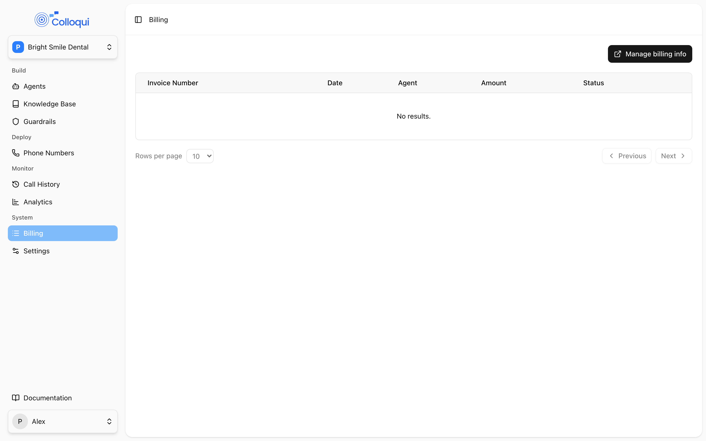
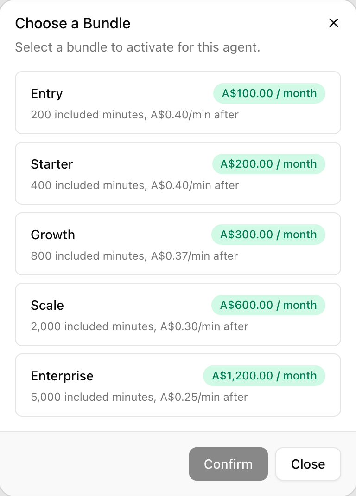

Billing is per workspace: one payment method, one set of invoices, and a bundle for each agent that runs calls. A bundle is a monthly subscription with a fixed base fee, a number of included call minutes, and a per-minute overage rate once those are used. Purchased numbers and SMS messages are added to the same invoices. A typical setup is a card on file, a bundle sized to each agent's expected call volume, and owners and admins watching for the usage alert emails that arrive at 50%, 75% and 100% of the included minutes.

## How it works

1. **Payment method.** The workspace needs a card on file before agents can be saved or published. Cards are managed in the billing portal, reached from **Billing → Manage billing info** or from the **Configure Payment Method** link that appears wherever a card is missing.
2. **Bundle per agent.** Activating a bundle on an agent creates a subscription for that agent with two parts: the base fee, billed monthly in advance, and a metered overage item for minutes beyond the included allowance. Changing bundle swaps both parts and invoices the prorated difference immediately.
3. **Usage.** A few minutes after each call ends, its duration in seconds is reported against the agent's overage meter. Included minutes are measured per billing period; whatever exceeds them is charged at the bundle's overage rate on the next invoice.
4. **Alerts.** About two minutes after each call, the agent's usage for the current period is compared with its included minutes. Crossing 50%, 75% or 100% emails every owner and admin, at most once per threshold per agent per hour.
5. **Numbers and SMS.** A purchased number adds a recurring line to the workspace's subscription, prorated from the day of purchase. Each SMS the agent sends is reported to a separate SMS meter on the same subscription.
6. **Invoices.** Everything lands on hosted invoices listed on the **Billing** page, with the upcoming invoice showing the current period's charges so far.

## Payment method

<Frame caption="The Billing page: invoices and the Manage billing info link.">
  
</Frame>

Whether a card is required depends on where you are:

| Where | Rule |
|---|---|
| Agent editor | **Save** and **Publish** are disabled until a card is on file. The page shows "Payment method required. Changes to this agent cannot be saved until one is configured." with a **Configure Payment Method** button. |
| Agents list | The same banner appears once the workspace has a billing account but no card. |
| Buy Number | A card is required only when the workspace already has an active bundle, because the purchase charges immediately. A workspace with no bundle yet can buy a number without a card; it is billed from the first bundle's invoice. |
| Add Number (your own) | No card needed. |

<Steps>
  <Step title="Open the billing portal">
    Click **Billing** in the sidebar, then **Manage billing info**. Or click **Configure Payment Method** on the banner.
  </Step>
  <Step title="Add a card">
    Add the card and billing details in the portal. The portal is also where you update the billing email and address that appear on invoices.
  </Step>
  <Step title="Return to the dashboard">
    The banner clears and **Save** and **Publish** become available.
  </Step>
</Steps>

## Bundles

Each agent runs on its own bundle. The agent's toolbar shows **Choose Bundle** when none is active, or the bundle's name once one is; the **Bundle** column on the **Agents** page shows the same.

<Steps>
  <Step title="Open the bundle dialog">
    <Frame caption="Choose a Bundle on the agent page.">
      
    </Frame>
    On the agent page click **Choose Bundle**. The **Choose a Bundle** dialog ("Select a bundle to activate for this agent.") lists the available bundles. If the list is empty it reads "No bundles are available."; contact support.
  </Step>
  <Step title="Compare">
    Each bundle shows its name, the base fee as "$X / month", and "N included minutes, $Y/min after". The active bundle, if any, carries a **Current** badge.
  </Step>
  <Step title="Confirm">
    Select a bundle and click **Confirm** ("Activating..."). The subscription is created and charged to the card on file. If the charge needs further action or fails, the error is shown under the list and nothing is activated.
  </Step>
</Steps>

To move up or down, click the bundle name on the agent page. The dialog becomes **Change Bundle** ("Select a different bundle to upgrade or downgrade this agent."); choose another bundle and click **Change Bundle** ("Updating..."). The change takes effect immediately: the new base fee and overage rate apply from now, and the prorated difference for the rest of the period is invoiced straight away. Included minutes are those of the new bundle.

Bundles are managed by workspace owners and admins. Developers see the bundle name but cannot open the dialog.

### Agents without a bundle

An agent with no active bundle has no included minutes and no overage rate. Its calls and SMS messages are not metered to any subscription and no usage alerts are sent for it. Activate a bundle before putting an agent on a live number; if you are running trials or evaluations, ask support how unbundled usage is handled on your account.

### Usage alerts

| Threshold | When it is sent | To whom |
|---|---|---|
| 50%, 75%, 100% of included minutes | Checked about two minutes after each call ends; the highest threshold crossed is sent | Every owner and admin of the workspace, by email |

The email subject is `Agent "<name>" has reached <N>% of its call usage`, and the body links to the agent. At 100% it adds that further calls incur overage charges and suggests reviewing the plan. The same threshold is not repeated for the same agent within an hour, so a busy agent that crosses 75% produces one email, not one per call. Alerts reset with the billing period.

## Numbers

Purchased numbers are billed monthly to the workspace for as long as you hold them, as a single line with a quantity equal to the number of purchased numbers, on the subscription of the first agent that had a bundle. Buying adds one to the quantity and charges the prorated amount for the rest of the period immediately; deleting a number reduces the quantity and credits the unused part of the period on the next invoice. Numbers you bring yourself are not charged.

## SMS

Messages sent by the [Send SMS](/build-an-agent/tools/send-sms) tool are reported to the agent's SMS meter as they are sent and appear as a separate line on the invoice. SMS is mobile-only; a message to a landline is rejected before anything is sent or charged.

## Invoices

**Billing** lists invoices newest first with **Invoice Number**, **Date**, **Agent** (linked to the agent whose subscription the invoice belongs to), **Amount** and **Status**, plus a link to the hosted invoice for viewing and paying. Expand a row to see its line items with description, quantity and amount. The first row, labelled **Upcoming Invoice**, is the draft for the current period: base fee, number lines and metered usage so far. **Rows per page** and the paging controls move through older invoices. Invoice numbering, tax handling and receipts are those of the billing portal.

Deleting an agent cancels its bundle immediately; the **Delete Agent** dialog says so when a subscription is active. The final invoice includes usage up to the cancellation.

## By API

| Action | Endpoint |
|---|---|
| List an agent's subscriptions | [List Agent Subscriptions](/api-reference/subscriptions/list): `GET /api/v1/workspaces/{workspace_id}/agents/{agent_id}/subscriptions` |
| Activate a bundle | [Subscribe Agent](/api-reference/subscriptions/create): `POST .../subscriptions` with `product_id` |
| Change bundle | [Update Agent Subscription](/api-reference/subscriptions/update): `PUT .../subscriptions/{id}` with `product_id` |
| Invoices | [Billing History](/api-reference/workspaces/billing-history): `GET /api/v1/workspaces/{workspace_id}/billing/history` (`limit`, default 10; `starting_after` for paging) |
| Billing portal | [Billing Info](/api-reference/workspaces/billing-info): `GET /api/v1/workspaces/{workspace_id}/billing/info` |
| Cards on file | [Payment Methods](/api-reference/workspaces/payment-methods): `GET /api/v1/workspaces/{workspace_id}/billing/payment-method` |

```bash
curl -X POST https://dashboard.colloqui.ai/api/v1/workspaces/$WORKSPACE_ID/agents/$AGENT_ID/subscriptions \
  -H "Authorization: Bearer $COLLOQUI_API_KEY" \
  -H "Accept: application/json" \
  -H "Content-Type: application/json" \
  -d '{"product_id": "01m5twykvnpjsgg97a7aq4tcmj"}'
```

`product_id` is the id of a bundle. The subscription object returned carries `stripe_status` (`active` once the first charge succeeds, `incomplete` if it needs action), `stripe_price`, `quantity`, `ends_at` and timestamps. Subscribing an agent that already has an active bundle returns an error; use update instead. All three subscription endpoints require the owner or admin role, like the dashboard.

## Troubleshooting

**I cannot save or publish an agent.** No card on file. Use **Configure Payment Method** on the banner, add a card, and reload the agent.

**"Payment failed. Please try again." when buying a number.** The immediate prorated charge was declined. Check the card in **Manage billing info** and retry. Nothing is added until the charge succeeds.

**The bundle dialog says no bundles are available.** No bundles are enabled for the workspace. Contact support.

**I changed bundle and got an invoice straight away.** That is the prorated difference between the old and new base fees for the rest of the current period. The regular monthly invoice follows on the usual date.

**I got a 100% usage email but calls are still being answered.** Calls continue; minutes beyond the allowance are charged at the overage rate shown in the bundle dialog. Move to a larger bundle if that is cheaper.

**A call ended but my usage has not moved.** Duration is written and reported a few minutes after the call, and the alert check runs about two minutes after that. Check again shortly.

**Two agents, one invoice for numbers.** Numbers are billed as one shared line on the subscription of the first agent that was given a bundle, not split per agent. The **Agent** column on that invoice is the agent whose subscription carries them.

## Related

- [Numbers](/deploy/numbers): buying and deleting numbers
- [Send SMS](/build-an-agent/tools/send-sms)
- [Workspace settings](/workspace/overview): who can manage billing
- [Versioning and publishing](/versioning/overview): the payment method requirement on publish
