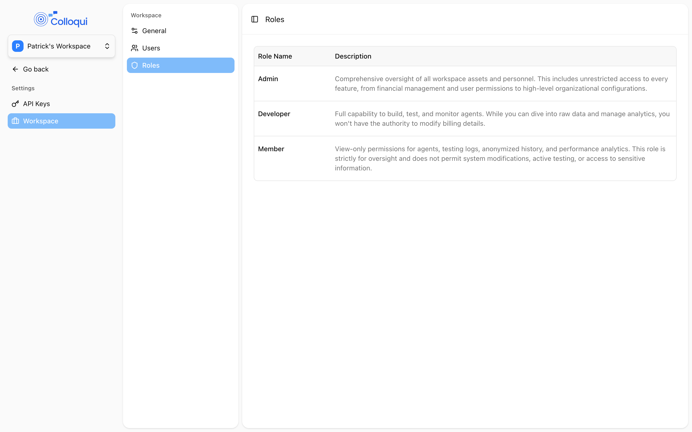
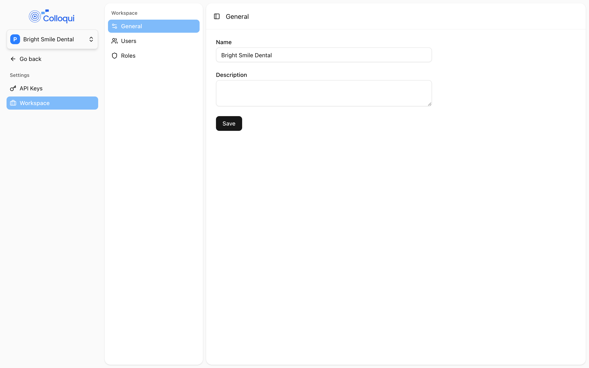
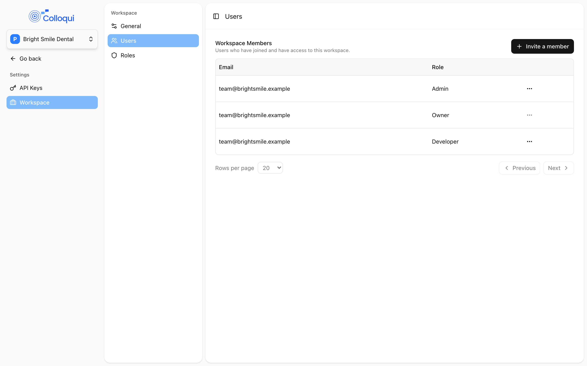

A workspace holds a set of agents, numbers, knowledge bases, guardrails and call history, with its own members, billing and API keys. **Settings → Workspace** is where you name the workspace, invite people and decide what each of them can see and do. An agency that builds agents for several clients usually gives each client its own workspace, invites the client's staff as members so they can listen to calls, and keeps its own engineers as developers.

## How access works

Access is decided in three layers, checked in this order on every page and API call:

1. **Role.** Each member has one role in the workspace: `owner`, `admin`, `developer` or `member`. Owners and admins can do everything. Developers can create and change things. Members can only look.
2. **Modules.** Developers and members are additionally limited to the modules they have been granted: **Agents**, **Knowledge base**, **Guardrails**, **Phone numbers**, **Call history** and **Analytics**. A developer with no **Phone numbers** module cannot open **Numbers** at all. Owners and admins always have every module.
3. **Agent access.** Developers and members can be limited to a list of specific agents. With a list, they see only those agents, their call history and their analytics. With no list, they see every agent the module grants. Owners and admins are never limited.

The same rules apply to the API: a key inherits the role, modules and agent list of the user who created it, within the workspace it was created in.

## Roles

<Frame caption="The Roles page.">
  
</Frame>

| Role | Can | Cannot |
|---|---|---|
| **Owner** | Everything an admin can, plus delete the workspace. The creator of the workspace. | Be removed or re-roled. There is exactly one owner. |
| **Admin** | Rename the workspace, invite, re-role and remove members, create API keys, manage bundles and billing, and build, publish and delete agents, numbers, knowledge bases and guardrails. | Delete the workspace. |
| **Developer** | Build, test and monitor: create, edit, publish and delete agents, numbers, knowledge bases and guardrails, and read call history and analytics, within their modules and agent list. | Invite members, change roles, create API keys, change bundles, or edit workspace settings. |
| **Member** | View agents, call history and analytics within their modules and agent list. | Change anything. |

The **Roles** page in settings describes Admin, Developer and Member in the dashboard's own words. Owner is not offered when inviting; it belongs to whoever created the workspace.

Two consequences worth knowing:

- Assigning a number, which publishes an agent, is a developer action. If you want a person to build drafts without being able to take anything live, give them the **Agents** module but not **Phone numbers**, since publishing needs a number.
- Billing is admin-only. A developer can open an agent but cannot activate or change its bundle.

## General

<Frame caption="Workspace General settings.">
  
</Frame>

**Settings → Workspace → General** has two fields:

| Setting | Values | Notes |
|---|---|---|
| **Name** | text, required | Appears in the sidebar switcher and on invoices. |
| **Description** | text, optional | For your own reference. |

Click **Save**; a toast confirms "Workspace updated successfully." Any member can open the settings pages to see the workspace name and member list; only owners and admins can change anything there.

## Users

<Frame caption="Workspace members and the Invite a member button.">
  
</Frame>

**Settings → Workspace → Users** shows two tables: **Workspace Members** ("Users who have joined and have access to this workspace.") with **Email** and **Role**, and **Invited Users** ("Users who have been invited but have not accepted yet.") with **Email**, **Role**, **Invited** and **Status** (**Pending** or **Expired**).

### Inviting someone

<Steps>
  <Step title="Open the invite dialog">
    Click **Invite a member**.
  </Step>
  <Step title="Enter the email and role">
    **Email** is where the invitation is sent. **Role** offers Admin, Developer and Member.
  </Step>
  <Step title="Choose modules and agents (developer and member only)">
    **Modules**: pick the areas the person may open. **Agent Access**: pick specific agents, or leave it empty; the dialog notes "Leave empty to grant access to all agents." These two fields are hidden for Admin, who gets everything.
  </Step>
  <Step title="Send">
    Click **Invite**. A toast confirms "Invitation sent successfully." and the person appears under **Invited Users**.
  </Step>
</Steps>

The invitation email contains a link to accept. An invite expires 1 day after it is sent by default; an expired invite shows **Expired** and has to be re-sent. Someone who is already a member cannot be invited again ("This user is already a member of the workspace."). While the invite is pending you can change its role, modules and agents from its row menu, or **Delete Invite**.

Accepting the invite creates an account if the person does not have one, and adds the workspace to the switcher at the top of their sidebar. A person can belong to several workspaces with a different role in each.

### Changing or removing a member

From a member's row menu choose **Update Role** to change the role, modules or agent list, or **Remove User** to take them out of the workspace. Two rules are enforced:

- Nobody can be given the Owner role ("The Owner role is reserved for the creator of the workspace.").
- The owner cannot be re-roled or removed ("Updating self is not allowed.", "Cannot remove the workspace owner.").

Removing a member does not delete their account or their API keys in other workspaces, but any API key they created in this workspace stops working for it.

## Switching and creating workspaces

The switcher at the top of the sidebar lists every workspace you belong to, with a search box. **Add another workspace** opens **Add Workspace**; enter a **Workspace Name** and you become its owner. A new workspace starts with no agents, no numbers, no payment method and no bundle; the current workspace is the one every page and every new API key is scoped to, so check it before creating a key.

## API keys

**Settings → API Keys** lists keys with **Name**, **Token**, **Created At** and **Expires At**. **Create API Key** takes a **Name** (up to 255 characters) and an optional expiry date. Only owners and admins can create or list keys, and a key is bound to the workspace that was current when it was created. **Delete API Key** revokes it immediately. See [Authentication](/get-started/authentication).

## Limits

**Settings → Limits** is a placeholder today. Workspace limits are not yet shown in the dashboard; the practical limits that apply are documented on each feature's page, for example the 1 to 10 chunks on a knowledge base or the five-version history on an agent.

## By API

| Action | Endpoint |
|---|---|
| List your workspaces | [List Workspaces](/api-reference/workspaces/list): `GET /api/v1/workspaces` |
| Create a workspace | [Create Workspace](/api-reference/workspaces/create): `POST /api/v1/workspaces` (`name` required, `description` optional) |
| Rename or describe | [Update Workspace](/api-reference/workspaces/update): `PUT /api/v1/workspaces/{id}` |
| Delete | [Delete Workspace](/api-reference/workspaces/delete): `DELETE /api/v1/workspaces/{id}` (owner only, and not the owner's default workspace) |
| List members | [List Workspace Users](/api-reference/workspace-users/list): `GET /api/v1/workspaces/{workspace_id}/users` |
| Add an existing user | [Add User](/api-reference/workspace-users/add): `POST /api/v1/workspaces/{workspace_id}/users` |
| Change role, modules or agents | [Update User](/api-reference/workspace-users/update): `PUT /api/v1/workspaces/{workspace_id}/users/{id}` |
| Remove | [Remove User](/api-reference/workspace-users/remove): `DELETE /api/v1/workspaces/{workspace_id}/users/{id}` |

The API adds users who already have a Colloqui account by their user id; email invitations are dashboard-only. Add a developer limited to two agents and three modules:

```bash
curl -X POST https://dashboard.colloqui.ai/api/v1/workspaces/$WORKSPACE_ID/users \
  -H "Authorization: Bearer $COLLOQUI_API_KEY" \
  -H "Accept: application/json" \
  -H "Content-Type: application/json" \
  -d '{
    "id": "01m5twykhwptgqc5mx79sqx0ab",
    "role": "developer",
    "modules": ["agents", "call_history", "analytics"],
    "agent_ids": ["01m5twyqcg5bx92w0xw52163tw", "01m5twyqf9ty81n2thtcv03qwx"]
  }'
```

`role` is one of `admin`, `developer` or `member` (`owner` is reserved for the workspace creator and is rejected on update); `modules` values are `agents`, `knowledge_base`, `guardrails`, `phone_numbers`, `call_history`, `analytics`; `agent_ids` must belong to the workspace. Omit or empty `agent_ids` to allow all agents.

## Troubleshooting

**A developer cannot see Numbers (or Knowledge Base, Guardrails...).** They are missing that module. Open their row, **Update Role**, and tick it under **Modules**.

**A member sees only some agents.** Their **Agent Access** list is set. Clear it to show all agents; the note "Leave empty to grant access to all agents." applies to updates as well as invites.

**Someone cannot accept an invite.** Invites expire after 1 day. Delete the expired invite and send a new one.

**I cannot change someone's role to Owner.** Owner is fixed to the creator of the workspace and cannot be transferred from the dashboard.

**An API key sees the wrong workspace.** Keys are bound at creation. Switch to the right workspace in the sidebar and create a new key there.

## Related

- [Workspaces](/core-concepts/workspaces): the concept
- [Authentication](/get-started/authentication): API keys
- [Billing](/workspace/billing): payment method, bundles and invoices
